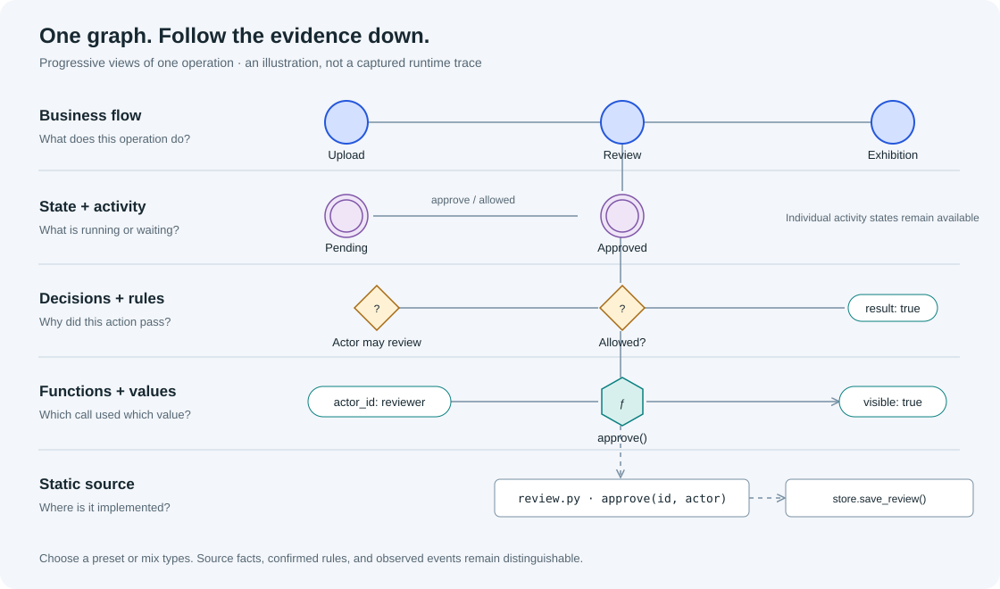
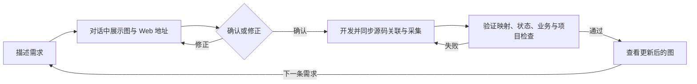

# Business Observer

**帮助开发者看懂 AI 实现的代码，以及程序真正发生的行为。**

[English](README.md) · [产品介绍](https://li-bruce.github.io/SoftwareStatusObserverSkill/?lang=zh-CN) · [交互演示](https://li-bruce.github.io/SoftwareStatusObserverSkill/demo.html?lang=zh-CN) · [安装与使用](docs/usage.zh-CN.md) · [源码导览](docs/source-guide.zh-CN.md)

Vibe coding 可以很快做出能用的页面，但内部状态、判断和调用关系往往难以掌握。`business-observer` 在开发过程中维护一张面向开发者的状态网，把业务流程、状态、判定依赖、关键函数、参数与实际运行事实联系起来。



这些是**同一张图的不同观察层次**，不是五套分离模型，也不要求所有节点只能属于一个抽象。可以从业务区域逐层展开，也可以混合类型检查关系。

## 两种模式，由你选择

| 模式 | 业务如何执行 | 两者共同保留 |
|---|---|---|
| 驱动 drive | 项目原生执行器读取状态声明，执行条件与转换。 | 状态网、源码关联、探针、真实值、更新与验证。 |
| 观察 observe | 项目使用自己的逻辑，图反映实际状态与行为。 | 同样的监控与映射要求。 |

Python 提供共用的图、记录、验证、导出和 Web；项目使用 Python 或 JavaScript 原生适配器，通过统一 JSON 交换事实。观测不可用不应阻止业务执行。

当前原生 `bo.fsm/1` 执行器支持严格校验的平面状态机子集。完整 Python 示例另有并发活动、资源、等待、汇合与恢复。其他复杂引擎需要明确适配。

## 贯穿一次开发迭代



开始时，通过必要的追问与反例确认你原本的意图，不主动扩展业务或推荐规则。先在对话中给出直观的业务图和可访问的 Web 地址；你仍在对话中修改与确认。

开发时，可使用自己的框架、架构和编码 Skill。AI 在每轮编码中维护状态声明、源码锚点、探针与检查。源码盘点独立于已有图，登录、消息、查询和前端操作等新增功能也要映射。

收尾时，运行根据已确认需求与独立预期制定的场景，检查实际参数、状态和结果。发现遗漏或不一致后修复代码与图，再次测试。**实现映射、状态约束、业务规则、项目检查分别报告**；图如实反映一个业务错误，不代表业务正确。

Skill 本身不是监听所有编辑器的后台程序。扫描发现变化后，当前编码 AI 需要处理，才能完成验收。

## 运行时观察与记录

1. 选择全部已埋点事件或局部范围。
2. 点击开始记录，再操作程序。
3. 结束记录，逐步回放状态、数值、判定和结果变化。
4. 根据视图层次调整回放细节，定位到函数和源码。

也可以先记录全部已埋点事件，再筛选展示。采集范围与回放粒度不同；未采集的信息保持未知。边上的传递动画需要真实调用或依赖证据，不能只凭静态连线或时间接近推断。

内置业务流、状态机、函数与参数、权限、并发资源、数据依赖、实际执行、等待失败、共享归属等视图；可自定义节点、边、区域、深度、范围和搜索的组合。支持展开、整体拖动、固定节点、显示名称修改、批注、核心标记与源码定位。个人布局保存在项目的 `bo_stategraph/config/views/local.json`。

迭代后会保留类型筛选、单个节点和连接的隐藏选择、展开状态及位置。“全部元素”清除筛选，保留布局和收起状态，并分别显示已展示、已收起、已筛除的数量。图版本变化后，当前录制列表清空并退出旧回放；同一版本重启仍保留录制。

[`dev` 开发计划](docs/development/dev-roadmap.md)列出了源码下钻、数据库结构和 API 关系层的现有基础、待实现内容与验收要求。

查看、上报、轮询、布局和录制控制本身不会进入业务事件。完整结构导出不受当前筛选影响；可关闭或移除 debug Web，同时保留真实状态声明和执行器。

## 安装并开始

```bash
git clone https://github.com/li-bruce/SoftwareStatusObserverSkill.git
cd SoftwareStatusObserverSkill
python tools/install_skill.py --project /path/to/your-project
```

脚本安装完整目录到项目的 `.agents/skills/business-observer`，已有目录会停止，避免覆盖修改。然后在该项目的新对话中输入：

```text
在这个项目中使用 $business-observer。
我想开发：[描述你的项目]。
先在对话中展示业务图，并提供可打开的 Web 地址。
确认没有理解偏差后，再开始实现，并持续更新图和检查。
```

你只需要回答重要业务问题、选择模式并查看图；中间文件和验证由 AI 处理。维护中的源码、注释、Skill 与默认文档使用英文；对话跟随用户语言，界面可切换中英文。原始对话与历史证据不改写。

依赖与完整命令见[使用说明](docs/usage.zh-CN.md)和[英文首页](README.md)。本地产品介绍可通过 `python -m http.server 8862 --bind 127.0.0.1` 启动，然后打开[介绍页](http://127.0.0.1:8862/docs/site/?lang=zh-CN)。

[独立交互演示](https://li-bruce.github.io/SoftwareStatusObserverSkill/demo.html?lang=zh-CN)用示例数据展示对话确认、图的展开、记录回放和需求迭代。阅读实现时，可以从[源码导览](docs/source-guide.zh-CN.md)了解模块职责及主要调用路径；本轮改动的比较、失败与复测记录见[验收材料](docs/review/readability-20261023/README.md)。

## 当前边界

当前支持 Python、JS/TS、React、Vue 的源码盘点与原生采集。源码层展示已索引符号和选定的局部关系，无法保证解析所有动态调用。完整源码调用图浏览、通用数据库结构与列血缘、增量接口和性能基线仍待扩展。不能通过编辑图直接执行业务命令，也不保证整个程序正确。

[架构与协议](skills/business-observer/references/multilanguage.md) · [源码及数据层分析](docs/source-data-and-language.md) · [测试证据](docs/review/english-gallery/README.md)

许可证：[MIT](LICENSE)。可视化使用开源 PixiJS、ELK.js，不包含 yFiles 专有代码。见[第三方声明](THIRD_PARTY_NOTICES.md)。

最新版从 `main` 安装；此前的 `v0.6.0` 保留为固定版本，见[版本说明](docs/releases/v0.6.0.md)。
