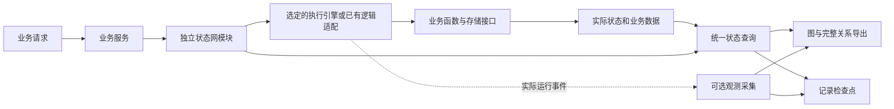

# 下一步开发方案：独立状态网与实现映射

日期：2026-10-22。依据本地评估及后续澄清制定。本文件是待实施方案，路径和接口示意不代表已经存在的产品能力。

评估和原始证据见 [本地版本评估](<C:/Users/Lvi_P/Documents/Work/CF/平台软著/SoftwareStatusObserverSkill/docs/assessment/2026-10-21/README.md>)。本次只修订文档，不修改业务程序、已安装 Skill、原有验收基线或运行数据。

## 1. 本期目标与范围

**将完整状态机移入独立模块；在每轮编码过程中自动维护状态网；结束时检验它是否如实、完整地反映实际实现。** 用户通过图理解 AI 写了什么，并判断是否符合需求。

| 必须完成 | 明确含义 |
|---|---|
| 完整替换 | 原状态机的声明、类型、推进规则、内部活动、资源、等待、恢复、校验和查询不能因拆分而减少 |
| 同一份状态 | 执行、Python 查询、页面、记录、导出都指向同一套身份和实际配置，不能各存一套“当前状态” |
| 两种开发方式都维护 | 默认在 AI 内部按状态网引导；用户明确拒绝时跟随其实现；两者都同步源码映射和监控 |
| 阶段验收 | 检查代码到图是否有遗漏、图到代码是否失真、运行状态和值是否正确映射 |
| 保留策略 | 限制内存事件与未保存日志的增长，清楚标记不能回放的区间 |
| 项目内个人配置 | 布局、展开、筛选、显示名和批注保存在状态网模块目录内，重生成不覆盖 |

“完整”以独立枚举的项目实现清单为依据：覆盖实际业务入口、状态/活动、关键判定、参数、调用和效果。普通辅助代码不必逐个显示，但必须有可追溯的归属或排除理由。未接入的关键实现不能被默默缩小到范围之外。未经执行的路径标为未验证，不能因静态结构存在就称为已运行验证。

本期不要求证明 AI 理解了全部需求，也不要求实现任意 Python 程序的全量栈、对象堆和形式化证明。既有业务测试继续执行并独立报告，不能为通过映射检查而删除或改写失败的业务预期。

**延期 TODO：** 运行事件增量 API、分页/推送、刷新与源码哈希缓存优化、性能基线、大图压测、多人协同合并、一般 Petri 网分析和通用权限引擎接入。开发期间发现代码增量仍是本期必需能力，与运行事件增量 API 不同。

## 2. 独立模块怎样完成替换

### 2.1 当前问题的原因

现有 `BOStateGraph` 增加了结构查询、部分声明校验和实例观察接口；完整示例仍在业务包内推进状态、管理活动和资源，并通过原存储导出运行配置。独立模块又维护自己的实例字典，且没有复用全部校验规则。

因此，“同一声明校验不同”和“实例查询两条渠道”来自迁移未完成。修复不能停留在补说明、改字段名或新增一个包装层，必须把执行机制、公共校验和实例来源统一起来。

### 2.2 代码职责

| 放入独立状态网模块 | 保留在业务代码及项目适配中 |
|---|---|
| 状态/事件/上下文类型，复合和并行状态定义 | 内容检查、索引生成、订单计算等领域函数 |
| 状态推进、活动生命周期、资源占用与归还、等待/汇合 | 查询权限关系和数据库记录的实际实现 |
| 执行引擎接入、完整状态查询、恢复规则 | 外部服务调用、业务效果提交、事务与存储适配 |
| 源码绑定、规则身份、校验、关系导出 | 启动时把函数、规则读取器和存储接口接入模块 |

业务层通过清楚的领域接口提交事件、调用操作和查询状态。状态机制的实现集中管理，领域函数保留正常名称；观测专用文件/方法使用 `bo_`，适配类使用 `BO`。独立目录是代码解耦，不要求额外进程或另一份数据库。状态更新与业务效果原本在同一事务中的，拆分后仍须保持这个事务边界。



执行引擎可以由项目选择；优先复用成熟实现，不重新写一个只能处理扁平状态的简化引擎。模块声明与引擎适配必须共享模型，图按同一身份投影。查询读取已提交的实际状态；图的个人配置和历史播放不回写业务状态。

### 2.3 尊重用户保留原实现的选择

“默认引导或观测跟随”描述 AI 怎样开发；“状态机驱动或原逻辑执行”描述程序怎样运行，二者不能混为一个开关。

采用状态机执行时，将原有状态机完整迁入独立模块，替代旧实现。用户明确要求保留普通函数或既有框架的推进逻辑时，通过适配读取它的真实状态、事件和效果；独立模块仍提供完整关系、类型、查询、监控和更新能力，但不能再推进一遍状态，也不能把预测状态当实际结果。该方式不承诺原逻辑没有提供的控制能力。

两种情况下均只允许一个实际状态来源和一套对外查询契约。观测跟随不是缩减映射要求的理由，也不能用于绕过默认方式下完整迁移的工作。

### 2.4 替换顺序与等价标准

1. 从原执行代码和现有场景列出能力清单：输入事件、迁移条件、动作、异常、取消、重试、版本失效、资源、等待、恢复和持久化。清单不能只从现有图生成。
2. 在独立模块内实现共享类型、校验和执行适配；明确已支持的层级与并发语义。当前已经支持的能力不能因采用“小型接口”而丢失。
3. 在隔离数据上向旧、新实现输入相同命令与条件，比较每一步状态、关键参数、动作次数/顺序、资源配置、错误和实际业务效果。仅规范化随机 ID、时钟等非语义差异。
4. 将原业务包中的状态推进和活动记账迁出。兼容入口只能委托新模块；不存在第二份独立维护的迁移表、资源计数或实例缓存。
5. 页面、记录和导出改用统一查询；同一实例、同一修订的快照必须一致。正在运行、等待和旧尝试收尾都能查询，不能仅返回最后一个尝试。
6. 移除采集与页面后再次运行核心包。业务使用的状态机仍保留；`off/fault` 关闭或破坏的是观测，不是执行引擎。

等价迁移默认保留原实现行为。若同时修复业务缺陷，需单独说明行为变化与相应测试，不能把迁移差异解释成“新模块更正确”而跳过核对。

## 3. 统一状态、层级和运行事实

公共模型至少保留：稳定节点/关系 ID、类型、上层抽象对应关系、源码位置、状态与事件类型、条件和动作引用。运行快照保留：构建/模型版本、业务对象、运行与尝试身份、活动调用身份、当前叶状态及祖先、各并行支线、资源持有者、等待条件、汇合结果、关键值及实际来源。

每次查询返回一份一致快照及实际修订依据。迁移期旧接口只从该快照派生；旧数据缺少某类修订时明确表示未知，不捏造数值。结构校验、运行配置校验和业务规则诊断使用共同的基础类型，但分别说明检查对象：

- 不存在的目标状态、未声明条件、自包含循环、类型不符：拒绝无效声明。
- 真实执行产生了非法值或非法迁移：保留原始事实并标出违规，不能“修正”后展示。
- 运行没有提供必要事实：标为未知或采集缺口，不能默认成功，也不能用空列表表示没有运行。

层级的直观解释及 Petri 示例见评估报告第 7 节。实现时尤其保留以下区别：

| 容易混淆的两件事 | 必须保留的区分 |
|---|---|
| “处理中”与内部进展 | 前者是摘要，内部每个活动仍有独立状态与身份 |
| 图上的分组与执行层级 | 函数放进一个圈，不代表自动拥有状态继承或并行语义 |
| 两项结束与两项成功 | 汇合与继续执行的业务条件分别计算、分别显示 |
| 有空闲资源与实际启动 | 可执行不等于已经执行；图的动画需要实际启动证据 |
| 实际失败与映射失败 | 前者属于程序行为；后者是图或采集与程序不一致 |

本期把已有资源占用/归还、等待、并发、ALL 汇合融入同一模块，复用活动 ID。占用要防止两个活动同时取得最后一个名额，异常/取消后的归还次数须准确。重试、旧尝试和新尝试分别标识，不能把旧结果用于推进新运行。更复杂的资源作用域或循环必须显式声明支持情况，不能退回孤立 Petri 状态副本。

## 4. 每轮编码怎样自动维护

### 4.1 从变化到内部任务

项目接入时建立源码范围、模块位置、生成文件归属和统一检查入口。范围包括未被 Git 跟踪的新源码，排除依赖包、缓存等非项目实现。构建出的全量清单与图分开保存，避免“漏画的代码也没进检查范围”。

```text
发现新增/修改/删除/改名
  → 静态解析受影响的入口、符号、类型、条件和调用
  → 生成内部待处理项
  → 编码 AI 更新业务归属、状态定义、映射和探针
  → 执行场景并核对实际状态/参数/效果
  → 阶段收尾检查
  → 更新图并报告剩余缺口
```

内部任务须包含变化位置、关联节点、未确定的调用和待补证据，不是只发一句“请同步图”。AST 能确定的关系自动生成；业务摘要、间接调用和观测边界由 AI 结合实现维护，并保留依据。无行为变化时可保留上层抽象，但源码绑定仍要更新。

### 4.2 触发与兜底

| 入口 | 职责 |
|---|---|
| 支持回调的 AI/编辑器宿主 | 在一批相关编辑完成后调用项目内变更检查，按实际能力触发内部任务 |
| 没有此类回调的宿主 | Skill 与项目 AI 指令要求编码 AI 每批相关修改后调用同一入口，不能等最终写完才画图 |
| 项目验证/CI 入口 | 再次枚举全部约定源码，发现遗漏、陈旧模型、未处理变更和未验证事实，阻止报告完成 |

文件监听可发现变化，但它本身不会理解业务，也不会自动唤醒任意宿主中的大模型。须分别报告“变化发现已接入”“AI 更新任务已接入”“阶段检查已接入”；未接入的部分不能宣称已自动运行。不安装未经请求的全局 hooks，不反复打断用户维护技术文件。

源码改动后，候选图可以更新；正在运行的旧进程仍使用旧构建。记录和图分别标明对应构建，新代码真正加载并验证后才能叠加新运行事实。

### 4.3 Skill 入口的调整

入口保留五步：理解并展示局部图、澄清必要分歧、约定观测与场景、伴随编码维护、收尾核对并交付更新图。详细图交互、协议和专项规则放参考文档。

开始时仍主动提炼业务链/网并提问；进入开发后维护过程由 AI 完成。仅出现新业务歧义才再次提问。用户采用其他编码 Skill、框架或设计方法不影响这条维护线路；未表态不等于退出。当前图的说明必须反映当前实现和已确认决定，原始讨论文字单独保留为历史来源。

## 5. 核心验收：如实、完整地映射实现

验收清单来自源码范围扫描、实际引擎及存储状态、独立场景读取，而非只遍历已有图。每项结果都带源码/构建版本、场景与证据位置；没有运行的检查保持“未验证”。

| 编号 | 要证明什么 | 至少包含的检查或反例 |
|---|---|---|
| M01 | 原状态机能力完整迁入 | 旧新实现逐步对照；取消、恢复、异常、重试及真实效果保持一致 |
| M02 | 同一声明只有一种公共解释 | 不存在的目标/条件、自包含、布尔与整数混同必须在各入口得到一致诊断 |
| M03 | 同一实例只有一种实际查询结果 | Python、图、记录和导出在同一修订下相同；多个尝试和未结束活动同时可查 |
| M04 | 新增实现不会逃出清单 | 新增入口但不更新图时失败；普通辅助文件分类排除有理由；删除节点/符号能发现残留绑定 |
| M05 | 函数、参数与结果确实对应 | 独立调用结果/存储读取对照观测；刻意绑错变量、接收者或返回值必须失败 |
| M06 | 决策与实际路径一致 | 分支结果、等待原因、权限条件和提交效果有实际证据；未求值不能写成拒绝或允许 |
| M07 | 层级和并发细节没有被摘要吞掉 | 父状态迁移与真实引擎一致；内部活动可查；折叠只改变显示；不提前汇合 |
| M08 | 资源与运行身份准确 | 单名额等待、足够名额实际重叠、占用/归还、异常收尾、旧结果不推进新尝试 |
| M09 | 检查没有被配置静默关闭 | 空模式、零必需断言、缺必要探针、跳过必需命令要失败；不把所有领域测试强设同一数量 |
| M10 | 映射能呈现错误实现 | 刻意制造提前提交等业务 bug：图显示实际错误路线，业务诊断失败；若图仍画正常流程，映射也失败 |
| M11 | 两种开发方式均维护 | 默认引导、明确拒绝、跨会话继续、重构之后均更新图并运行检查，不要求用户操作同步文件 |
| M12 | 关闭观测不破坏程序 | on/off/fault 的实际业务结果对照；核心包保留执行状态机，采集异常不改变结果 |
| M13 | 保留策略不伪造完整记录 | 达到上限后内存/未保存文件受控；当前状态保留；缺失区间明确；保存记录仍可读取 |
| M14 | 个人配置可持续使用 | 刷新/重启/切换端口/重生成后恢复；重命名可迁移；删掉节点不把批注误贴他处；写入失败可见 |
| M15 | 公共模块不依赖归档领域名称 | 小型异领域项目的关键字段进入快照、记录和图；视图使用类型标签，不猜函数名称 |

M10 用于防止检查只会认“正确流程”。图准确显示了业务 bug 时，可以报告“映射一致，业务规则失败”，但不能报告整个项目全部通过。图与测试共同漏掉的实现由 M04 的独立清单及 M05–M08 的实际读取发现。

结果分别列出：映射验证、结构/状态规则诊断、业务测试、未验证/未覆盖项。既不能把业务错误隐藏，也不能把真实违规状态当成观察器应当修改的状态。阶段检查只为实际覆盖的范围出具结果，不声称证明所有可能路径。

## 6. 本期事件保留策略

将保留策略放在项目配置中，明确最大内存事件数、未保存日志的容量/保留时长、结束实例的历史保留期和主动保存记录的处理方式。提供有界默认值及调整说明；实际数值在实现时随示例验收固定，不以未经测量的默认值冒充性能结论。

| 数据 | 保留与清理要求 |
|---|---|
| 全图、声明、源码映射 | 是项目产物，不随运行事件过期清理 |
| 正在运行/等待/收尾的实例当前状态 | 持续可查；不能随历史事件淘汰而消失 |
| 已结束实例和普通历史事件 | 按项目配置清理，查询明确可用时间/序号范围 |
| 未主动保存的日志 | 有总容量边界，轮换或删除旧片段并记录缺口 |
| 正在录制的事件 | 独立从采集入口接收，不能依赖可能被淘汰的页面事件列表；达到录制上限后明确停止并记录边界 |
| 用户主动保存的录制与个人配置 | 默认不自动删除；不承诺无限可写空间，写入失败须显式报告 |

事实先更新实际状态/检查点，再进行可选历史保留。若只能从日志恢复当前状态，必须先形成可靠检查点才能清理依赖事件。禁止用最新状态填补过去丢失的片段。普通历史策略不删除业务数据库记录，不影响业务函数执行。

这一步验证容量限制和数据边界是否有效；吞吐量、延迟分位数及高负载稳定性留待性能基线工作。

## 7. 个人布局与批注保存在项目内

建议目录如下，名称可随项目结构调整，但位置归属于独立状态网模块：

```text
project/
  app/                         业务代码
  bo_stategraph/               独立状态网代码与项目定义
    config/
      retention.json           事件保留设置
      views/
        default.json           可共享的默认视图
        local.json             当前个人视图，默认不提交 Git
    generated/                 可重新生成的映射和图产物
  integrations/                业务存储、执行和采集接线
```

配置必须在 `generated/` 外，生成器只更新归属清单中的产物。代码复制、Skill 升级和重新生成都不能覆盖个人配置。配置写失败只能影响视图保存，不能影响业务或状态机运行；部署为只读目录时明确提示未保存，不伪装成功。

`local.json` 按稳定 `project_id`、个人配置身份和视图 ID 存储，下列字段是待实现的协议要求：

| 配置内容 | 保存方式 |
|---|---|
| 坐标、固定状态 | 以稳定节点 ID 为键；子节点相对所属节点保存偏移，移动整圈后可恢复 |
| 展开范围、视野、焦点 | 保存展开 ID、缩放/平移和焦点；过滤隐藏不删除原信息 |
| 节点/边/圈筛选与自定义视图 | 各视图独立保存组合条件和布局 |
| 显示名、批注、核心标记 | 覆盖显示内容，保留源码原名和真实身份；不会重命名源码或修改规则 |
| schema 与配置修订号 | 用于升级和检测两个窗口同时保存的冲突 |
| 待重新关联的旧项 | 节点删除或身份不确定时保留个人文字，等待重新关联，不擅自按相似名称迁移 |

页面通过本地服务读取、保存指定配置文件；不接收任意磁盘路径。服务采用完整校验、原子替换和修订号比较，避免半写入或不同窗口静默覆盖。浏览器只作缓存和临时恢复，磁盘配置是持久来源。

首次升级时，只在该项目尚无磁盘个人配置时迁入现有浏览器配置；已有文件不得被旧缓存覆盖。服务端确认写入成功后才显示“已保存”。项目 ID 不依赖端口，换端口仍能恢复；不同项目不相互套用布局。

`local.json` 及临时/备份文件默认放入项目 `.gitignore`。用户需要共享时，显式导出选定视图或保存为 `default.json`；模型导出不自动携带个人批注和运行记录。多人实时协同不在本期范围。

## 8. 实施顺序及需要修改的现有部分

| 顺序 | 现有入口 | 交付物与完成条件 |
|---|---|---|
| A：统一模块 | `bo_stategraph.py`、`behavior_model.py`、`statechart_contract.py`、`execution_contract.py` | 共用类型/校验、真实引擎适配、统一实例查询；M01–M03、M07–M08 通过 |
| B：迁移完整示例 | `examples/team-archive/archive_app/workflow.py`、业务接线、交付示例及 python-modes | 将原状态机制迁出；真实效果和行为对照一致；旧接口只委托；M12 通过 |
| C：每轮自动维护 | `code_structure.py`、`change_sync.py`、项目 AI 指令和正常检查入口 | 项目范围清单、变更任务、阶段检查；M04–M06、M09–M11 通过 |
| D：配置与保留 | `recording_session.py`、两个观测适配器、`layout.js`、`viewer.js`、本地服务 | 领域字段配置化，有界保留和磁盘个人配置；M13–M15 通过 |
| E：Skill 与交付 | `SKILL.md`、相关参考文档、`tools/verify.py`、CI、安装和复制检查 | 新约定与实际命令一致，所有支持方式进入日常检查；保留一轮完整修改与回放材料 |

参考文档至少同步修改 `independent-python.md`、`runtime-statechart.md`、`source-isolation.md`、`cochange.md`、`continuous-development.md`、`validation-rules.md` 和视图/记录说明，移除与新职责相冲突的旧建议。领域参数白名单仍须保留，但来源改为项目类型与配置，而不是写死归档字段。

实施时同时维护运行库副本的版本和迁移说明。安装升级不得覆盖项目业务定义、个人视图或保存记录。检查失败必须修复真实原因，不能仅重新接受基线消除差异。

## 9. 最终审查材料

交付一个可复现的版本，包含：变更前后源码/图对应关系；原反例的修复结果；完整替换对照；一轮新功能与重构；两种开发方式的维护记录；真实运行记录与关键截图；阶段检查结果和未覆盖项；个人配置保存/恢复操作说明。

材料中明确区分旧审查证据、新版本实际执行结果和仍未实现的 TODO。截图用于确认图表达与交互，不能代替源码、状态和效果对照。对话可以使用 AI 扮演需求方演练，但须标明模拟，不声称是真人使用证据。

用户日常只需使用 Skill 讨论需求、正常开发并打开更新图。安装、自动维护接入状态、查看图与定位源码的操作说明应简短；生成过程、协议编号和检查日志放入开发文档。

## 10. 理论参考的使用范围

- [SCXML 状态配置](https://www.w3.org/TR/scxml/#LegalStateConfigurations)：用于校准父子状态、并行活动集合和迁移的含义，不要求把项目改写成 XML。
- [渥太华大学 Petri 网课程材料](https://www.site.uottawa.ca/~bochmann/ELG7187C/CourseNotes/BehaviorModeling/Petri-nets/index.html)：用于解释条件、资源、并发和汇合；本项目将这些机制融入原状态网，不增加独立权威层。

上述理论用于确定执行与观测的含义。本期是否完成，仍由模块替换、实际实现映射及对应测试证据判断。
