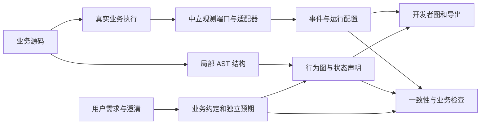

# business-observer 本地版本评估

评估日期：2026-10-21。对象为本地 `SoftwareStatusObserverSkill`、已安装的 `business-observer` 和本地运行示例。按用户要求，云端尚未更新不作为缺陷。审查期间没有修改产品代码、原项目的验收基线、业务数据库、记录文件或个人布局。

2026-10-22 修订：按后续讨论调整目标、解释和优先级，保留 10 月 21 日的实测结果与原始证据。**本期核心是独立状态网完整接管原有状态机，以及每轮编码结束时如实、完整地映射实现。** 事件保留和项目内个人视图配置纳入本期；增量接口、性能基线列入 TODO。具体任务和完成条件见 [下一步开发方案](<C:/Users/Lvi_P/Documents/Work/CF/平台软著/SoftwareStatusObserverSkill/docs/assessment/2026-10-21/NEXT-DEVELOPMENT.md>)。该方案尚未作为产品代码实现。

## 1. 总体判断

**这是一个已经形成实际开发闭环、具备调试价值的 Python 工程原型，但还没有达到通用、稳定接入不同项目的工具成熟度。**

它最有价值的部分，是把业务约定、关键源码、运行事实和验证结果关联起来，让开发者沿业务问题下钻到函数、参数与实际效果。这一目标已经落实到程序和检查脚本，不能把它评价为单纯的业务展示页或一份长提示词。

目前的主要问题是：独立模块只接入了部分声明、观察和导出能力，原项目的执行、校验和实例查询没有完成迁移；同一声明在不同入口会得到不同校验结果；源码变化到模型更新还缺少自动触发和收尾检查的完整接线；部分通用模块保留示例领域的字段与判断方式。前两项属于替换工作没有做完整，不是独立模块必须保留两套机制。

本次完整检查通过，但针对性反例仍复现了漏检和误报。因此，适合在明确范围的 Python 项目中试用，配合现有检查与人工审阅。下一步验收应检查源码、状态网与实际运行是否对应，并明确覆盖范围和缺口。工具把实际实现呈现给开发者，由开发者判断 AI 是否漏问或误解；“证明 AI 正确理解全部需求”不作为本工具的验收目标。

| 评价方面 | 结论 |
|---|---|
| 产品定位 | 合理，已回到辅助开发者理解和调试代码的目标 |
| 已有示例的功能闭环 | 较完整，有真实运行、数据库效果、反例与图交互 |
| Skill 引导原则 | 基本合理；最新的开发方式选择符合用户要求 |
| 自动持续维护 | 有检查支撑，尚需把变更发现、内部更新任务、收尾验证接成自动流程 |
| 独立状态网替换 | 尚未完整替代原状态机，是本期首要任务 |
| 业务与观测隔离 | 可选采集已有隔离证据；完整状态机代码尚需迁出业务核心 |
| 跨项目复用 | 部分实现，仍有明显示例耦合 |
| 事件长期保留 | 内存和文件总量缺少边界，本期补保留策略；性能优化另列 TODO |
| 易用性与引导效果 | 有任务演练；真人研究是后续评价，不是本期映射验收前提 |

## 2. 2026-10-21 的核查范围与证据

核查覆盖 Skill 入口与相关参考文档、17 个 Python 脚本的职责和关键路径、前端图/布局/记录/回放模块、两个完整示例、双执行方式示例、安装与检查入口。第三方压缩渲染库核查版本与许可证声明，没有逐行审计其内部实现。

本地 Skill 有 72 个文件、21 篇参考文档。入口文件为 118 行、8,715 字符；参考文档合计 53,932 字符。这些计数排除了缓存，不是 token 数。已安装 Skill 与仓库中这 72 个文件逐一比对，无差异。

为了避免“边审查边修复”影响结论，在独立复制目录运行原有完整检查，并另外构造反例。所有产品判断以本地当前文件为准；Git 提交号只作为背景标识，不冒充工作区版本。

| 本次执行 | 结果 | 能支持的结论 |
|---|---|---|
| 隔离副本 `tools/verify.py` | 返回 0，约 103.6 秒 | 原有整体检查、安装、HTTP 示例、剔除观测后的核心包等当前能通过 |
| `tools/test_stategraph_module.py` | 11 项通过 | 已有独立模块测试覆盖的边界通过 |
| `examples/python-modes/test_modes.py` | 5 项通过 | 小型例子中两种执行方式及观测边界通过 |
| 交付示例运行 | 16 个场景 × on/off/fault，共 48 次 | 32 项业务预期、2 条白盒规则/7 项检查所在范围有当前证据 |
| 资料归档运行 | 40 个场景 × on/off/fault，共 120 次 | 63 项业务预期、6 条白盒规则/11 项检查所在范围有当前证据 |
| 新增针对性复现 | 9 项，详见后文 | 发现独立模块误报/漏检、配置缺口，也确认已声明的覆盖边界 |
| 当前页面与导出只读检查 | 页面已连接；全模型 59 节点、124 条边 | 当前图和完整关系导出可用；本次未改变用户操作状态 |

当前服务构建为 `6b9d254e59337efa2e5c72ce0c9df365535692071ee6b769c9c8e2cd9c057f49`，导出中的源码绑定状态为 `current`。完整检查只在 Windows / Python 3.13.13 / transitions 0.9.3 环境重新执行；仓库虽有其他平台的 CI 配置，本次没有据此声称它们已复验。

证据文件：[范围与哈希清单](<C:/Users/Lvi_P/Documents/Work/CF/平台软著/SoftwareStatusObserverSkill/docs/assessment/2026-10-21/inventory.json>)、[检查命令与结果](<C:/Users/Lvi_P/Documents/Work/CF/平台软著/SoftwareStatusObserverSkill/docs/assessment/2026-10-21/checks.json>)、[示例覆盖摘要](<C:/Users/Lvi_P/Documents/Work/CF/平台软著/SoftwareStatusObserverSkill/docs/assessment/2026-10-21/baseline-summary.json>)、[完整检查日志](<C:/Users/Lvi_P/Documents/Work/CF/平台软著/SoftwareStatusObserverSkill/docs/assessment/2026-10-21/check-00.log>)、[独立模块测试](<C:/Users/Lvi_P/Documents/Work/CF/平台软著/SoftwareStatusObserverSkill/docs/assessment/2026-10-21/check-01.log>)、[双执行方式测试](<C:/Users/Lvi_P/Documents/Work/CF/平台软著/SoftwareStatusObserverSkill/docs/assessment/2026-10-21/check-02.log>)、[反例脚本](<C:/Users/Lvi_P/Documents/Work/CF/平台软著/SoftwareStatusObserverSkill/docs/assessment/2026-10-21/reproduce.py>)、[反例结果](<C:/Users/Lvi_P/Documents/Work/CF/平台软著/SoftwareStatusObserverSkill/docs/assessment/2026-10-21/reproductions.json>)。这些结果不能相加成“彼此独立的全部测试数量”：完整检查中已有部分重复调用。

## 3. 功能特性与落实程度

“已实现”指存在代码和对应证据，不表示对所有软件都有效；“部分实现”包含范围明确的实现和仍由项目适配的部分。

| 能力 | 本地落实情况 | 关键边界 |
|---|---|---|
| 从对话整理顶层业务网 | 已有流程、记录结构、问题依赖和校验 | 业务提炼由 AI 完成，脚本不自动发现所有遗漏 |
| 主动澄清状态、权限、并发和恢复 | 有具体问法、来源、部分回答及变更规则 | 已有演练集中于审批、检查、提交类流程 |
| 默认依据状态网引导开发 | 已写入 Skill、参考文档和示例项目约定 | 属于对使用该 Skill 的 AI 的工作约束 |
| 用户拒绝该开发方式后继续观测 | 记录 `guided/observe` 与 `drive/observe` 两个独立维度 | 配置检查已做；最新完整对话行为尚缺跨领域复测 |
| 开发中维护图、源码映射与探针 | 有 begin/inspect/verify/accept/check、AST 差异和版本绑定 | 尚缺自动发现新文件并触发内部更新任务；本期补齐 |
| 多层图和核心调用关系 | 可按业务分组下钻到函数、参数、条件与源码 | 选定静态调用切片，非全程序控制流/数据流分析 |
| 独立状态网及完整导出 | 标准库模块、结构查询、实例接口、迁移核对、JSON 导出已实现 | 尚非原状态机的完整替代；执行、校验和实例来源须统一迁入 |
| 主流程与内部活动同步 | 示例保留各活动、资源、等待、汇合及运行身份 | 只覆盖声明和接入的活动，不是全部 Python 栈帧 |
| Petri 特性的融合 | 真实实现资源占用/归还、等待、并发和 ALL 汇合 | 单次运行内固定活动；不是一般 Petri 网执行/分析器 |
| 语义探针 | 白名单载荷、身份、依赖、队列、关闭与故障隔离 | 仍需项目确定真实业务边界和取证位置 |
| 开始/结束记录、回放、逐步值变化 | 已实现范围选择、起止快照、事件记录和视图级步骤 | 只记录已接入事实；不是任意代码的时间旅行调试器 |
| 图的交互 | PixiJS/ELK、拖动、聚集、展开、关系高亮、类型筛选、预设与自定义视图 | 当前存在实际实现；大图和长时间使用尚无性能结论 |
| 批注、核心标记与布局保持 | 按节点身份保存到浏览器，重生成不直接覆盖 | 本期改为项目状态网目录内的配置文件；浏览器只作缓存 |
| 共享成员 | 单一真实身份、多处引用入口 | 是引用投影，不是通用重叠集合区域布局 |
| ReBAC | 有较完整的情况清单、规则/事实/求值区分，示例有真实条件记录 | 没有通用 OpenFGA/SpiceDB/DMN 适配器 |
| class 与实例 | AST 识别类/方法；运行已有 entity/attempt/call 身份 | 尚无完整类、实例、接收者关系及对象堆呈现 |
| 局部图与对话确认 | 独立提取器、预算、边界、原始身份、JSON/Mermaid | 当前以子图提取和已有分组为主，不自动完成语义摘要 |
| 一致性验证 | 静态、运行声明、白盒值、真实效果、故障对照、定向改错 | 核心改为实现映射的完整性和准确性；业务规则检查单独报告 |
| 源码隔离与可裁剪 | 导入方向、生成文件归属、实际核心包运行已验证 | “去掉采集”与“明确导出裁剪包”应持续区分 |
| 导出共享 | 全图、记录、显式清单项目包、完整性检查 | 不是协同编辑；校验值不是签名或自动脱敏 |
| 从图操作软件 | 尚未实现 | 当前图编辑只改变展示，不能执行业务命令或授予权限 |

现有图可称为带类型、来源和运行事实的业务行为关系模型。没有图数据库或 RDF 并不构成缺陷。真正影响质量的是节点/边的语义、身份、版本和可验证性，而不是是否采用“知识图谱”名称。

## 4. 优先问题

以下 P1 表示应在扩大实际使用前处理；P2 表示影响复用、持续维护或运行可靠性；P3 为较局部的契约问题。它们不是安全漏洞等级。本次未发现需要认定为 P0 的已复现业务破坏问题。

### F1 · P1：独立模块与项目检查使用了不同的模型契约

`BOStateGraph._bo_validate()` 检查状态值、节点/边身份等，但没有复用完整项目的声明、层级和活动配置校验。

本次复现：

- 迁移目标不存在：独立模块构造成功，`statechart_contract` 拒绝。
- guard 未声明：独立模块构造成功，项目校验拒绝。
- 节点以自身为 parent：独立模块构造成功，`behavior_model` 拒绝。
- 可用资源改为 `-1`：`bo_observe` 给出 `status: observed`，`execution_contract` 拒绝该配置与日志不一致。
- 双执行方式示例把模型标为 `schema_version: 3`，但同仓库 v3 校验器报 `missing intent`；其节点和边也采用了简化接口。

这里并不意味着完整项目的验证失效。完整入口仍调用较严格的校验器，文档也说明活动语义要另外验证。问题是**独立模块的契约和检查状态无法直接代表完整系统的契约**，新接入者容易把 `observed` 或导出 `check` 成功理解为已经核对所有内部状态。

本期应完成替换：完整状态机声明、类型、执行适配和校验统一进入独立模块，项目检查、运行查询、图导出调用同一套公共规则。小示例也采用这套规则，不继续用另一种简化 v3 绕过完整校验。无效声明应拒绝加载；运行中真的出现非法值时，保留实际值并报告违规，不能丢掉事实或自动改成合法值。

代码：[独立声明校验](<C:/Users/Lvi_P/Documents/Work/CF/平台软著/SoftwareStatusObserverSkill/skills/business-observer/scripts/bo_stategraph.py:74>)、[活动配置接收](<C:/Users/Lvi_P/Documents/Work/CF/平台软著/SoftwareStatusObserverSkill/skills/business-observer/scripts/bo_stategraph.py:173>)、[项目状态机校验](<C:/Users/Lvi_P/Documents/Work/CF/平台软著/SoftwareStatusObserverSkill/skills/business-observer/scripts/statechart_contract.py:10>)、[示例构造器](<C:/Users/Lvi_P/Documents/Work/CF/平台软著/SoftwareStatusObserverSkill/examples/python-modes/build_model.py:42>)。对应复现：`undefined_target`、`undefined_guard`、`parent_cycle`、`invalid_activity_configuration`、`mini_schema_interoperability`。

### F2 · P1：合法的层级状态迁移会被误报

`bo_candidates()` 只比较当前状态字符串与 transition 的 source，未解析祖先状态。

复现模型包含 `active.a`、`active.b` 和 `done`，在父状态 `active` 上声明 `finish → done`。实际 transitions 的 `HierarchicalMachine` 能从 `active_a` 正常迁移到 `done`，现有声明校验也通过；独立观察器却得到零个候选，报告“实际迁移与声明不符”。

这是已复现的错误，不是缺少某条业务用例。它直接影响用户要求的层级状态机和开发者对异常提示的信任。建议建立明确的引擎语义适配和一致性测试；未支持的层级、并行或历史状态特性应在接入时拒绝或标为不支持，不能接收后按扁平规则核对。

代码：[候选迁移匹配](<C:/Users/Lvi_P/Documents/Work/CF/平台软著/SoftwareStatusObserverSkill/skills/business-observer/scripts/bo_stategraph.py:128>)。对应复现：`hierarchical_transition`。层级和并行状态不是单一字符串枚举就能完整表达，参见 [SCXML 的合法状态配置](https://www.w3.org/TR/scxml/#LegalStateConfigurations) 与 [transitions 的层级状态机说明](https://github.com/pytransitions/transitions#hierarchical-state-machine-hsm)。这里引用其语义作为对照，并不要求项目改用 SCXML。

### F3 · P1：空的 probe_modes 能使业务结果比较执行零次

`config()` 不校验 `probe_modes` 必须非空，`assess_observations()` 则直接遍历该数组。把它配置为 `[]` 后，即使真实效果应为 1、实际为 0，业务结果比较也返回无错误。

本次反例保留了正确的状态机声明和必需运行探针；使用正常 on/off/fault 配置得到三条业务错误，使用空数组得到零条。没有改动检查器或伪造“通过”文件。

这证明了该检查环节能被配置失误静默关闭。**本次没有据此声称两个完整示例在其他白盒检查和项目测试仍开启时也一定会错误通过。**

建议验证模式的取值、非空、必需组合，输出实际执行的断言数；新接入配置缺项和检查数量退化应有明确诊断。测试命令列表和必需运行探针等同样应有变更保护策略，而不只保护业务预期文件。

代码：[配置读取](<C:/Users/Lvi_P/Documents/Work/CF/平台软著/SoftwareStatusObserverSkill/skills/business-observer/scripts/change_sync.py:37>)、[按模式比较](<C:/Users/Lvi_P/Documents/Work/CF/平台软著/SoftwareStatusObserverSkill/skills/business-observer/scripts/change_sync.py:271>)。对应复现：`empty_probe_modes`。

### F4 · P2：新文件发现和后续源码适配尚未闭合

`code_structure.scan()` 和版本绑定只处理显式选择的文件。新增未登记的 `new_entry.py` 后，旧绑定仍返回 `current`。工具在 limits 中说明了这个边界；但相对于“AI 每轮编码自动适配相关代码”的目标，这仍是必须补齐的开发流程缺口，不应转交给用户手工维护。

本期按项目源码范围独立枚举新增、修改、删除和改名，产生受影响符号及待处理项，再触发开发 AI 的内部更新任务。静态工具能确定的结构自动更新；业务归属、动态调用和关键观测点由 AI 结合实现处理。阶段收尾检查扫描整个约定范围，拒绝仍有相关未映射项的完成声明。是否需要进入可视图与是否检查过该文件是两件事，不要求全量代码平铺上图。

代码：[显式文件扫描与限制](<C:/Users/Lvi_P/Documents/Work/CF/平台软著/SoftwareStatusObserverSkill/skills/business-observer/scripts/code_structure.py:115>)、[绑定检查](<C:/Users/Lvi_P/Documents/Work/CF/平台软著/SoftwareStatusObserverSkill/skills/business-observer/scripts/behavior_model.py:158>)。对应复现：`unlisted_source`。

### F5 · P2：实时事件保留与页面刷新没有长期容量边界

探针队列是有界的，单条载荷也有限制，这部分处理正确。但两个示例的适配器会持续追加全部事件到内存列表；归档示例还持续追加 JSONL。页面约每 400 ms 获取一次完整视图，后端反复读取已登记源码核对哈希，并返回保留的事件与运行配置。记录模块每次保存会重新序列化完整记录。

因此，有界队列不能等同于系统内存、文件大小和刷新开销都受控。记录文件的 20,000 事件/32 MiB 上限也不约束适配器的总历史事件列表。长时间运行时成本随保留量增长，这是代码路径可确定的问题；具体何时变慢，本次未做压力测试，不能给出生产开销百分比。

本期先实现保留策略：内存事件和未保存日志有容量/时间边界；活动实例当前状态不随历史清理消失；主动保存的记录和个人配置不被普通清理删除。裁剪导致无法回放的区间必须标明。事件游标/分页、增量刷新、构建绑定缓存和性能基线列入 TODO，不作为本期验收条件。当前同进程后台线程不是独立采集进程，实际采集开销仍需后续测量。

代码：[事件保留](<C:/Users/Lvi_P/Documents/Work/CF/平台软著/SoftwareStatusObserverSkill/examples/team-archive/integrations/bo_observer.py:17>)、[完整视图构造](<C:/Users/Lvi_P/Documents/Work/CF/平台软著/SoftwareStatusObserverSkill/examples/team-archive/integrations/bo_server.py:87>)、[轮询](<C:/Users/Lvi_P/Documents/Work/CF/平台软著/SoftwareStatusObserverSkill/skills/business-observer/assets/stategraph-viewer/viewer.js:545>)、[完整记录保存](<C:/Users/Lvi_P/Documents/Work/CF/平台软著/SoftwareStatusObserverSkill/skills/business-observer/scripts/recording_session.py:83>)。

### F6 · P2：公共记录与视图模块仍含示例领域规则

通用 `recording_session.py` 把可记录的 authority 参数写死为 `capacity/content_bytes/limit_bytes/...`，命令参数写死为文档、审批者、文件夹等字段。另一个项目即使在权威快照中提供 `queue_depth` 或 `inventory_count`，没有对应事件或专门适配时，记录检查点也不会自动保留这些参数。

权限视图还通过节点 ID、名称和函数名是否包含 approval/role/权限等词来选取相关决策。这适合示例，但换名或换领域可能漏选真实规则。

应把字段白名单、领域语义标签、参数到节点的映射放入项目适配配置，公共模块只处理协议和边界。不是取消白名单，而是让白名单成为项目契约。类型化规则身份也应优先于名称猜测。

代码：[固定字段名单](<C:/Users/Lvi_P/Documents/Work/CF/平台软著/SoftwareStatusObserverSkill/skills/business-observer/scripts/recording_session.py:16>)、[权限视图筛选](<C:/Users/Lvi_P/Documents/Work/CF/平台软著/SoftwareStatusObserverSkill/skills/business-observer/assets/stategraph-viewer/analysis.js:30>)。

### F7 · P1：实例查询尚未完成统一替换

完整示例构造了 `BOStateGraph`，但没有持续调用 `bo_observe()`；完整运行配置仍来自业务存储，再由 `bo_export_view()` 包装导出。

当前只读导出实际得到：顶层 `instances` 为 0，`runtime.machine.configurations` 为 15；后者是保留的运行配置数量，不是 15 个正在执行的任务。**这不表示 15 个运行没有监控或没有导出。** 它说明“查询独立模块实例”与“查询完整运行配置”目前是两种接口和语义，不能直接互换。

不能伪造统一修订号的原则仍然正确，但只增加说明或能力标记不能完成替换。本期必须统一实例身份、状态来源和查询接口，让页面、Python 查询、记录和导出使用同一份带修订号的实际配置。迁移期旧接口只可委托新接口或由同一快照派生，不能各自维护状态。实例未接入时须报告缺口，不能返回一个看似表示“没有运行”的空列表。

代码：[适配器构造](<C:/Users/Lvi_P/Documents/Work/CF/平台软著/SoftwareStatusObserverSkill/examples/team-archive/integrations/bo_observer.py:15>)、[原协议导出](<C:/Users/Lvi_P/Documents/Work/CF/平台软著/SoftwareStatusObserverSkill/skills/business-observer/scripts/bo_stategraph.py:224>)。证据见 `reproductions.json` 的 `live_read_only`。

### F8 · P2：已经确认的业务模型仍残留未确认表述

归档示例的 13 个澄清决定均为 resolved，完整验证通过；但生成模型和它的源文件仍写着“候选业务依赖图”，入口节点 summary 仍说“具体发起时机与审批、检查顺序未确定”。`discovery.networks` 的当前入口说明也仍有“先后待确认”。历史 sources 中保留最初候选原话是正确的，当前模型摘要则应反映已经确定的含义。

这是一项直接影响调试理解的文案一致性问题，也说明文件同步和引用检查不能代替语义核对。应区分历史来源文本、当前业务解释和真正未决项；在决定关闭后检查当前投影是否还残留冲突表述。

代码/产物：[模型源](<C:/Users/Lvi_P/Documents/Work/CF/平台软著/SoftwareStatusObserverSkill/examples/team-archive/tooling/behavior_source.json:18>)、[当前模型](<C:/Users/Lvi_P/Documents/Work/CF/平台软著/SoftwareStatusObserverSkill/examples/team-archive/behavior.json:65>)、[当前业务网入口](<C:/Users/Lvi_P/Documents/Work/CF/平台软著/SoftwareStatusObserverSkill/examples/team-archive/discovery.json:93>)。

### F9 · P2：最新能力没有全部进入日常回归入口

现有完整检查覆盖很多真实场景，质量高于只跑 schema 和单元测试的演示项目。不过 `tools/verify.py` 没有运行 `examples/python-modes/test_modes.py`，当前 CI 也只调用前者。本次单独补跑的 5 项测试不能代替以后每次修改自动执行。

最新的“默认引导、显式拒绝后观测跟随、两者监控都必须保留”主要经过文本和配置约束测试；已有独立完整对话材料来自较早的候选 Skill。尚缺将最新 Skill 冻结后，在不同领域、已有代码、新功能和重构任务上的重复试验。

本期把所有承诺支持的接入方式放入同一回归入口，重点检查两种开发方式都维护源码映射、探针和实例，并能阻止遗漏同步的阶段完成。对话演练保留含糊需求、部分回答、修订、明确拒绝开发方法和跨会话继续，用于检查流程是否遵守约定；不把它解释为 AI 理解全部需求的证明。跨领域真人易用性研究放到后续。

代码：[完整检查入口](<C:/Users/Lvi_P/Documents/Work/CF/平台软著/SoftwareStatusObserverSkill/tools/verify.py:18>)、[CI 配置](<C:/Users/Lvi_P/Documents/Work/CF/平台软著/SoftwareStatusObserverSkill/.github/workflows/check.yml:21>)。

### F10 · P3：枚举类型比较存在 Python 的布尔/整数混同

`bo_value_errors(True, {"type": "enum", "values": [1]}, ...)` 返回无错误。原因是 Python 中 `True == 1`，而这里使用普通的 `in` 比较。模块说明强调不做类型转换；在需要区分布尔与整数枚举的契约中，这会漏报。

建议复用已有白盒断言中的类型敏感比较方法，并统一几个模块的基础值校验规则。

代码：[枚举检查](<C:/Users/Lvi_P/Documents/Work/CF/平台软著/SoftwareStatusObserverSkill/skills/business-observer/scripts/bo_stategraph.py:37>)。对应复现：`strict_enum_type`。

## 5. 代码结构是否合理

总体方向合理，但正处在“从具体示例抽出公共工具”的过渡期。下图说明现有主要数据链路，不表示独立模块已经接管完整状态机。



该结构的优点是：业务核心不依赖图页面；实际执行与观察不混为权威来源；语法候选和业务解释分别保留；查看器可以只读；工具用明确 argv 执行检查；路径和打包清单有边界；探针有白名单、关闭、异常和队列满处理。剔除观测层后实际运行核心包的测试，给隔离性提供了有效证据。

主要结构债务有四项：

1. **模型协议分散。** behavior v3、statechart、activity-graph、bo-stategraph/v1、event v3、recording v1 分担不同职责本身合理，但公共类型和校验规则重复，支持范围不一致。应统一内部类型与协议转换，而不是简单将所有文件合并。
2. **公共库与领域适配混杂。** 记录字段和权限视图启发式属于项目适配；通用状态校验、事件身份和导出属于核心。现在这个边界还不够干净。
3. **复制分发成本较高。** Skill、两个示例和实际项目各有运行库副本。当前有字节一致性检查，这是优点；但仍缺一套清晰的升级、兼容及模型迁移机制。可以保留可复制分发方式，同时记录版本与迁移契约，不一定必须改成 PyPI 包。
4. **部分代码过于密集。** `viewer.js` 约 802 行且同时处理绘制、交互、存储、轮询、回放；`change_sync.py` 约 411 行，承担配置、快照、影响、审阅、执行和验收。许多长行压缩了多个判断，增加审查和错误定位成本。已有拆出的 layout、recording、whitebox 等模块值得保留，后续围绕职责继续拆分。

本期应将完整状态机迁入独立模块，包含声明、类型、执行引擎适配、内部活动/资源处理、实例查询和公共校验。业务计算、数据访问和实际操作通过接口连接，不把业务函数正文复制到状态机里。可以继续使用成熟引擎，但其状态机制不能继续散落在业务核心中，也不能在观察器内另写一套简化推进规则。

代码边界据此调整为：独立状态网核心；项目执行/存储适配；静态分析与同步检查；可选事件采集；图视图与配置。独立代码目录不要求独立数据库或进程，原有状态与业务效果的事务一致性必须保留。剔除观测时，可以去掉采集和页面；被业务执行依赖的状态机模块必须保留。

## 6. Skill 文本与引导流程是否有效

### 已经合理的部分

- 先说明理解，再问改变行为的歧义，不要求用户从空白设计整张图。
- 每轮少量具体问题，允许继续不依赖答案的工作；不把沉默和推荐选项当答复。
- 区分用户原话、项目规则、推断和授权自行选择，允许部分回答与显式修订。
- 默认 AI 在内部按状态网指导开发；用户明确拒绝时遵从其实现方式，监控和同步仍保留。
- 中间工作由 AI 完成，用户不必手填同步文件；常规技术修复不再反复索要确认。
- 开发前确定需要观察的状态、参数、函数和效果，编码中维护映射与探针，完成后核对实际实现及运行。
- 明确图的读者是开发者；简洁不能以隐藏函数、参数、状态依据为代价。
- 明确脚本、AST、哈希与运行记录各自不能证明什么，避免宣称全语义保证。

这与规范驱动流程中“先明确意图，再规划、实现和核对”的方向一致。可以借鉴 Spec Kit 的阶段化产物与回归流程，但不应把另一套编码流程强加给用户；该 Skill 应作为跨阶段的必要维护支线。[Spec Kit 官方流程](https://github.com/github/spec-kit#spec-driven-development)

### 仍不足的部分

**入口文本负担偏大。** 118 行看起来不多，但实际上有 8,715 字符，包含大量并列义务和交互细节，另有 21 篇参考文档。问题不只是长度，而是哪些是不可省略的检查、哪些只在特定项目适用、哪些是未来接入约定，没有足够清晰的优先级。适合将入口压缩为工作阶段、适用范围、必须守住的规则和按需读取表；复杂图交互和引擎专项约定下沉到对应文档。

**“必须维护”尚未接成自动流程。** 安装器复制文件，不自动理解项目、建立所有适配或监听所有编辑器。本期需提供项目内的变更发现入口、可由宿主调用的内部任务入口，以及每轮完成前的统一检查。支持事件触发的宿主接入其实际提供的机制；没有该机制时，由编码 AI 在每批相关修改后调用，再由交付入口查漏。必须报告实际接入状态，不能把 Skill 文本中的要求称为已经运行的监听器。

**映射检查不能只检查已有图。** 若 AI 同时漏掉某个新入口的节点和对应测试，只遍历图中的节点仍可能全部通过。应从项目源码、运行引擎声明及测试中读取的真实状态/效果独立建立检查清单，再与图、探针和记录对照。关键状态、分支、函数或参数被漏画、错绑、隐藏时要能发现；普通辅助代码可以归入局部结构或明确排除，不能以“简洁”为由删除决定行为的信息。

**映射正确与业务正确需要分别报告。** 程序实际跳过审批时，图应展示这条实际路径；实际出现非法资源数时，应保留该值并标出规则诊断。图把错误实现画成理想流程，才是映射错误。既有业务测试仍保留，失败不得隐藏，但不再要求本工具证明 AI 是否理解了用户的全部需求。完整映射可以帮助用户发现理解偏差。

建议的内部流程为：提炼业务与受影响局部图 → 澄清改变行为的缺口 → 确定观测项及验证场景 → 编码期间自动发现变化并维护 → 阶段收尾核对源码/模型/实际运行 → 提供更新图与缺口。用户不需要维护中间文件。已有对话演练继续用于检查这个流程；独立真人效果研究另列后续工作。没有行为变化的修改只执行适用检查，不重新开展全量需求访谈。

## 7. 状态机、Petri、权限和类/实例的理论边界

### 状态机层次：大状态里面还保留具体状态

用一个简化的资料处理例子：上层显示“处理中”，展开后能看到“检查内容”“生成索引”等内部活动。如果两个活动可以同时进行，就分别记录它们各自是等待、运行、成功还是失败，不能只保存一个“处理中”。同一时刻的完整状态可能是：**处理中；内容检查已成功；索引仍在运行；一个名额被占用。**

| 概念 | 容易理解的含义 | 这里需要做到什么 |
|---|---|---|
| 复合状态 | 大状态内还有小状态，例如“索引活动”内有“等待、运行、结束” | 保留当前小状态及其所属的大状态 |
| 并行区域 | 几条支线各自处于某个状态，例如检查完成而索引未完成 | 查询同时返回各支线，不能互相覆盖 |
| 父状态上的迁移 | 在“处理中”定义的停止操作，可以按引擎规则适用于内部子状态 | 根据实际引擎选择迁移；停止后的收尾依照项目约定执行 |
| 视图折叠 | 暂时只看大状态 | 只减少显示，不删掉底层状态或监控 |

真正的层级状态机有执行规则；单纯把几个函数圈在一起，只是图的分组。分组圈可以出现在同一张图，但不能据此推断函数并行或继承停止操作。并行状态也不自动等于多个操作系统线程。F2 的问题正是：真实引擎支持父状态上的迁移，独立模块却只按当前小状态名称寻找，于是误报。[SCXML 的状态配置与并行语义](https://www.w3.org/TR/scxml/#LegalStateConfigurations)

### Petri 特性：说明工作为什么能开始、为什么必须等待

继续使用上面的例子，假设检查和索引各占用一个处理名额：

| 情况 | 程序应如何工作 | 原图直接显示什么 |
|---|---|---|
| 有两个空闲名额 | 检查和索引都可以开始 | 两个活动的实际运行状态；可用名额减少 |
| 只有一个名额 | 一个开始，另一个等待 | 谁占用了名额，谁在等名额 |
| 一个活动结束 | 按规则归还名额，另一个才有机会开始 | 归还记录、等待解除和后续实际启动 |
| 检查已成功，索引还没结束 | 不能进入“全部成功后提交” | 缺少的是索引结果，而不是笼统的“等待” |
| 两项均结束，但有一项失败 | “都结束了”成立，“都成功了”不成立 | 分开显示汇合条件与提交条件 |

Petri 网用“标记”表示条件成立或资源可用，用“变迁”表示消耗这些条件/资源并产生新结果的动作。落实到本项目，就是将可执行条件、占用、归还、等待和汇合纳入同一套状态机制；抢占名额必须是原子操作，不能两个活动都读到最后一个名额并同时占用。以上例子是对本项目的设计解释，基础概念参见 [渥太华大学 Petri 网课程材料](https://www.site.uottawa.ca/~bochmann/ELG7187C/CourseNotes/BehaviorModeling/Petri-nets/index.html)。

不需要再建一张独立的 Petri 图。继续使用原有活动、资源和条件节点，执行、查询、记录和图使用同一身份。当前 `execution_contract` 支持单次运行内的固定活动、整数容量和 ALL 汇合；本期必须完整迁入并验证这些已有能力。重复活动、跨运行共享资源、可选分支汇合和通用死锁分析，仍是需另行实现的扩展，不能因使用 Petri 概念就宣称已经具备。

### 权限、对象和验证

**ReBAC。** 文档已经从“一跳父子”扩展到直接关系、群组、角色、继承、并/交/排除、租户、上下文和撤销，方向正确。抽象规则图稳定复用；一次请求绑定具体主体、对象、版本、上下文和真实求值证据。无需预先画出全库所有授权实例。当前示例只证明其自身规则，不能等同于通用权限解释器。OpenFGA 对模型与关系元组的区分可以作为接口设计依据。[OpenFGA 概念](https://openfga.dev/docs/concepts)

**类与实例。** 类型、对象、调用和业务对象是不同身份。当前代码对方法/参数/调用事实已有基础，但没有完整的通用类型关系与对象实例协议。应按调试需求选择关键对象和接收者，而不是全量采集对象堆；先在 schema、身份和跨实例测试中落实，再增加视觉类型。

**验证方法。** 目前是结构检查、运行一致性和有限场景验证的组合，还不是一般形式化验证。后续最适合补的是有独立预期的状态序列测试、资源不变量和定向变异；不要为追求测试数量增加只复述实现的断言。Hypothesis 的规则式状态测试可以生成动作序列并寻找失败，与现有手写场景互补。[Hypothesis 状态测试](https://hypothesis.readthedocs.io/en/latest/stateful.html)

## 8. 运行、展示和共享的质量

| 方面 | 已有证据 | 未能据此证明的内容 |
|---|---|---|
| 对业务的影响 | on/off/fault 对照、空端口、异常隔离、核心包实际运行 | 零开销、慢载荷不会拖慢调用、生产级故障隔离 |
| 运行身份 | build/run/attempt/entity/call、参数版本、显式依赖 | 未接入调用的完整性、所有跨服务因果关系 |
| 历史回放 | 原始事件、起止状态、源码快照、避免借用未来结果的检查 | 任意时刻全程序变量恢复或重新执行 |
| 图交互 | 类型图例、布局保存、共享入口、原始端点、筛选与动画模块 | 大规模节点下的流畅度、所有显卡/浏览器的稳定性 |
| 易理解性 | 当前页面已聚焦图和操作，函数/值可逐层查看 | 开发者能否更快发现 bug，需要实际任务试用 |
| 共享 | 明确文件清单、校验值、只检验不自动执行 | 自动脱敏、身份可信证明、跨设备批注协作 |

观测故障不应改变主体程序行为，是成熟遥测系统的基本要求；当前空端口和异常隔离方向正确，但仍应补慢回调、慢存储、进程退出和持续积压的测试。[OpenTelemetry 错误处理原则](https://opentelemetry.io/docs/specs/otel/error-handling/)

当前界面截图为 915×835 视口、用户保存的 58% 缩放和业务视图。类型、连线、批注和记录入口均可见；图例占一定宽度，细标签在该缩放下较小。这里只能作为具体呈现观察，不能据一张图判断所有层级可读性，也不能声称已复现或解决过去所有崩溃问题。本次未改布局或操作业务。


10 月 21 日版本的个人布局、名称和批注存储在浏览器同源数据中。本期按用户选择，改为项目状态网代码目录下的配置文件，例如 `bo_stategraph/config/views/local.json`，浏览器只作缓存。保存坐标、相对位置、展开范围、视野、筛选、自定义视图、显示名、批注和核心标记。默认忽略个人文件，可显式导出共享配置；重新生成模型不能覆盖它。代码改名导致节点身份变化时，使用有依据的 ID 映射迁移；不能确定的批注保留为待重新关联项，不擅自贴到相似名字的新节点上。

本地服务只监听回环地址，写请求有同源与大小检查，源码读取受已加载清单限制；适合当前本地合成示例。没有对外部部署、多人访问或真实敏感数据进行本次认证。打包的 synthetic-only 字段是声明，不是内容识别或脱敏能力。

## 9. 建议的推进顺序与验收条件

本期优先完成替换和实现映射闭环。以下是 10 月 22 日修订后的顺序，详细任务见 [下一步开发方案](<C:/Users/Lvi_P/Documents/Work/CF/平台软著/SoftwareStatusObserverSkill/docs/assessment/2026-10-21/NEXT-DEVELOPMENT.md>)。

| 顺序 | 工作 | 完成条件 |
|---|---|---|
| 1：完整替换 | 盘点旧状态机能力；统一定义、类型、执行、校验和实例查询 | 旧新实现对照一致；页面/Python/导出取同一配置；无第二套推进逻辑 |
| 2：每轮同步 | 项目源码清单、变化触发、内部 AI 更新任务、阶段收尾检查 | 新入口、重构、删改探针都被发现；相关未映射项阻止报告完成 |
| 3：准确呈现 | 图与运行对应；领域字段配置化；层级/Petri、实例身份和当前说明一致 | 静态和实际运行可对照；错误业务实现不会被画成理想流程 |
| 4：保留与配置 | 有界事件保留；个人布局和批注落到项目状态网配置目录 | 历史清理不丢当前状态/主动保存记录；重启、重生成后恢复个人视图 |
| 5：统一验证与交付 | 所有支持方式进入检查入口；精简 Skill；冻结一次完整迭代材料 | 有可复现的缺陷、修复和复测记录；报告映射覆盖、缺口及独立业务诊断 |

本期沿用现有完整示例验证等价替换，再选一个小型异领域 Python 项目验证通用字段和增量修改。这里的“增量修改”指开发时新增/修改代码，不是延后的运行事件增量 API。更广的并发队列、持续事件、跨服务规则和真人试用矩阵列入后续，不要求本期先建设一批大型示例。

对最新开发流程保留明确答复、部分回答、修订、授权自行决定、明确拒绝引导和未表态继续开发的演练。检查用户选择是否被遵守、两种方式是否都完成映射维护，不要求证明 AI 没漏掉所有需求问题。

**TODO：** 运行事件增量接口、分页/推送、刷新与哈希缓存优化、延迟/CPU/内存性能基线、大图压测、多人视图合并、通用权限引擎与高级 Petri 适配。这些不混入本期完成条件。

## 10. 结论的适用范围与复现

本次结论来自当前代码、隔离执行、指定反例、现有演练材料和一次当前页面只读查看。没有开展新一轮跨模型/真人 Skill 实验，没有进行长时间性能压测，也没有完成第三方引擎、分布式服务或全量代码形式化验证。

完整检查已在隔离副本执行，因为其入口会调用示例的 verify/accept。审查不会在原目录重新接受基线。隔离目录与每条命令记录在 `checks.json`。

反例可从仓库根目录运行：

```powershell
.\.venv\Scripts\python.exe -B -X utf8 docs/assessment/2026-10-21/reproduce.py
```

它只写本审查目录的结果和临时夹具；对运行服务只执行 GET。复现返回 0 表示脚本执行完成，不表示被审查功能正确。应阅读每项 expected/actual 含义及错误内容，不能把脚本退出码当产品通过标志。

目前最值得保留的是“业务理解—关键代码—真实状态—检查证据”的关联方式。下一步应完成完整状态机的独立化、每轮自动同步与实现映射验收，并补事件保留和项目内视图配置。业务是否符合用户真实意图仍由开发者借助图和业务测试判断。以上是开发目标修订，不是修复完成声明；原始审查日志及 `report-check.json` 仍对应 10 月 21 日版本。
