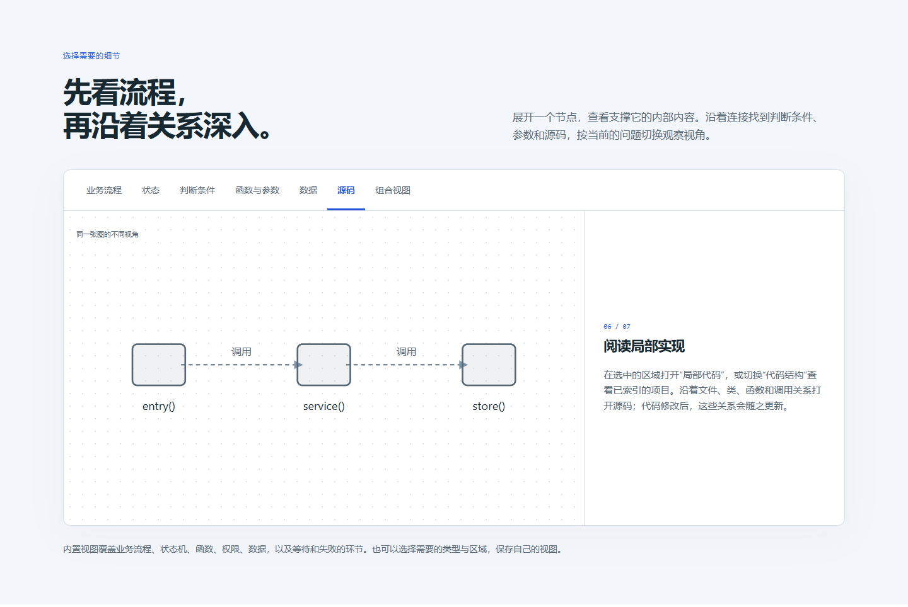

# v0.7.0 implementation assessment

This review follows the earlier assessment's scope: implementation fidelity,
state semantics, architecture, synchronization, observation isolation, usability
and delivery. It reviews the local `dev` implementation, including the database
and optional code layers, plus an independent application conversation.

## 1. Overall judgment

The component boundaries are suitable for the current product. Python owns
shared graph and verification services; the application owns execution and
authoritative data; native adapters exchange typed JSON facts. The optional
source view reuses independent source inventory rather than making business
nodes the limit of what gets scanned.

The main release risks were inconsistent contracts and lifecycle ownership,
rather than a need to rewrite the entire repository. Three defects surfaced in
the independent trial and further issues were reproduced during this review.
Repairs preserve strict checks and independent expected results. The tables
below distinguish a supported, tested scope from broader completeness claims.

The first passing trial was followed by a real requested iteration. A passing
v1 result alone would not establish that migrations, preserved graph identities
and new required observations survive an update.

## 2. Scope and evidence

- Canonical source inventory: [module sizes and source hashes](source-inventory.json).
  The inventory excludes installed copies, dependencies, tests and historical
  evidence. It is a source snapshot, not a code-quality score.
- Independent trial: [v1 result](../../review/release-v0.7.0/v1-summary.md),
  [public database repairs](../../review/release-v0.7.0/repairs.md), and the
  [release evidence index](../../review/release-v0.7.0/README.md).
- Focused source checks: [initial failures](code-red-refined.log),
  [concurrency and reload retest](code-concurrency-green.log),
  [final source tests](code-final.log), and [viewer checks](code-view.log).
- Actual browser: [source view results](browser/browser-result.json) and
  [bilingual introduction](site-final/result.json). These use real Chrome and local
  services; the separate product walkthrough uses explicitly synthetic data.
- Full acceptance and publication are recorded in the
  [ordered work table](../../development/code-vis-release.md).
- [GitHub clone and fresh installation](github-install-final/result.json) verifies
  all 172 installed Skill files against published commit `fa37289`, and restores
  both accepted examples from the downloaded source.

The separate conversation's user role is simulated and identified as such.
Code execution, SQL effects, HTTP requests and screenshots are real. This is
engineering acceptance, not a human usability study or a general correctness
proof.

## 3. Reproduced defects and repairs

| Finding | Effect before repair | Resolution and evidence |
| --- | --- | --- |
| D1: SQLAlchemy defaults | A declared string default could differ from equivalent reflected SQLite SQL. Valid models failed schema consistency. | Compile native defaults with the SQLAlchemy dialect; keep expression and literal semantics distinct. Real defaults, escaping and true mismatches are tested. See the public repair record. |
| D2: conflicting data evidence requirements | A capture allowlist was interpreted as requiring fields from mutually exclusive outcomes, including errors on successful queries. | `data/evidence.py` supplies one outcome-aware validator to data and feature checks. Exact configuration, capture and source identities are required; ordinary capture requirements remain strict. Missing selected values, known row counts, failures and transaction outcomes still fail. |
| D3: source/data enrichment overwrote each other | Regenerating database nodes removed source-owned evidence, causing a perpetual synchronization difference. | Preserve unchanged source enrichment and stable ordering, regenerate data-owned fields. A real sync → enrich → independent check → sync cycle is tested. |
| A1: empty or corrupt saved source index | Empty objects and other false-like JSON values could bypass comparison, and damaged JSON escaped the normal failed report. | Independently recompute and compare a nonempty index; invalid saved data reports failure without repairing itself. Tests include empty objects/lists, null, false and malformed JSON. |
| A2: server-wide request lock | A slow source query or response write delayed unrelated event ingestion and build replacement. | `SessionHost` pins each request's session, publishes replacements atomically and defers cleanup until the last old request finishes. Real HTTP tests prove concurrent ingestion, old-build rejection, new-build acceptance and cleanup. |
| A3: broad fallback exclusion | In a project without `sync.json`, all files beneath `bo_stategraph/` were excluded, including application-owned execution code. | Exclude only exact unchanged installed copies. Authored or edited state modules remain in the source inventory. Explicit project source scopes retain their existing rules. |
| A4: inconsistent conditional-declaration lookup | The source index found functions inside conditional blocks, but the source binder could not locate them. | Reproduced against both real parsers in [conditional_binding.py](conditional_binding.py). The binder now traverses control-flow blocks without changing lexical scope; ambiguous repeated definitions still fail. [Retest](conditional-binding-green.log) and the 18-case source suite pass. |
| A5: source display limits were incomplete | Node counts were visible, but links omitted by edge/boundary budgets were not stated on the page. | The source summary now shows loaded relations, boundary nodes and omitted related links. The underlying full JSON export remains available. |
| A6: live-only source preset during replay | Recorded frames do not contain the optional source index, but Code structure was still selectable. That preset could produce an empty recorded view. | Disable that preset during replay, use the recorded overview when opening from code, and restore the live code view on return. [Browser regression](replay-source-final/browser-result.json) checks both directions and actual rendered nodes. |
| A7: discussion focus overrode a saved perspective | A page reload treated an already-seen discussion as new and switched the saved analysis view back to overview. The independent application exposed this after its configured four gates passed. | Persist discussion revision and active/cleared state. Restore known highlights without reframing; migrate older saved views without overriding them. [Failing regression](conversation-focus-red.log), [retest](conversation-focus-green.log) and [browser reload and dismissal](conversation-browser-final/browser-result.json) preserve the sequence. The regression is now part of the shared full check command. |
| A8: normal retention looked like lost capture | The collector added expired live-history events to `dropped`. The viewer called them missing, and a recording crossing the retention limit could report a false gap although its event listener retained the interval. | Keep actual producer gaps in `dropped` and report `evicted_events` separately. [Two failing cases](retention-red.log) and [retests](retention-green.log) cover count/time eviction and a real missing producer event. [Real SQLite/browser acceptance](retention-browser/browser-result.json) crosses the count limit while recording and checks English/Chinese expiry labels. |

The suspected stale-display-on-error defect was **not reproduced**: `CodeLayer`
already clears its slice on a failed request. An explicit regression now protects
that behavior. The first product-page harness also used an invalid minimum
character count for Chinese copy; [that failure](site-harness-first.json) is
retained, and the check now verifies a real localized description.

The first replay retest used Playwright's `isDisabled()` for an individual
`option`; this runtime returned false even though the actual DOM property and
disabled attribute were true. The [diagnostic result](replay-source-retest/browser-result.json)
is retained. The final test checks the native option property, a nonempty
recorded view and the restored live source nodes.

The first retention retest read the stop-response event count as though it were
the saved event list. Its [harness error](retention-harness-first.log) is retained;
the corrected test reads the actual saved recording and still requires every
interval event, no false gap and a visible deliberately missing producer event.
Historical recordings retain their original diagnostics; the corrected health
semantics apply to newly collected views and recordings.

## 4. Architecture and ownership

```mermaid
flowchart TD
  conversation[Confirmed conversation] --> definition[Project and state declarations]
  application[Native application] --> facts[Selected runtime JSON facts]
  application --> storage[Authoritative storage]
  source[Independent source inventory] --> code[Optional code index]
  source --> binding[Implementation and source bindings]
  models[Native data models and catalog] --> data[Typed data projection]
  definition --> graph[Shared graph and instance service]
  binding --> graph
  data --> graph
  facts --> graph
  graph --> viewer[Views, focus and replay]
  code --> viewer
  storage --> checks[Independent observations and expected results]
  graph --> checks
  code --> checks
```

| Component | Owns | Boundary to retain |
| --- | --- | --- |
| `workflow/` | Source change inventory, requirements, review, four verification categories and acceptance | A source scan identifies omissions; it does not infer approval or business truth. |
| `graph/`, `code_graph/` | Authored graph utilities and derived source structure | Source relationships are static facts or unresolved candidates, never automatic execution evidence. |
| `data/` | Native catalog adapters, schema provenance, data-operation protocol, projection and refresh | The observer reads metadata; application migrations change storage. Query completion is distinct from transaction commit. |
| Native adapters and application `bo_` wiring | Allowlisted capture, queues and transport | The application continues when observation is off or fails. The observer's own operations remain excluded. |
| `service.py`, `session_lifecycle.py` | Unified instances and build/session ownership | Request lifetime cannot serialize unrelated parsing, transport or producer ingestion. |
| `observation/` | Retention, recording intervals, replay evidence and export | Recorded facts keep run/build/entity identity; missing facts stay missing. |
| Shared viewer | Typed nodes/relations, progressive expansion, layouts, notes and presets | Personal view changes never change business semantics or execute application commands. |

The new data evidence module removes duplicated interpretation between two
validators. The session lifecycle module removes ownership mechanics from the
HTTP handler. Both are small, behavior-focused extractions with executable
regressions. Installed copies and compatibility entrypoints remain deliberate:
package checks compare copies with their canonical source, while frozen review
records preserve history.

Readability has improved through formatting, purpose comments, documented
ownership and the [source guide](../../source-guide.en.md). Large functions remain
in requirements assessment, data projection and source parsing. Their sizes are
maintenance signals: further extraction should follow a concrete change and
retain the same validation cases. There is no evidence here that replacing the
entire architecture would be safer than the targeted repairs.

## 5. Capability assessment

| Capability | Implemented behavior | Evidence boundary |
| --- | --- | --- |
| Initial dialogue and diagram | Necessary clarification, mode choice, conversation diagram, actual Web address, explicit graph confirmation | The trial demonstrates these steps for two iterations. It cannot prove that every possible ambiguity will be asked. |
| Source-first mapping | Enumerates source independently, classifies features/support, binds functions and required parameters | Parser scope and unresolved dynamic targets remain explicit. A selected graph region never shrinks the inventory. |
| Runtime observation | Native events, selected values, states, transaction results and independent witnesses | Capture is configured, not every local variable or every database row. |
| Hierarchical state | Complete Python examples cover active configurations and nested/parallel behavior | The native Python/JS `bo.fsm/1` executor remains a strict flat subset. Unsupported execution semantics require an adapter. |
| Concurrency and Petri-style behavior | Activities, resources, waiting and joins live in the same state configuration | Tested scenarios do not establish liveness for every scheduler or distributed failure. |
| Authorization | Definitions, relations and one evaluation can be distinguished and bound to source/runtime facts | No general permission solver is claimed; inferred graph paths cannot manufacture grants. |
| Classes and instances | Static classes/functions retain source identity; runtime instances retain entity/run/build identity | A class node is not a runtime object; arbitrary heap reconstruction is not implemented. |
| Database structure and use | SQLite, PostgreSQL, MongoDB, Redis and Neo4j; schema/model/sample provenance; native Python and Node operations | Generic column lineage, arbitrary ORM support and database-internal execution plans remain outside scope. |
| Code view | Optional local focus and whole indexed project; imports, calls, inheritance, parameters and source access | Rendering is bounded; full export contains the index. Arbitrary runtime dispatch and complete data flow are unresolved extensions. |
| Personal views and recordings | Stable IDs preserve views across builds; obsolete recordings leave the current-version list | Explicit aliases resolve known renames. Similar labels cannot safely establish identity. |
| End-of-batch checks | Mapping, state rules, business expectations and project checks report separately | Missing/failed observations cannot be converted into passes by a correctly formatted graph. |
| Installation and export | Canonical Skill installation, checked managed copies and runnable observer-free core export | Installing a Skill does not automatically upgrade an application's existing runtime. |

## 6. Skill guidance and iteration discipline

The sequence remains confirmation → implementation with continual maintenance →
independent verification. The user chooses drive or observe at adoption. Business
clarification stays in conversation; implementation reconciliation belongs with
the coding work. The agent performs graph maintenance without making the user
manage intermediate files.

The [iteration graph checks](https://github.com/li-bruce/VibeLens/blob/v0.7.0/skills/business-observer/references/iteration-graph-checks.md)
now make case selection explicit: inspect changed nodes, neighboring consumers,
shared helpers, state/data dependencies and display boundaries. Run the affected
feature cases and an applicable negative control in an isolated copy. Keep the
project-wide gates and independent business expectations.

Prompts cannot intercept arbitrary edits made by other tools. Reliability comes
from the connected scan/inspect/verify/accept/check command sequence, strict
identity and required runtime evidence. The CLI and schema remain a learning
cost; the short Skill entrypoint links to focused references instead of exposing
every maintenance command in the user flow.

## 7. UI, recording and publication

The opening graph stays high level. Code structure is opt-in; database structure
and data operations are separate presets of the same typed graph. Filters,
collapsed groups and local boundaries retain the original relationships.
Annotations and positions use stable IDs.

The product introduction now includes a data perspective and explains local
versus whole-project source exploration. English and Chinese share the same
interaction. The sample walkthrough has its own page and is labeled as a demo.
Desktop and 390-pixel layouts are checked with an actual browser.

The optional source index belongs to live exploration. Recorded source bindings
still open the source saved with the recording; replay does not silently query
the current code index. A code view temporarily switches to recorded overview
and returns to the previous code perspective when replay ends.



## 8. Remaining limits and next work

- Generic OpenAPI/endpoint-to-client relationships remain planned. Existing
  route/handler discovery is not a complete API relation layer.
- More dynamic dispatch, type-only references, arbitrary value flow and further
  database/ORM adapters need separate contracts and tests.
- Large source graphs have explicit budgets. No whole-program performance or
  long-running production load baseline is claimed.
- The Web viewer still has a substantial orchestration module. Keep lifecycle,
  rendering, filters and projection tests separate when extracting more of it.
- This release tests one new Python application conversation and its iteration,
  plus the existing native Node/React/Vue regressions. It does not claim a new
  independent conversation in every supported language.

The final release record contains the accepted source revisions, complete
regression results, distribution checks and the preserved failure/fix/retest
sequence. It should be read with this assessment rather than replacing its
limits with a single “all software is covered” conclusion.
