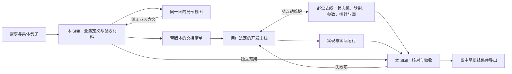

# 用业务模型引导开发：Skill 路线

状态：v0.4 实现说明与后续边界。白盒检查、局部图提取和显式清单导出已有命令；通用 ReBAC 引擎适配、图上语义修改与多人在线合并仍待实现。

## 目标与范围

本 Skill 帮助开发者先说明程序应当怎样运行，再检查实际实现是否符合这些要求。它作为开发的一条必需支线，持续维护业务图、状态机、源码映射、参数、探针与检查材料。开发主线可以使用用户指定的任何设计、框架和编码方法。

使用体验分为三步：先对话梳图；开发时由 AI 自动维护支线；每轮结束查看更新图并交互检索。内部的生成、审阅、版本和检查操作不转交用户。新的业务歧义才需要继续提问，例行同步无需反复确认。

业务、状态、规则、数据、函数和运行事实共用一张有类型的图。界面根据问题选择展开范围。图覆盖的行为范围须明确，未接入的外部系统和动态代码不能当作已验证。

本轮细化为三个配套契约：

- [统一图：类型、规则、抽象与探针](unified-graph.zh-CN.md)
- [独立局部图模块](focus-module.zh-CN.md)
- [验证、编码交接、导出与同步](verification-and-sharing.zh-CN.md)

可借鉴的现有 Skill 与职责区别见[参考工具](related-skills.zh-CN.md)。

## 开发主线自由选择，观察与验证支线持续维护

| 阶段 | 本 Skill 的责任 | 编码 Skill / 程序的责任 |
|---|---|---|
| 开发前 | 提炼业务对象、操作、规则与状态；主动澄清；展示局部图；形成执行声明、测试场景、探针约定和交接清单 | 可以参与技术可行性讨论；尚不把未决业务选择写成既定行为 |
| 编码中 | 随改动解析关键函数与参数、维护业务映射及图；检查状态机和探针的实际接入；更新受影响测试 | 自由选择实现方案；在应用内实现状态与业务逻辑，并在约定位置接入中立探针接口 |
| 开发后 | 使用开发前的预期验证真实程序；展示失败对应的局部图；确认覆盖范围；导出和保存验收记录 | 提交实际构建信息和实现映射；根据失败项修复，保留旧需求约束 |

这条支线在已选范围内不能省略，但不接管项目架构或全部编码决策。用户可以直接写代码，也可以配合 Spec Kit 或其他 Skill。通过项目配置衔接已有目录和测试入口；交接文件足以在当前或另一开发环境继续，无需自动创建新对话。

普通文案、布局和不改变行为的局部重构沿用已确认规格，不重启整套需求访谈。现有项目从选定业务链接入，不要求先重建全部架构。

## 开发前：形成可执行、可检查的约定

1. **选范围。** 明确参与者、对象身份、入口、成功效果，以及本轮改变什么；以一个可验证的业务链或业务网为单位。
2. **画当前理解。** 从同一模型生成局部图；规则定义、数据例子、待确认假设分别标明。未实现节点允许暂时没有源码位置，但须列为待接入。
3. **问行为分歧。** 使用具体例子和后果提问，每轮只问影响本轮的关键问题。已有答案直接引用。比如“一跳删除权限”已明确，但“删除带孩子的对象时如何处理孩子”仍可能未定。
4. **形成执行定义。** 定义数据类型、命令/事件、状态与并行活动、判定、资源及效果接口。优先使用程序已有引擎或成熟框架；可生成业务模块的初始声明，供编码阶段直接接入。模拟器通过同一接口使用合成数据。
5. **先建验收。** 独立保存场景、初始数据、操作序列、预期状态和实际效果、必须保持的约束。向用户展示会影响理解的少量正例和反例，不要求其审阅每条内部测试。
6. **交接。** 绑定规格、图、预期、接口与工具版本，生成可读说明和机器可读清单。已明确的范围可以继续；未决部分保持未决。

“先建执行定义”包含真实业务代码的最小声明，不等于所有代码都要等模型完成后才开始。模拟通过只说明模型在这些输入下满足检查；真实数据库、并发调度和事务效果仍待接入验证。

## 开发后：验证是必经步骤

1. 核对交接版本、源码修改范围、模型与代码绑定，读取实际加载的状态机定义。
2. 使用预先保存的场景和预期运行真实程序，读取返回值、状态和权威存储效果。
3. 核对运行过程、关键判定依赖、并行活动、等待、汇合和资源归还；分别检查观察开启、关闭和故障的业务结果。
4. 对重要规则执行操作序列测试和定向改错测试，确认检查能够发现真实偏差。
5. 把失败项映射回需求、节点、输入、函数和效果，生成可讨论的局部图。修复代码或澄清需求后再验收，不用重新生成图覆盖错误。
6. 保存该版本的结果、覆盖与未知项，再生成复现包或共享视图。

测试预期不能从当前实现的输出自动回填。需求确实改变时，明确改变哪些需求和场景，保留旧值、依据和变更记录；其他预期继续约束实现。

## 图如何连接开发前后

局部图是统一模型的视图；源码映射和运行记录补充同一模型的证据。运行结果与需求不一致时报告偏差，不自动把需求改成结果。

## 方法依据与取舍

| 方法 | 本 Skill 借鉴什么 | 不据此声称什么 |
|---|---|---|
| [BDD Example Mapping](https://cucumber.io/docs/bdd/example-mapping/) | 通过规则、具体例子和未决问题主动引导讨论，把例子变成验收输入 | 几个例子已穷尽全部需求 |
| [可执行状态图 SCXML](https://www.w3.org/TR/scxml/) | 精确定义嵌套/并行状态、事件、条件与动作，用于应用执行声明 | 声明并行状态就已经实现线程并发、资源控制或数据库原子性 |
| [Datalog 规则与事实](https://souffle-lang.github.io/tutorial) | 区分规则、数据与实例推导；明确直接关系和递归关系 | 所有权限都应传递，或必须使用某个规则引擎 |
| [精化映射](https://www.microsoft.com/en-us/research/publication/the-existence-of-refinement-mappings/) | 声明从内部执行到上层行为的映射及保留的可观察量 | 静态映射和有限测试等于所有路径的形式化证明 |
| [PROV-O](https://www.w3.org/TR/prov-o/) | 按实际使用、生成、派生记录连接数据、计算和效果，指导探针位置 | 时间先后足以证明因果，或者未采集的依赖可以补造 |
| [契约式设计](https://www.eiffel.com/values/design-by-contract/introduction/)与[模型测试](https://www.microsoft.com/en-us/research/publication/on-the-fly-testing-of-reactive-systems/) | 先规定输入义务、结果保证和不变条件，再核对实际操作序列 | 实现自己生成的预期足以成为独立正确性依据 |

并发、等待、汇合和资源消耗/归还继续借鉴 Petri 网的表达思想，落实在原有活动和资源关系中。实际调度和持久化由应用负责，验收读取真实配置与效果。

## 参考 Spec Kit 的实现

本轮核对提交 `f68ffcab37a253d42a226bc9bcf4fef451efa38c` 的源码。以下借鉴流程和数据接口，不复制其所有命令、提问次数或自动 hooks。

| Spec Kit 中实际采用的办法 | 本项目采用方式 |
|---|---|
| specify / clarify 形成规格和澄清记录，命令声明下一步 handoff | 本 Skill 的前置流程输出业务模型、问题来源和编码交接清单 |
| plan 输出数据模型和 contracts；模板规定必要内容 | 定义节点/边类型、接口、状态、规则、探针和验收所需字段 |
| check-prerequisites 检查必需文件并返回结构化路径 | 交接前后检查文件存在、格式、版本与关联；文件齐全不等于行为正确 |
| analyze 只读核对规格、计划、任务的歧义、遗漏和冲突 | 核对需求—模型—场景—实现的映射，报告问题，避免悄悄改写依据 |
| converge 对照原规格追加未完成任务，保持规格和代码不变 | 后置阶段输出可交给编码 Skill 的修复项；另加真实运行与效果验证 |
| 命令间交接和可恢复工作流 | 使用显式阶段、输入输出和版本，恢复时先核对产物是否改变 |

源码依据：[specify](https://github.com/github/spec-kit/blob/f68ffcab37a253d42a226bc9bcf4fef451efa38c/templates/commands/specify.md)、[clarify](https://github.com/github/spec-kit/blob/f68ffcab37a253d42a226bc9bcf4fef451efa38c/templates/commands/clarify.md)、[plan](https://github.com/github/spec-kit/blob/f68ffcab37a253d42a226bc9bcf4fef451efa38c/templates/commands/plan.md)、[analyze](https://github.com/github/spec-kit/blob/f68ffcab37a253d42a226bc9bcf4fef451efa38c/templates/commands/analyze.md)、[前置检查脚本](https://github.com/github/spec-kit/blob/f68ffcab37a253d42a226bc9bcf4fef451efa38c/scripts/powershell/check-prerequisites.ps1)、[converge](https://github.com/github/spec-kit/blob/f68ffcab37a253d42a226bc9bcf4fef451efa38c/templates/commands/converge.md)。

本项目保持独立安装。Spec Kit 是一种可选接入对象；其他编码 Skill 只要读写交接契约，也可以接入。

## 分阶段实现路线

| 阶段 | 要做的内容 | 完成判据 |
|---|---|---|
| M0：路线与契约 | 本组设计文档，明确六项需求与开放问题 | 人可理解，职责和验证边界明确；不宣称功能已经实现 |
| M1：关系与身份 | 节点/边类型、定义与实例、实际检查、源码及证据映射；迁移现有模型 | 直接、继承、群组、组合、排除和条件均保留原语义；旧节点标注可迁移 |
| M2：局部图模块 | 按问题提取、边界摘要、分层展开、版本绑定和修改建议 | 同一输入稳定输出；未显示条件不丢失；可跳回完整图；旧版本修改被识别 |
| M3：前置建模与交接 | 主动提问、模型执行、预期与场景、探针计划、编码交接清单 | 关键未决项阻止相应验收；另一编码流程能只凭材料继续实现 |
| M4：后置验证 | 静态、场景、轨迹、约束、定向改错和显示核对 | 刻意漏图、错误权限、提前汇合等能够被检查定位到原图 |
| M5：导出与协作 | 三类包、相对路径、版本与内容清单、合并冲突和新环境复现 | 独立目录能重新运行；共享视图不冒充当前运行；规则冲突不会静默覆盖 |

模块可以先用合成小例验证，不以大规模全量关系展开作为首个目标。M2 的基本展示与 M3 的交接可分步交付；语义编辑在版本、冲突和测试机制齐备后接入。

## 当前已有与需要新增

- 复用：`requirements_dialogue.py`、`code_structure.py`、`change_sync.py`、状态/内部活动契约、隔离检查、现有统一图和布局标注。
- v0.4 新增：`whitebox_contract.py` 的源码/参数/真实事件检查，`focus_graph.py` 的来源与边界保留，`project_bundle.py` 的显式清单导出和完整性检查；[持续开发约定](../../skills/vibelens/references/continuous-development.md) 可与其他开发方法配合。
- 后续：引擎原生解释适配、局部图的语义修改建议与冲突处理、多人在线协作。当前用 Git 处理源码和约定的协作，不声称已有图规则编辑器。
- 仍需按项目确认：真实规则引擎与数据读取范围、删除或恢复的效果、可公开数据、其他语言的接入方式。单一示例的规则不成为通用默认。
