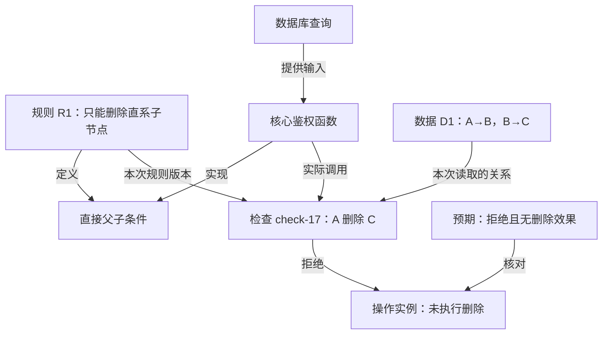

# 统一图：规则、数据、代码与执行的关系

[返回路线](roadmap.zh-CN.md)。状态：统一语义约定。现有模型与运行协议实现其中的关键子集；通用规则引擎适配仍待接入。

## 统一名称

继续称为“业务行为图”。“判定依赖”是其中一种关系和一种观察范围，不再用“判定依赖网”命名另一套系统。

同一张图中的节点与边都有明确类型、身份和来源。状态机描述允许的状态变化；业务规则描述什么条件成立；代码映射说明哪里实现；数据关系说明当前有哪些对象和联系；运行记录说明实际发生过什么。这些内容相互连接，但不互相替代。

统一图提供关联索引和可追溯表示。已确认需求说明“应当怎样”；应用的执行声明/规则引擎说明“实际采用什么规则”；数据库提供对象与关系事实；真实程序提供执行状态与效果。各自保留权威来源，图上的显示值不反过来覆盖它们。

初版可以沿用文件模型、SQLite 和索引适配，不要求为了统一表达先迁移到图数据库。查询/计算型功能侧重数据依赖与输入输出契约，事件型功能侧重事件协议，生命周期和协作过程侧重状态与活动；并非所有函数都需要包装成状态机状态。

## 一份规则定义与许多求值实例

规则包含变量，数据提供对象及关系，实际请求绑定主体、动作和对象。数据库规模增大时不复制规则定义，也不预生成所有主体—对象对。先识别适用的权限情况，再按本次请求展开，详见 [权限情况清单](../../skills/vibelens/references/authorization-patterns.md)。

| 规则情况 | 定义关注什么 | 实例展开保留什么 |
|---|---|---|
| 直接授权 | 主体与对象的指定关系 | 具体关系记录和读取范围 |
| 群组与角色 | 成员集合、角色到操作的映射 | 成员、角色范围、被授权资源 |
| 层级继承 | 哪种关系允许传播、方向与边界 | 实际路径和每一步引用的规则 |
| OR / AND / 排除 | 任一满足、全部满足、去除指定集合 | 操作数、分支结果、未求值或未知 |
| 上下文条件 | 时间、租户、参数、身份来源 | 本请求实际输入、类型和版本 |

“A→B→C”本身只给出关系路径。若规则是“只允许删除直接子节点”，A 对 C 不满足该规则；若规则明确允许沿这些边继承查看权限，A 对 C 可以满足。两种都应正确表达。具体操作能否完成还取决于其余规则和提交时的数据，不能只看图连通性。

| 内容 | 图中的身份与依据 |
|---|---|
| 规则定义 | 稳定规则节点、变量、操作符、定义/源码位置和版本 |
| 实例事实 | 对象与关系记录身份、方向、来源和读取范围 |
| 参数绑定 | 一次检查如何引用规则，并绑定主体、动作、对象和参数 |
| 预览推导 | 在指定规则和数据下计算的结果；与真实执行分开 |
| 实际检查 | check/call 身份、真实输入、已执行子条件与返回结果 |
| 实际效果 | 事务或操作身份、持久化结果与影响对象 |

没有画出的边不代表关系不存在；查询失败、分页未完或观察缺口都不能作为否定事实。对象的父子关系也不自动授予某个用户代表对象操作的资格。级联删除等效果范围另需明确，不能从许可结果推断。

这种区分借鉴 [Datalog 的规则与事实](https://souffle-lang.github.io/tutorial) 和 [OpenFGA 的关系组合](https://openfga.dev/docs/configuration-language)，不要求项目使用指定引擎。图负责关联来源，权限结果由项目真实实现提供。

## 按问题展开，避免实例爆炸

默认展示规则定义和当前关注对象。用户选择一个主体对某个对象的操作，才展开相应绑定、事实读取、函数和检查记录。一个规则节点可以关联许多检查实例，不在首页展开所有对象对，也不预生成所有拒绝边。

规模随规则而异：一跳父子授权通常随直接关系数增长；传递闭包可能产生远多于原边数的对象对。实例结果可以按需计算或缓存，但须绑定规则版本、数据依据和请求上下文。

统一图维护稳定定义、映射、实例索引和已纳入范围的事实，不意味着把生产数据库全量复制进图。按查询载入的数据标明范围、分页和时间；未载入、无权限显示和不存在是不同情况。超出预算显示“还未展开”，不改变权限结果。

数据变化后规则定义可以保持不变；依赖旧事实的结果失效并重新检查。依赖索引既要记录读到的关系，也要记录查询范围，以识别新增关系、删除关系和空结果的变化。无法精确定位时保守重查相关范围。历史检查保留旧数据依据，不被新值覆盖。

## 节点类型

下表是语义分类，不要求为每个字段都画一个节点。只有需要单独引用、连接、展开或比较的内容才成为节点；其他内容保留为有类型的属性。

| 类别 | 可出现的节点 | 必要区分 |
|---|---|---|
| 需求与约束 | 业务目标、规则来源、问题、决定、必须保持的条件 | 已确认、待确定和假设分开；原话不直接等于可执行表达式 |
| 领域定义 | 对象类型、字段/值类型、关系类型、操作与事件定义 | 对象类型和实际对象分开；事件类型和一次事件分开 |
| 行为定义 | 业务活动、状态定义、转换、条件、AND/OR/排除、资源要求、汇合要求 | 活动不等于状态；条件结果不等于执行状态 |
| 实现结构 | 核心函数、参数/返回值定义、查询、接口、源码位置 | 静态可能调用与实际调用分开；动态未解析关系显式保留 |
| 领域实例 | 对象、关系记录、参数值/版本、资源实例 | 数据身份与快照分开；不同时间的值不能混成一个事实 |
| 执行实例 | 业务运行、活动实例、函数调用、读取、规则检查、状态变化、等待/恢复 | 同一函数的不同调用、同一任务的不同运行不能共用一个可变结果 |
| 效果与证据 | 提交记录、输出产物、失败记录、数据读取依据 | 计算返回、提交请求和提交成功分开 |
| 验证与视图 | 场景定义、一次测试结果、验收记录、局部视图、显示标注 | 场景预期与实测结果分开；显示别名不修改源码或规则 |

业务网和函数图可以交叉。一项业务活动可能由多个函数实现；一个函数也可能支持多个业务场景。分层表达不强制每个节点只有一个父节点。

## 边类型

| 关系组 | 典型含义 | 使用约束 |
|---|---|---|
| 业务组织 | 组成、细化、先决活动 | 折叠组织关系不自动成为执行先后 |
| 状态执行 | 某事件在条件成立时允许转换；活动激活/完成 | 转换保留事件、条件、动作与作用域，不能只留一条无条件箭头 |
| 判定依赖 | 规则读取字段/关系；某结果用于某个判断 | AND、OR、排除的组合结构显式表示；多输入通过条件/活动节点表达 |
| 数据关系 | 直接父子、成员、归属、拥有 | 方向和范围由领域定义；直接父子不自动传递；不与界面分组共用类型 |
| 数据处理 | 输入、输出、读取、写入、派生 | 派生声明标明是否有静态证据、模拟结果或实际事件 |
| 并发资源 | 获取、占用、归还、等待、全部/部分完成后汇合 | 数量、容量、运行身份和参数版本必须可核对 |
| 程序关联 | 可能调用、实际调用、参数传递、代码实现 | 静态边不能被染成已执行；调用顺序不能直接称为因果 |
| 跨层映射 | 实例属于定义、调用实现活动、内部状态映射上层状态 | 映射需说明依据和可观察量，不凭命名近似自动当成行为等价 |
| 证据来源 | 某检查使用某次读取；某提交生成产物；某结果被新检查替代 | 引用具体记录，保留版本和历史 |
| 验证覆盖 | 场景检验规则、结果来自运行、失败指向节点 | “有用例”与“本次执行通过”分别表示 |
| 视图映射 | 摘要代表哪些节点/边、边界连接哪里 | 只属于视图；不增加业务事实或执行许可 |

相同起止节点之间可以有不同类型或不同实例的多条边。边也有稳定身份、来源和适用范围；不能按两个端点合并全部关系。

## 抽象、实现与运行之间的映射

观察深度可以是“业务意图 → 状态/规则/数据契约 → 核心实现 → 一次实际运行”。数据实例还要通过“实例属于定义”连接；它不是单纯沿文件目录向下展开的一棵树。

图为设计示意，不代表已经采集的运行。

每个摘要声明关心哪些可观察量，例如许可结果、被删对象、活动完成、资源占用和提交次数。实现中增加缓存、循环或辅助函数时，这些量仍须符合上层规则。形式化的精化映射为此提供理论基础；当前采用明确映射和场景核对，不声称已证明所有路径等价。[精化映射研究](https://www.microsoft.com/en-us/research/publication/the-existence-of-refinement-mappings/)

上层“处理中”可以折叠多个内部状态；完整模型仍保留范围内所有活动实例及等待、执行和资源配置，按运行和版本检索。普通局部变量或外部状态没有接入时列为未覆盖。

## 来源、身份与状态

建议公共字段：`id`、`kind`、`definition_ref`（适用时）、`source_refs`、`model_revision`。源码证据绑定源码内容与符号；运行证据另有 `run_id`、`call_id/check_id`、实际加载的 `build_id`、参数版本和数据读取依据。

数据版本只记录实际来源提供的版本、令牌或时间信息；无法获得一致快照时明确标注，不能伪造一个统一数据版本。运行历史用记录身份区分，稳定定义节点只承载定义和显示属性。

至少分开四个状态维度：

- 执行：未开始、运行、等待、完成、出错、取消。
- 条件：满足、不满足、无法判断；另记是否实际求值。
- 适用性：当前依据仍有效、需要重新检查、历史记录。
- 验证：未检查、通过、失败、证据不足。

规则定义没有天然的“绿色通过状态”。预览计算不显示为真实检查；短路未执行的子条件不能补算后伪装成已执行。

证据关联借鉴 [W3C PROV-O](https://www.w3.org/TR/prov-o/) 的实体、活动、使用和生成关系；具体事件仍须真实采集。类型和边端点约束可借鉴 [SHACL](https://www.w3.org/TR/shacl/)，也可以用现有 JSON/Python 校验实现；结构校验不证明业务判断正确。

## 由模型决定探针位置

开发前形成探针计划，编码阶段绑定到真实代码位置，开发后验证是否实际触发。

| 语义位置 | 最小观测内容 | 目的 |
|---|---|---|
| 命令进入 | 操作、对象、运行、关键参数及版本 | 区分谁针对哪个对象发起哪次操作 |
| 权威读取返回 | 查询范围、返回记录引用、必要字段、读取依据和完整性 | 解释使用了哪些关系，区分空结果与读取失败 |
| 条件实际求值 | 规则版本、参数绑定、读取事件引用、子条件结果与短路 | 说明为什么走当前分支；不在页面重新计算冒充运行事实 |
| 关键函数进入/退出 | 调用身份、关键输入输出、异常、关联活动 | 从业务节点定位真实实现 |
| 活动/资源变化 | 活动身份、前后状态、占用/释放数量、等待与唤醒原因 | 核对并发、汇合与资源约束 |
| 提交前保护 | 最新相关版本与授权检查、事务或操作身份 | 发现计算期间的数据/关系变化 |
| 提交后效果 | 实际影响对象、持久化结果/产物身份 | 区分“准备删除”和“已提交删除” |

读取探针记录程序已经读到的内容，不额外查询一遍更新的数据冒充原读取。外部检查仅给出布尔值时，只展示汇总和缺口；OpenFGA 普通 Check 不负责完整解释“为什么”。[关系查询说明](https://openfga.dev/docs/interacting/relationship-queries)

字段按需求选择，避免收集整行数据库或全部局部变量。观测通过中立接口接入，关闭或异常时不改变业务结果。不可丢的事务记录属于业务持久化；可丢的观察事件出现缺口时显示缺口。
