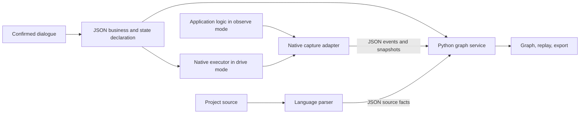

# Shared graph architecture and multilingual refactor

Python supplies shared graph, validation, recording, querying, and presentation. Each application keeps native business execution and authoritative state. Versioned JSON carries declarations, source facts, and runtime evidence.

The original failures, fixes, and retests are retained in the [refactor evidence](review/multilanguage-refactor/README.md). Subsequent locale and independent-gallery work is indexed in the [current review](review/english-gallery/README.md).

## Responsibilities

| Module under scripts/bo_observer/ | Responsibility |
|---|---|
| protocol.py and schemas/ | Versions, identities, types; unsupported declarations fail |
| graph/ | Structure, hierarchy, state constraints, source relations, focused extraction |
| workflow/ | Confirmation, change inventory, separate mapping/business results, source migration |
| observation/ | Capture isolation, retention, recording, event-bound historical states |
| web/ and service.py | Queries, source navigation, preferences, shared service entrypoint |
| delivery/ | Architecture boundaries, managed files, installation, export |
| adapters/ and sources.py | Native Python/JS probes/executors; Python, JS/TS, React, Vue source facts |

Top-level scripts retain thin compatibility entrypoints. Target-project bo_stategraph/ contains declarations, bindings, and required native components; it does not duplicate application business logic in the Python service. The canonical full viewer is assets/stategraph-viewer/.

Confirmed business grouping, source facts, and actual observations share stable node identities but cannot stand in for one another. Ordinary relation edges are not executable transitions. Filtering does not change the full model.

## Migration and verification

Preserve earlier checks and active change baselines. Separate common services and language adapters, retire unchanged obsolete managed files, and report conflicts for modified files. Preserve project declarations, private layout settings, and historical evidence.

Drive/observe is an explicit user choice. Both require independent source inventory, capture, and final verification. Business ambiguity goes to the user; implementation ambiguity is reconciled against current source and actual cases.

Reports separate mapping fidelity, state constraints, business expectations, and project checks. Static calls remain candidates; dynamic targets, permissions, and values need runtime evidence. Scripted dialogues are development tests, not human-usability studies. Never remove or weaken earlier assertions to obtain a pass.
