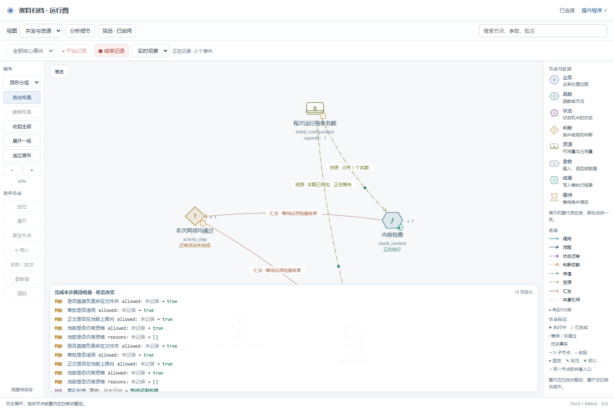
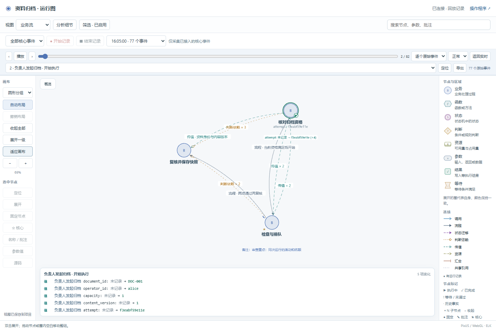

# 六项复评问题的修复与验收

对象：本地 `SoftwareStatusObserverSkill`，修复起点为 `f37b5c4`。依据 [2026-10-22 复评](../../assessment/2026-10-22/README.md)，原评估目录保持不变。修复、原始失败、过程中的新失败、反例和复测分别保留。

本轮优先修复映射检查、状态机语义和锁顺序。既有业务预期和白盒断言保持原字节；增加检查，不通过减少场景、断言或探针消除失败。

**六项问题均已修复，最终完整验收通过。** 本机已安装的 Skill 同步了 17 个变更文件。规范源、示例副本、已验收实例、可剔除观测层的核心包和新目录恢复分别检查。验收完成时尚未推送远端；发布记录见 Git 历史。

## 六项修复

| 项目 | 实际修改 | 回归证据 |
|---|---|---|
| R1 实际投影与映射对照脱节 | 引入 `bo-mapping/v1` 清单，固定场景、模式、实际来源、图节点及字段路径。逐个实例读取真实存储和实际投影，公共导出必须与指定场景的完整快照一致；检查缺项、错绑、类型、修订和清单退化。原 `mapping_checks` 继续执行。 | 缺实例、缺场景、错字段、布尔/数字混同、空导出和删除必需字段均被拒绝；真实完整收尾反例见下文。 |
| R2 状态机语义不完整 | 共同校验器在加载前验证声明、引擎/版本、guard 接线和支持范围；补齐通配顺序、子状态优先、复合初始进入、完整活动配置和独立并行区域。声明比较保留 JSON 类型区别。 | 与真实 `transitions` 引擎对照；错误目标和缺失子状态保留为违规事实，不能显示 `observed`。 |
| R3 查询与记录锁顺序相反 | 一致快照提供者在图锁外读取；查询和导出继续由同次快照派生实例，不建立第二份状态缓存。 | 实际归档程序用线程屏障重现原锁顺序，查询和记录均能结束；另测查询/导出回调不持图锁。 |
| R4 watch 遇到文件占用退出 | 原子替换对短暂权限冲突有限重试；watch 发布失败时保留旧文件和待办，下一轮继续发布，不能误认为已更新。 | Windows 真实共享文件句柄占用后释放，进程持续运行并发布新源码任务；持续写失败保留原文件。 |
| R5 全图导出丢失运行帧 | `bo_export_view` 保留 `runtime_frames`；导入核对事件身份、构建、运行和完整修订。 | 完整帧往返和防御性复制通过；事件缺失、修订错绑及布尔修订被拒绝。 |
| R6 默认文件探针无界追加 | `Pins(path=...)` 默认走有界 `EventHistory`；传入 `project_root` 后应用项目保留策略，非法策略在创建时报错。 | 25 个事件、2 个内存名额、1,024 字节文件边界及轮换；文档最小接入直接验证配置读取。 |

代码以 `skills/business-observer/scripts/` 为规范源，同步至两个完整示例和普通 Python 示例。新回归进入 `tools/verify.py`；Skill 入口、接入说明、同步模板及中英文 README 均随实际接口调整。

## 严格校验的边界

**非法定义应当阻止启动或装载。** 项目执行器调用 `validate_runtime_definition`，传入真实引擎、版本和 guard 名称；`bo_require_definition` 将实际声明与模型绑定，差异抛出 `ValueError`。旧 `bo_check_definition` 保留为诊断查询，不能作为“已强制校验”的替代。

支持的是明确的声明子集。历史状态、跨并行区域迁移、状态/迁移回调和未适配的引擎选项会被拒绝，不能悄悄按平面状态机解释。业务自己采用普通函数时，观察器不会擅自改成另一套执行器。

**已经发生的错误运行必须如实显示。** 非法状态、资源值或迁移结果保留实际值及诊断；对应状态约束验收失败。缺少必要修订、构建或核心参数时，不能把两份相同的空值判为完整映射。观察器不会修改真实状态，或丢掉错误记录来制造“图是合法的”。

折叠与执行配置不同：界面可以折叠为“检查中”，实际查询仍须包含活动子状态。复合状态声明了初始子状态，却只上报父状态时，现在会报配置不完整。

## 失败、修复与复测过程

| 阶段 | 结果与处理 | 保存的材料 |
|---|---|---|
| 修复前运行新增回归 | 10 个测试方法中出现 7 个断言失败和 11 个错误，包含子用例；保留原失败，没有用旧代码的总回归通过代替问题复现。 | [原始日志](before-regressions.log)、[修复前规范源散列](before/product.json) |
| 首批修复 | 映射、引擎、锁和其余三项的针对性检查通过；真实并发测试最初误用无包名导入，修正测试加载后通过。 | [中间日志](regressions-expanded.log)、[18 项复测](regressions-expanded-02.log) |
| 严格边界补查 | 发现空修订对空修订、声明中的布尔/数字混同、帧中布尔修订仍可能通过；补齐检查。 | [失败](strict-boundaries-before.log)、[修复后](strict-boundaries-after.log) |
| 两示例正常验收 | 新检查发现重启测试的子进程启动时未绑定构建。修正真实子进程的启动参数，不在事后补造观测值，原业务预期不变。另一次模型生成遇到本地写入错误，所有权检查阻止了验收；重试生成并核对成功。 | [失败阶段](stage02.log)、[重试生成](build-delivery-02-retry.log)、[修复复测](stage03.log) |
| 完整入口第一次 | 旧迁移测试将独立包文件作为无包名脚本导入，导致相对导入失败。改为按独立包加载，保持旧新定义、状态、活动、资源和效果的全部比较。 | [失败全日志](full-acceptance-01.log)、[加载修正复测](migration-loader-retest.log) |
| 完整入口第二次 | 通过。之后另加层级配置反例，发现只上报复合父状态仍被视作完整事实；补充拒绝该不完整配置。 | [第二次全日志](full-acceptance-02.log)、[层级反例失败](compound-configuration-before.log)、[20 项复测](compound-configuration-after.log) |
| 最终浏览器复测的等待边界 | 复用的旧脚本选择自定义视图后立即刷新，没有等待项目保存完成，恢复断言失败。保留失败；在原断言之前增加服务端配置已含该视图的检查，再刷新验证。页面原有“待保存/已保存”语义不变。 | [失败日志](browser-final/browser-first.log)、[失败结果](browser-final/ui-result.json) |
| 运行帧身份补查 | 事件和运行帧同时缺失运行/构建身份，或同为负修订时，仅比较相等仍不够；增加非空身份、快照类型和非负修订要求。 | [失败](frame-identity-before.log)、[复测](frame-identity-after.log) |
| 最后复制与恢复检查 | 同步副本时再次出现本地文件写入 `OSError 22`，停止后重试成功，未认定底层原因。新目录测试曾把交付示例的 `runtime` 工具目录也排除了，修正隔离副本的排除范围后两个示例均通过。 | [复制失败](sync-copy-io-failure.log)、[恢复脚本失败](fresh-release.log)、[恢复复测](fresh-release-retest.log) |

## 实际阶段门禁反例

从已验收的真实归档项目复制隔离副本，先 `begin` 保存旧基线。保持全部场景、业务预期、探针及原对照项，逐次注入错误，再恢复同一变更。没有重新建立基线隐藏改动。

| 修改 | verify / accept / check |
|---|---|
| 删除必需的 `operator_id` 映射项 | 全部失败；指出覆盖退化和缺少上下文字段 |
| 新增未登记的业务函数文件 | 全部失败；源码清单指出具体遗漏文件 |
| 将公共导出实例清空 | 全部失败；原 480 项对照和 189 项业务断言仍通过，映射报告独立指出公共投影不一致 |
| 恢复正确投影及清单 | 三步全部通过；公共导出包含真实实例 |

首次完整正反对照见 [结果](counterexample-results.json) 和 [命令](counterexample-commands.json)。业务正确、映射正确、状态约束及项目检查继续分别报告。

后续再次运行的 [正反对照](counterexamples-final/counterexample-results.json) 得到相同结论。此后仅补充非法运行帧身份检查，并重新执行定向测试与下列完整入口。

## 最终验收结果

| 验证范围 | 结果 | 证据 |
|---|---|---|
| 完整入口 `tools/verify.py` | 退出码 0；原有检查和新增回归共同通过 | [最终全日志](full-acceptance-complete.log)、[命令及退出码](final-commands.json) |
| 六项问题的定向回归 | 20 个测试方法通过，含多个反例子用例 | [最后定向复测](frame-identity-after.log)；完整入口再次运行同一测试文件 |
| 真实状态机对照 | 154 次实际迁移与观察结果一致；134 个没有对应处理器的输入单独统计 | [结果](engine-matrix-result.json) |
| 交付示例 | 16 场景 × 3 模式；保留 201 项原映射对照和 96 项业务断言，增加 303 项投影核对 | [验收记录](final/delivery/verification.json) |
| 归档示例 | 40 场景 × 3 模式；保留 480 项原映射对照和 189 项业务断言，增加 1,110 项投影核对 | [验收记录](final/team-archive/verification.json) |
| 源码迁移、关闭观测与核心包 | 原迁移检查、30 个真实 SQLite/线程旧新场景、两种 Python 实现、三种探针模式及独立核心包运行通过 | 最终完整入口日志；这些与示例验证重叠，不相加为独立测试总数 |
| 页面和重启恢复 | 14 项页面操作与 5 项重启检查通过，未发现脚本错误或崩溃；记录 85 个事件、3 个操作，83 个步骤呈现变化 | [页面结果](browser-complete/ui-result.json)、[重启结果](browser-complete/ui-resume-result.json) |
| 原预期与可恢复交付 | 四份原业务/白盒文件逐字节不变；从 `.release` 恢复的两个新目录检查通过 | [摘要及散列](final/summary.json)、[新目录恢复](fresh-release-results.json) |
| Skill 与安装 | Skill 格式校验通过；当前安装副本按修复前散列检查后更新，原文件在本地工作区备份 | [格式检查](skill-validation-final.log)、[安装记录](installation-applied.json) |

最终归档示例构建为 `66ca0e8096b53060be761595b99a0ed340c38bb5367ad0c78285fd799fe6f9a6`，与最终浏览器两次运行一致。交付示例构建为 `35a21cbb99f32616b8852c5e486c53cb232cfd7b70c042c5a525f45036c858f4`。完整观测输出和项目检查日志以 `.json.gz` 保存在 `final/`，可解压审查；[产品散列](final/product-sha256.json) 记录规范源及关键实现文件。





需求澄清检查沿用原有的可执行对话场景与阶段测试；本次没有新开独立 AI 会话，也不把浏览器脚本称作真人使用研究。Skill 格式检查最初因测试 Python 缺少 YAML 依赖未能运行，随后使用本机已有依赖的 Python 通过，没有向业务运行依赖增加包。

## 使用与复现

本材料记录本地验收，后续发布记录见 Git 历史。新项目使用本地安装后的 `$business-observer`。AI 负责建立映射清单、源码绑定和探针，用户继续只讨论业务、回答关键问题和查看更新图。

已有项目升级时，先保存正常变更基线，按 [独立模块说明](https://github.com/li-bruce/VibeLens/blob/v0.7.0/skills/business-observer/references/independent-python.md) 升级公共文件；再按 [映射清单说明](https://github.com/li-bruce/VibeLens/blob/v0.7.0/skills/business-observer/references/mapping-contract.md) 补齐 `sync.json.mapping_contract` 和实际场景投影。不能新建基线跳过旧检查。

仓库根目录执行：

```text
python tools/verify.py
python tools/test_assessment_fixes.py
```

定向脚本在本目录：`engine_matrix.py` 对照真实引擎；`gate_counterexamples.py` 要求新的隔离目录名称；`run_browser.py` 用实际浏览器测试隔离服务，并在换端口后重读项目配置和录制。浏览器通过只说明这些操作可执行，不等于真人易用性或长期性能结论。

本轮不扩展一般 Petri 调度、通用权限引擎、运行事件增量 API 或性能基线。无法观察的外部行为仍须标明，当前验收不证明任意软件的全部语义。
