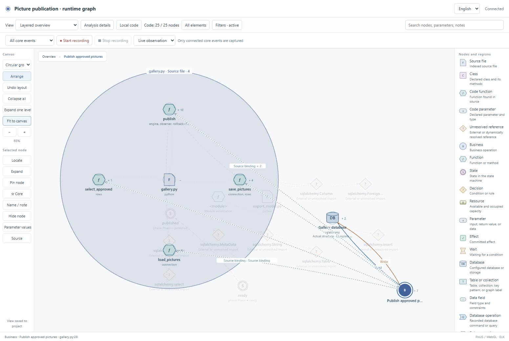
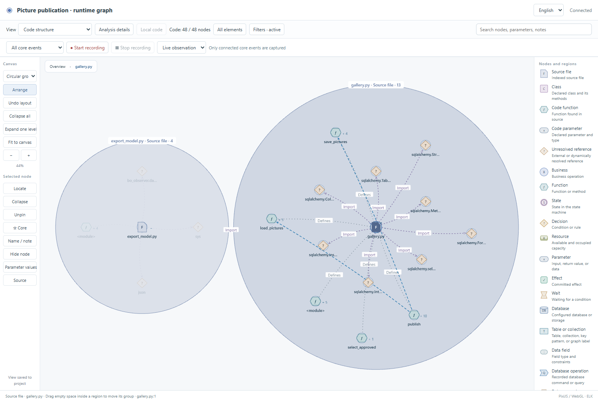

# Code structure acceptance

Work starts from published `db-vis` / `dev` at `af5ae5a`. The database branch's
[five GitHub CI jobs passed](https://github.com/li-bruce/SoftwareStatusObserverSkill/actions/runs/40013071589).
The ordered release workflow is tracked in [the work table](../../development/code-vis-release.md).

## Implemented scope

The optional layer exposes files, classes, functions, parameters, imports,
inheritance and static call occurrences in the existing graph. Local code uses
the selected authored node's source bindings; the Code structure view browses
the independently indexed scope. New/deleted files and parse failures update
automatically. Nodes retain stable identities, layouts and annotations.

The implementation separates source indexing, bounded neighborhood queries,
Web access and viewer projection. Actual runtime events and the business/state
declaration remain independent. [Design and prior art](../../development/code-vis.md)
document the relationship types and coverage limits.

## Recorded checks

| Check | Evidence |
| --- | --- |
| Merged dev CI | [`96f28f7`, five jobs passed](https://github.com/li-bruce/SoftwareStatusObserverSkill/actions/runs/40016953997): Windows/Linux with Python 3.11/3.13 and real database services |
| Full repository regression | [Complete run](full-repository.log), `python tools/verify.py --database`: passed, including clarification, native adapters, strict mapping/state/business/project checks, HTTP, installation and independently executed observer-free exports |
| Actual browser, source edits and SQLite operation | [Final browser result](final-current/browser-result.json): optional loading, local/full views, source access, new file, parse failure, deletion/recovery, pin coordinates and notes after reload/upgrade, real recording and observer exclusion, EN/ZH |
| Source/query/HTTP regressions | `tests/test_code_graph.py`: Python/Node/React/Vue, imports/inheritance, repeat-call identity, module initialization, shadowed callbacks, syntax errors, source revision, hidden Web and independent tampering/staleness checks |
| Viewer projection and filters | `tools/test_code_view.mjs`; [existing layout regression](layout-retest.log) retains all previous assertions |
| Existing refactor regressions | [30 cases](refactor-regression.log) |
| Git-export installation | [Result and tested Git tree](git-export-result.json); [first attempt](git-export-check.log) retained; documented setup and both accepted examples pass in [retest](git-export-retest.log) |
| Delivery example | [Protected expectations](delivery-protected-expectations.json), [review](delivery-review.json), [four reports](delivery-verification.json), [accept](delivery-accept.log) |
| Archive example | [Protected expectations before source classification](team-archive-protected-expectations.json), [review](team-archive-review.json), [four reports](team-archive-verification.json), [accept](team-archive-accept.log) |

These are automated executions with synthetic application data. A separate
new-conversation trial follows the code branch's full acceptance and merge.

## Failures and corrections

1. [First browser attempt](attempt-1/browser-result.json) could not display the
   local source projection. Passing native `fetch` as an object method lost its
   browser receiver. An explicit wrapper fixes the invocation; the
   [next attempt](attempt-2/browser-result.json) passed.
2. [First complete delivery run](delivery-first-failure.json) rejected a candidate
   changed during testing. The original baseline stayed intact; subsequent
   acceptance uses fixed source. The same run caught a layout fixture that used
   a visual role as a protocol node kind. The fixture now supplies `code_role`
   with the correct base kind and keeps every original layout assertion.
3. The existing saved-filter assertion then caught an actual upgrade defect:
   code types were added to an explicit state-only selection. Filter migration
   now preserves the exact selection, including empty arrays. Source types are
   enabled by the user's code-view action and remain editable afterward.
4. [Conditional-source inspection](conditional-observer-first-failure.log)
   found `BOObserver.trace.broken`, an existing fault-mode callback previously
   skipped under an `if` statement. Python extraction now visits conditional
   declarations. The example explicitly classifies this exception-only callback
   as observer support; business assertions and probe obligations are unchanged.
5. New native tests reject a false imported-function target when a JavaScript
   callback parameter, including a destructured parameter, shadows that name.
6. The first Git-export harness skipped the documented `tools/setup_adapters.py`
   dependency installation. The strict check correctly rejected missing parser
   evidence. Installing the locked dependencies is the harness correction;
   source checks and the accepted baseline are unchanged.

## Boundaries

Static targets are syntax candidates. Dynamic dispatch and external targets stay
unresolved; the graph does not fabricate executions. UI retrieval has explicit
budgets and boundary nodes; the CLI exports the full indexed scope as JSON.
Type-only references, complete variable flow and additional language adapters
remain outside this version. Runtime build status is separate from the current
source index revision. Original failed evidence is retained.
