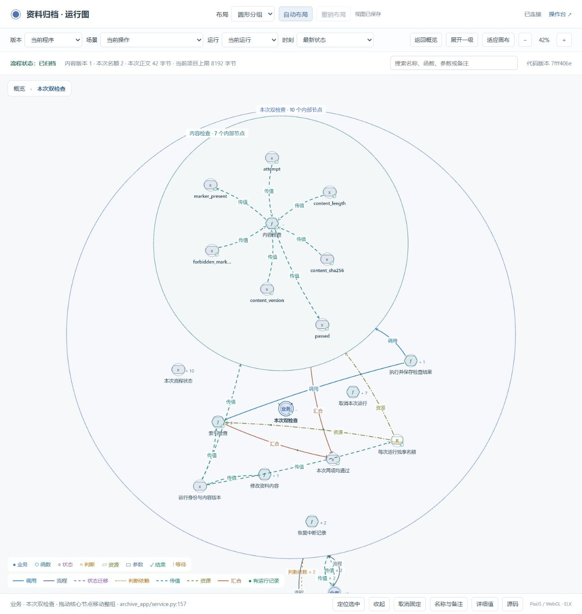
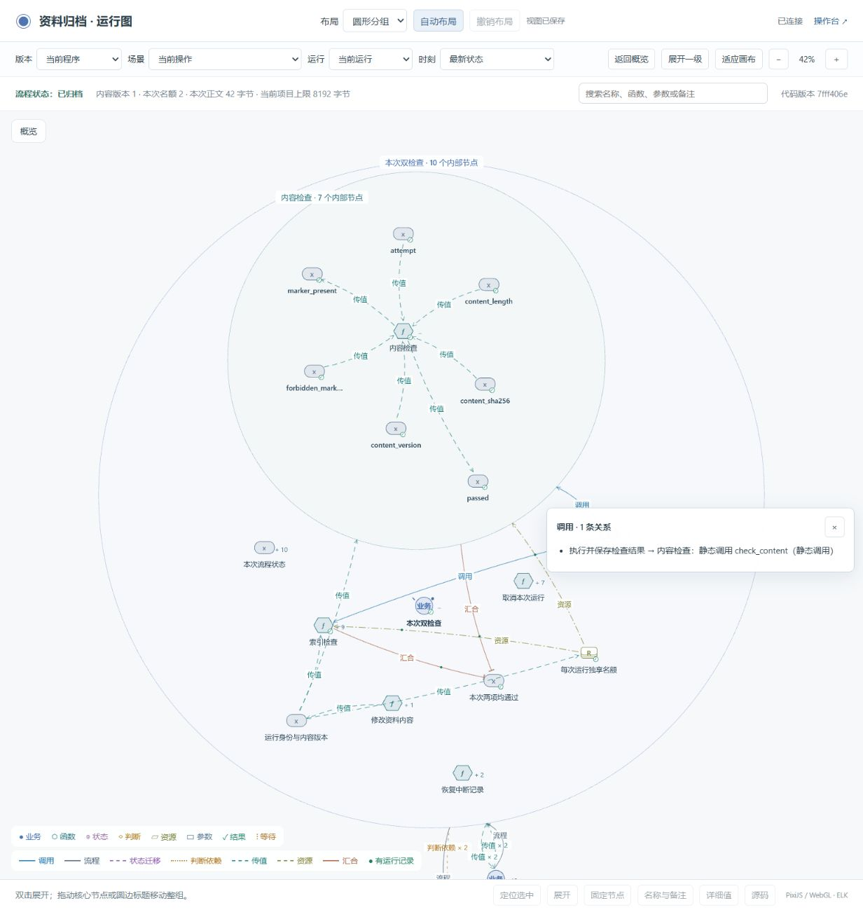

# 圆形分组与整体移动

展开一个节点后，它和内部节点组成一个圆形分组。内部还可以继续展开，形成嵌套圆。上层关系连接到分组边界，组内保留函数、参数和执行关系。折叠只改变视图，完整图和运行记录仍然保留。

## 操作

- 双击核心节点展开或收起；点击“定位选中”看清这一组。
- 拖动核心节点、圆边或圆边标题，移动整组。已收起的后代也会一起移动，再次展开时以新的位置恢复。
- 使用“圆形分组 → 自动布局”重新整理旧布局，可撤销。名称、备注和固定标记保留。
- 点击关系文字查看原始端点及每条关系的依据。汇总线上的条数表示原始关系数量。

节点用形状与颜色区分类型。连线区分调用、流程、状态迁移、判断依赖、传值、资源与汇合；运行记录用独立标记表示。静态调用不会因为显示在运行图中就被当作已经执行。

## 验证记录

已同步 Skill 模板、两个公开示例和 8824 演示。三个项目执行正常的 `inspect → verify → accept → check`，结果在 [verification.json](verification.json)。图检查覆盖圆形包含、组间避让、关系类型与原始端点、部分运行依据、隐藏后代移动及保存。

[浏览器记录](browser-checks.json)包含展开整组拖动、收起后移动再展开、刷新恢复、圆边端口、自定义名称和备注保留。测试使用单独的浏览器来源，避免与用户正在使用的布局相互影响；最后在当前页面验证鼠标点击并保存截图。

交互测试发现并修复了三个问题：关系按钮的回车误触发折叠；内层区域遮住外层标题；运行轮询关闭关系明细。关系明细现在随数据更新，切换版本时关闭，防止混用不同版本的信息。

[运行记录](runtime-check.json)核对最终加载版本、一次真实并行检查的完成状态、采集错误和丢失，以及原资料和归档快照是否保持不变。

这些是程序与浏览器检查，不代表真人易用性研究或大图性能测试。手动固定的位置与自动打包冲突时，优先保留固定位置。

实现沿用现有 PixiJS 和 ELK，没有增加依赖。层级包围参考 [D3 circle packing](https://d3js.org/d3-hierarchy/pack)，层级端点参考 [ELK graph structure](https://eclipse.dev/elk/documentation/tooldevelopers/graphdatastructure.html)。圆的大小只表示布局所需空间。
