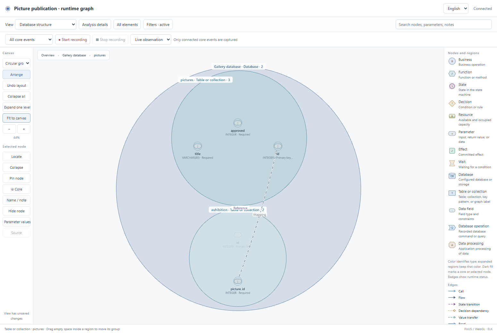

# Database observation review

Branch: `db-vis`, created from `dev` at `ab14ff7`.

Final local acceptance passed on 2026-10-24 after recovering the interrupted
Codex session. Both example baselines were preserved throughout recovery.

This update adds data structure, native queries, selected transformations and
transaction outcomes to the existing developer graph. The maintained source is
under `skills/business-observer/scripts/bo_observer/data/`; the native JavaScript
adapter is `adapters/javascript/bo_data.mjs`.

## Evidence

| Scope | Recorded result |
| --- | --- |
| Actual database metadata and schema changes | [Final collector run](final/catalog-live.json): PostgreSQL, MongoDB, Redis, Neo4j, 4 passed. SQLite uses real-file regression tests. |
| Actual Python database operations | [Final runtime](final/runtime-python.json): 4 database families; selected values, transformations, outcomes and observer exclusions. |
| Actual Node database operations | [Final native runtime](final/runtime-node.json): pg, Mongoose, redis, Neo4j driver; shared event/catalog protocol validation. |
| Graph and browser behavior | [Final browser results](final/database-browser-results.json) and [browser procedure](browser-acceptance.md): real SQLite, strict capture mapping, recording/replay, layout/filter retention, schema upgrade, failure/recovery. |
| Storage-choice dialogue | [Transcript](final/dialogue.md) and [commands](final/dialogue.json): explicitly scripted conversation with actual CLI/model-export/migration/query execution. |
| Structural regressions | [Collector and sync notes](catalog-and-sync-notes.md), [unit retest](database-unit-regressions-retest.log). |
| Recovery after the Codex restart | [Recovery run](04-recovery-data.log): repeated real database, native-client and browser checks completed. The original working tree and both active change baselines were retained. |
| Complete data acceptance | [Final combined run](08-final-data.log): 77 data unit/integration cases, JavaScript checks, four live collectors, Python/Node native operations, dialogue and browser checks passed. |
| Full repository acceptance | [Complete run](11-full-repository.log): original regression gates, multi-language behavior, installation, clean exports and both examples passed. |
| Existing delivery example | [Upgrade review](delivery-acceptance.md): all four reports passed; fresh-copy restoration passed. |
| Existing archive example | [Upgrade review](archive-acceptance.md): all four reports passed; fresh-copy restoration and ordinary validation passed. |
| Git distribution bytes | [Git-exported copy](14-git-export.log): installed the locked parser, checked all 97 runtime copies and restored both accepted examples from the actual Git index archive. |

The dialogue is a scripted simulation, not an independent AI or human usability
study. Runtime tests execute real local database servers with synthetic data.
They do not use mocked server responses as live evidence.

## Failures and repairs

- The PostgreSQL binary driver was blocked by Windows application control. The
  [first collector report](catalog-live-before-driver-fix.json) preserves the failure.
  The pinned pure Python pg8000 driver completed the real PostgreSQL retest.
- PyMongo can report a successful command transport with `writeErrors` in its
  reply. The [first runtime report](runtime-live-first.json) exposed a missed
  duplicate-key error. The adapter now distinguishes failure, partial failure
  and acknowledgement errors; the live retest passed.
- Initial browser attempts preserved in `database-attempt*.json` caught an
  invalid dependency envelope and misleading missing-target diagnostics on
  transformation/transaction events. The repaired adapters emit valid causal
  references and applicable target evidence.
- Regression tests caught missing catalog-error handling, unverified defaults
  and constraints, wrong query targets, declaration-only relation loss, stale
  managed source paths, and overly broad "matches" labels. These checks remain
  in the suite.
- A transient Windows client-port allocation failure remains in
  [the first unit log](database-unit-regressions.log). The test helper retries
  only that allocation error; assertion and HTTP failures remain failures.
- Independent review found that PostgreSQL dollar-quoted and binary literals
  escaped the original SQL summary redaction. The [failing regression](redaction-native-literals-failure.log)
  and [runtime retest](redaction-runtime-retest.log) record the correction for
  SQLGlot's native literal types. Unselected literal values are removed.
- A source parser was unavailable when an earlier example baseline was created.
  Recovery preserved that baseline and compared the unchanged source against
  its preceding accepted structure. New baselines now reject incomplete source
  scans before writing files: [first failure](baseline-parser-first.log),
  [retest](baseline-parser-retest.log). Open business questions remain allowed
  during initial modeling and continue to block acceptance when required.
- The browser fixture originally requested fields that some operations did not
  capture, and treated rollback as a successful transaction case. Its actual
  events failed the [independent mapping check](demo-mapping-first.log).
  Operation-specific selections and an explicit rollback expectation now pass
  [the same gate](demo-mapping-retest.log). Browser acceptance checks this result.
- Mixed `INSERT ... SELECT` operations need distinct read and write targets.
  The graph now supports per-target roles, including a table used in both roles.
  Actual SQLite execution, reversed-role rejection and precise animation are
  covered by [the regression run](demo-and-targets-retest.log) and the final suite.
- An existing layout test constructed data roles as invalid node kinds. The
  fixture now uses the real protocol types and retains every original assertion:
  [original failure](delivery-layout-first-failure.json). Business expectations
  and implementation checks remain intact.
- Git's default line-ending conversion changed new protocol schema bytes while
  their installation manifests retained the original hashes. The index-byte
  check rejected this mismatch in [the first distribution check](git-export-before-renormalize.log).
  Protocol schemas now retain exact bytes through Git, like the existing shared
  package markers. The staged files were refreshed and the actual Git archive
  passed package and accepted-build restoration checks for both examples.

## View review

The browser report names every screenshot and its checkpoint. It verifies a
real 12-to-7 selection and 7 committed rows, a rolled-back attempt leaving 7
rows, and zero additional business events from an observer-only query.

## Boundaries and reproduction

Follow [the example](../../../examples/database-observer/README.md) and
[the integration reference](../../../skills/business-observer/references/database-observation.md).
The graph distinguishes database enforcement, application declarations, partial
metadata and observed operations. Generic native target bindings remain labeled
as supplied by the application. SQLAlchemy MySQL integration is available through
its dialect but has no real MySQL test in this record. Other database families,
database-internal execution plans and automatic column lineage need more adapters.

The final checks ran on Windows with Python 3.13.13, Node 20.19.6 and Chrome
155.0.8059.85. Real database services ran in the provided local Docker fixture.
The GitHub Actions jobs are configured; this local record does not claim that
the remote CI matrix has run. Maintained source formatting and installed-copy
checks also passed. Original failed logs retain their captured bytes.
