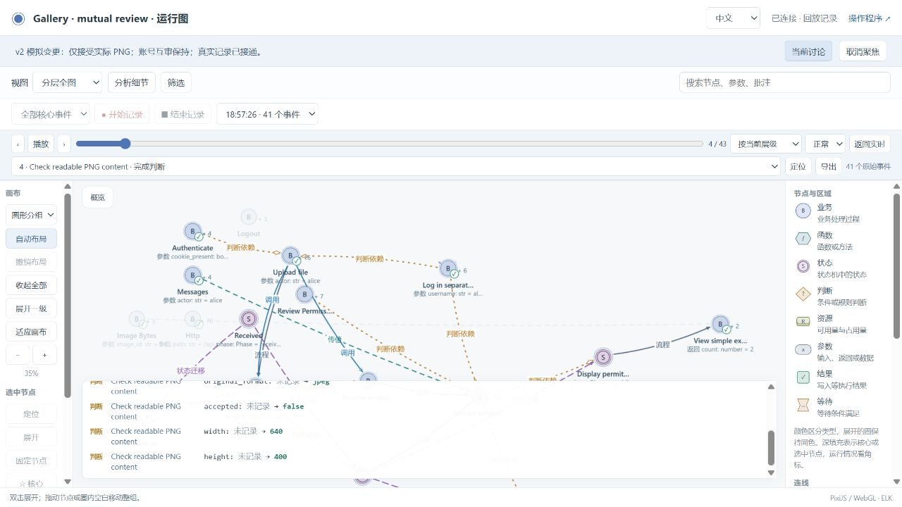

# English migration and independent gallery trials

The complete repository acceptance suite and both independent gallery trials passed their declared final scopes on 2026-10-23. Repository checks, application checks, actual browser evidence, and source-package checks are reported separately.

The request combines English maintenance, a bilingual graph viewer, a conversation-first business diagram, an illustrated introduction, and two independent Python/Node gallery development trials. This acceptance record is included in [v0.6.0](../../releases/v0.6.0.md). [Publication checks](../github-publication-v0.6.0/README.md) are recorded separately from the original local acceptance results.

## Review first

- [Illustrated introduction](../../site/index.html) and [default README](../../../README.md).
- [Current Skill instructions](../../../skills/business-observer/SKILL.md), including the opening inline diagram, mode choice, and per-iteration checks.
- [Failures, repairs, and retests](failures-and-fixes.md). Earlier failures remain failures in their original files.
- [Complete-suite result](38-full-suite-result.json) and [raw successful log](37-full-suite-retest.log).
- [Source depth, database relationships, and language policy](../../source-data-and-language.md), separating implemented behavior from extensions.

## Repository acceptance

Run `python tools/verify.py` from the repository root with the documented dependencies installed. The successful rerun exits 0. It includes installation, strict declarations, source drift, dialogue protection, independent mapping evidence, observer isolation, localization, view relations, actual execution, recording/replay, and independently executed exports without observer modules.

| Scope | Result | Evidence |
|---|---|---|
| Complete repository suite | Passed | [Result](38-full-suite-result.json), [log](37-full-suite-retest.log) |
| Earlier complete-suite attempt | Failed on stale fingerprints in the translated small Python example; retained | [Failure](32-full-suite.log), [result](33-full-suite-result.json) |
| Python modes repair | Regenerated declaration/source fingerprints; all six original mode/drift checks pass | [Regeneration](35-python-modes-regenerate.log), [retest](36-python-modes-retest.log) |
| Native Python/JS and compiled React/Vue handlers | 18 cases across drive/observe and observation on/off/fault | [Summary](25-native-app-retest.log), [full evidence](native-acceptance.json) |
| Existing delivery example | Mapping, state, business and project reports passed; 96/96 business assertions | [Gate summary](gate-summary.json), [log](30-delivery-full-gate-retest.log) |
| Existing archive example | Same four reports passed; 189/189 business assertions | [Gate summary](gate-summary.json), [log](30-team-archive-full-gate-retest.log) |
| Old/new Python service behavior | 30 real SQLite/worker scenarios passed after exact prose normalization | [Retest](22-service-parity-retest.log) |
| Product introduction | Six concept views, mixed filters, keyboard navigation, illustrative replay, copy action, Chinese persistence | [Browser receipt](28-product-browser.json) |
| Main documentation | 54 local links in six files resolve | [Link receipt](39-documentation-links.json) |
| Final portable review materials | Ten archives pass CRC and known excluded-path checks; reviewed local links resolve | [Archive receipt](40-portable-artifacts.json), [final link receipt](41-final-documentation-links.json) |

The archive's first full gate passed mapping/state/project checks but failed business checks because translated seed content changed accepted data. The repair restored the original bytes in a separate JSON data file. Its expectations were not changed. This is a concrete example of reporting faithful mapping separately from correct business behavior.

## Feature coverage and limits

| Feature | Verification and boundary |
|---|---|
| Initial conversation graph and verified Web URL | `bo_design preview` and the viewer share discovery IDs/revision; preview/focus regressions pass. Viewing a page is not confirmation. |
| Source-to-graph synchronization | Independent source inventory, stale/new/deleted source checks, protected requirements, actual value/call witnesses, and independent effects are exercised. A Skill cannot wake arbitrary inactive editors. |
| Drive and observe | Both modes pass the native scenarios. Native `bo.fsm/1` is a strict flat subset; concurrency/resource/join/recovery cases remain in the complete Python examples. |
| Runtime inspection | Real events, state frames, values and effects are tested. Capture scope and display detail are separate; unobserved calls remain unknown. |
| English maintenance and Chinese display | Source/instructions/default docs use English; explicit UI choice is preserved. Original user labels, accepted data, Unicode tests and historical evidence retain their text. |
| Project-owned configuration | Upgrade/idempotence and personal-layout preservation are checked. Public evidence excludes actual session/collector tokens and private configuration payloads. |
| Core export and Web removal | Extracted business cores actually run without observer modules; retained declarations still execute. |
| Complete static code browser and generic database lineage | Analysis/proposal only, not an implemented or measured completeness claim. |

These are finite engineering checks and independent AI development trials. They are not a human usability study, a production benchmark, or proof of all program paths.

## Preserved evidence

- 01-view-regression.log: expected failed assertion after English UI labels changed.
- 02-view-coverage.log and 03-colors.log: relation coverage and type-color checks.
- 04-preview-tests.log: conversation/Web continuity checks.
- 05-language-tests.log: multilingual protocol/source regression.
- 06-view-regression-retest.log: repaired English expectation, same invariant retained.
- 07-refactor-retest.log: stale copied static projection detected before regeneration.
- 08-english-template-preview.log: translated template and preview retest.
- 09-python-prose-migration.json and 10-web-prose-migration.json: maintained source migration scope.

Original historical evidence under other review directories is not rewritten. Exact bilingual display/reason translations used by the old/new parity comparison are in tests/fixtures/language-migration.json; all compared fields, states, types, transitions, resource counts, and effects remain checked.

## Independent trials

Two user-requested new conversations use separate frozen copies, application projects, databases, and acceptance records.

| Trial | Conversation | Intent source |
|---|---|---|
| Python gallery | 01a167ea-5003-7b22-8514-7a532e64ccf7 | Explicitly labeled simulated requester; fixed uploader/reviewer roles |
| Node.js gallery | 01a167ea-616e-7311-b0e1-67d027f14263 | Real user specified mutual review across accounts; subsequent test confirmation labeled simulated |

The Node project must not be silently changed to the Python persona's role model. Both use actual image validation, in-app notification, approval/rejection, and a public exhibition.

Candidate 3 has 144 files. Its manifest SHA256 is fd022e1377b17e2679a8e1e8e0b9cbba51d1bb41c2f4af017383cc7dab1ccb8c. [Frozen archives and file hashes](frozen-skills/index.json) preserve all three candidates. The [canonical comparison](34-frozen-comparison.json) finds only one removed trailing blank line in SKILL.md after the freeze; executable and viewer files match candidate 3.

Both trials preserve v1 and apply one explicitly simulated v2 request: allow actual PNG only, reject JPEG/other formats without a review notification, and retain the confirmed authority/review/exhibition rules.

| Final trial | Four acceptance categories | Actual final browser recording | Review materials |
|---|---|---|---|
| Python / fixed uploader and reviewer | All passed; 162/162 business assertions; 13 project tests; 18 mapped features | 58 events, two state frames, no gaps; JPEG rejected without rows/messages, PNG reviewed and published | [Review index](trials/python/REVIEW-INDEX.md), [final reports](trials/python/evidence/v2-final-four-reports.json), [source](trials/python/gallery-v2-source.zip), [evidence](trials/python/gallery-review-evidence.zip) |
| Node.js / accounts review each other's uploads | All passed; 63/63 business assertions; 11 mapped features | 41 events; JPEG rejection followed by PNG review/publication; zero collector errors/drops | [Review index](trials/node/REVIEW.md), [final reports](trials/node/review/changes/png-only-v2/verification.json), [source](trials/node/gallery-v2-source.zip), [evidence](trials/node/gallery-trial-evidence.zip) |

The projects differ in their confirmed permission model and implementation; their event or assertion counts are not a language-performance comparison. Both demonstrate real login, content decisions, in-app messages, review, public queries, source synchronization, recorded changes and independent effects.

Python's final project also fixes a reproduced same-host cookie collision by using a project-specific session name. Actual HTTP before/after requests and a new regression retain CSRF checking. The old isolated login failure's historical cause remains unproven. The pre-repair v2 evidence is retained separately.

These conversations began on candidate 1, retained their original answers, and moved through candidates 2 and 3 to verify repairs. Candidate-3 results cover public upgrades, current preview/focus, retained configuration, full application gates and final browser operations. They do not retroactively turn the first missing inline diagram or failed browser attempt into a pass, and they are not two additional conversations started afresh on candidate 3.

Python's redacted v1/v2 source archives were extracted and run with the existing local dependency environment. Node's full source archive was hash/inclusion checked; its observer-free cores were actually executed. A fresh network dependency installation of either portable package is not claimed. Evidence packages retain raw failures and retests; explicitly redacted copies have their own manifests and leave local originals unchanged.

Python's final report was corrected to consistently name the final build, 13 project tests and final recording. The pre-cookie report remains byte-identical in a separately labeled checkpoint. Packaging/report helper snapshots were finalized after source extraction checks; [the byte comparison](trials/python/evidence/final-artifact-equivalence.json) confirms the accepted application, runtime, declaration and Skill inputs match the executed copies. No passing business test was relabeled or rerun for this documentation correction.

This is actual recorded execution: the decoder reads JPEG successfully, while the confirmed format rule rejects it. The public introduction's concept diagrams below are separate illustrations.

## Verified defects repaired in the common Skill

- Windows runtime metadata path separators could misclassify an unchanged managed viewer as application source.
- Chained calls at one location could produce colliding implementation-question identities.
- Design focus read a valid bo-project/v1 document as a bare model.
- A live phase display assumed optional machine.labels existed.
- Replay guessed semantic labels from string values, confusing business pending with activity pending.

Regression cases retain path/hash conflict checks, each chained target's confirmation obligation, wrapped/plain model loading, omitted labels, and the distinction between project phases, activity enums, and raw captured values. The frame integration reference now explains partial snapshots without allowing missing state-boundary frames.

## Product introduction

[Interactive introduction](../../site/index.html) · [Source/data/language analysis](../../source-data-and-language.md)

The introduction is an explanatory static site. Its graphs and replay examples are illustrations, not recorded production facts. The browser receipt covers a desktop in-app browser; mobile/device testing is not claimed. The real gallery trials have their own operation recordings and screenshots. [Delivery URL checks](42-delivery-urls.json) confirm the introduction and both application/graph pairs were reachable when delivered; these local servers are not permanent hosted deployments.

