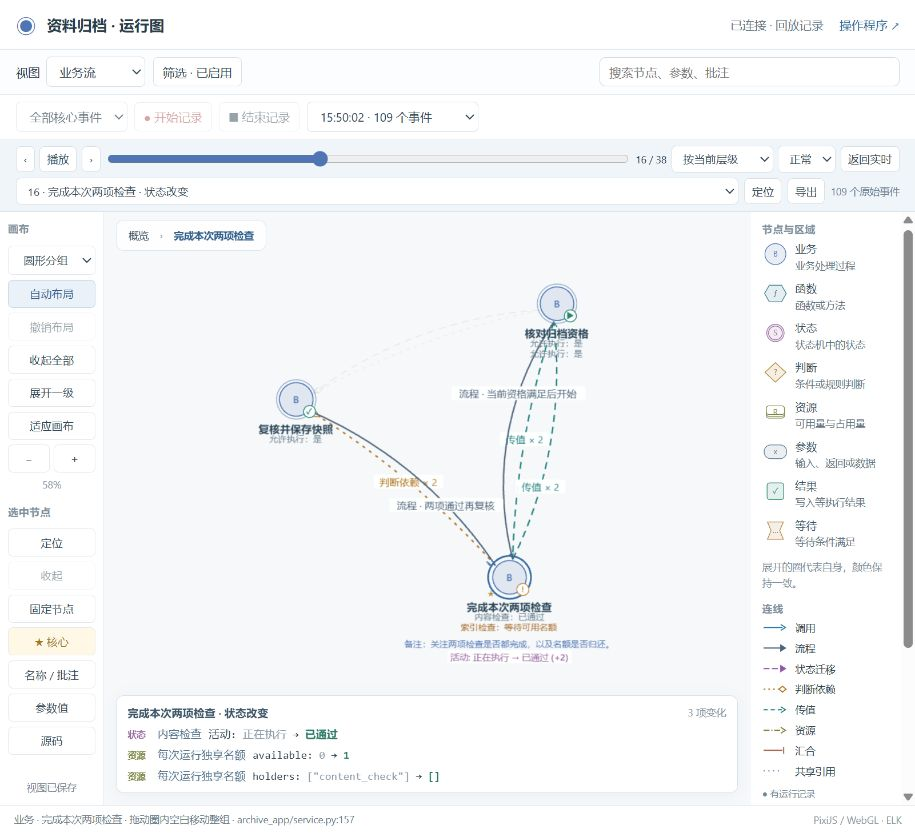
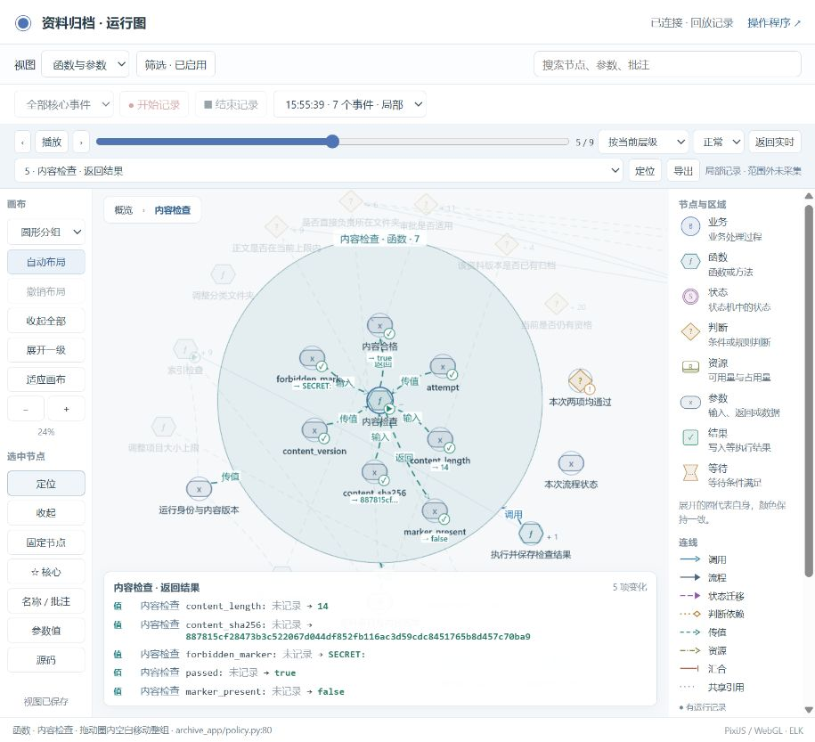

# 聚焦记录与分层回放

本轮针对开发者的日常调试：记录一次操作，先看业务变化，再下钻到函数、参数和源码。图操作不改变业务执行。

## 直接使用

1. 打开运行图，选择业务流、状态机或函数等视图。
2. 选择“全部核心事件”，或先选节点/圈，再选择“仅选中区域”。点击开始记录。
3. 在操作程序中执行一次操作，回到图中结束记录。
4. 用播放、上一步、下一步查看变化；切换视图或展开节点可改变显示粒度。选择“逐个原始事件”可查看采集明细。
5. 选择节点后，用“名称 / 批注”和“☆ 核心”保存自己的关注点。选择记录、分析视图与筛选不修改程序。

上方只保留分析、搜索、记录和回放。画布与节点操作在左侧，图例常驻右侧。原来的版本、测试场景、运行、时刻选择器与长状态横幅已移出主页面；既有记录保留，源码身份仍随记录绑定。

## 本轮检查

三份项目（交付示例、归档示例、当前运行程序）均执行原有业务、图、白盒、一致性、隔离与新增记录回归入口，结果见 [verification.json](verification.json)。没有修改权限规则、状态机条件或业务预期。业务源码的变动仅为观测调用增加 bo_ 前缀，使用 AST 还原调用名后与原代码对照相同。

真实操作了两次合成归档运行：

- 全部采集：一个名额，两项检查依次执行，保存 109 个探针事件与 2 个操作标记。业务视图 38 步，函数视图 111 步；两者包含的开始/结束边界和操作标记不同，均不删除底层事实。切换前后保持同一原始事件游标。
- 局部采集：选择内容检查，使用两个名额。保存 7 个事件，仅包含内容检查和完整状态版本的边界；索引检查仍正常执行并通过，其函数载荷没有进入这份记录。结束后恢复默认采集。

范围、来源、缺口、旧记录与原资料保留情况见 [runtime-checks.json](runtime-checks.json)。浏览器验证见 [browser-checks.json](browser-checks.json)。记录从原来的 3 份增至 5 份，既有记录原文件未变；资料、已归档快照和此前 13 次运行均保留。

复测中修正了两个问题：不同审批调用的参数不再被误表示为同一值变化；业务视图不再展示隐藏函数的逐条 ID、时间参数变动。资源取用与归还分别标明方向，状态和数值仍以实际事件及执行记录为依据。

## 截图

业务步骤直接显示活动状态与可用名额的变化。

下钻查看内容检查的输入和返回值；局部记录明确提示范围外未采集。

## 表达边界

[类型、规则和采集方案](../../../skills/business-observer/references/types-rules-capture.md) 区分已实现与后续接入：当前静态分析识别 class 与方法，但没有通用对象堆/实例视图；当前规则示例没有接入 DMN、OpenFGA 或 SpiceDB 的通用解释适配器。规则结构与本次实例绑定、最小关系解释子图的方案已写入 Skill。

当前采集是显式观测端口与同进程后台线程，不是独立采集进程。全部采集只覆盖已接入的核心探针，不能保证每行代码、每个变量或每个函数都有记录。局部记录保留必要的完整状态边界，但不能补录范围外的函数值。当前检查是选定场景和浏览器操作的证据，不是全程序语义证明、负载基准或真人易用性研究。
