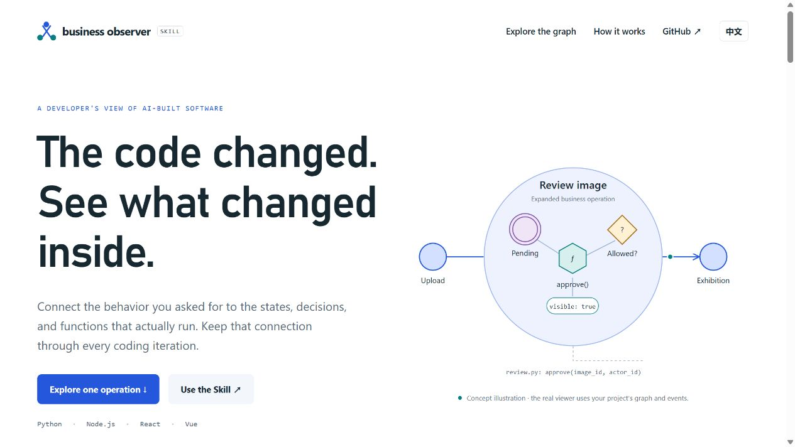

# GitHub publication acceptance — v0.6.0

This record supplements the [independent gallery trials](../english-gallery/README.md). It tests publication, installation, clean checkouts and the live bilingual introduction. It does not replace or rewrite earlier trial evidence.

## Publication results

- The [GitHub Pages introduction](https://li-bruce.github.io/SoftwareStatusObserverSkill/) is live. The account's existing custom domain redirects it to `liblog.vip/SoftwareStatusObserverSkill/`; no domain setting was changed.
- English/Chinese switching, retained language preference, mixed graph filters and the matching documentation link were tested on the deployed page. The product animation is illustrative, not connected to a user's application.
- Clean-checkout fixes and their full cross-platform retest are recorded below. Final release and installation receipts are added only after the corresponding operations succeed.

## Failures, fixes and retests

| Finding | Repair | Evidence |
|---|---|---|
| Shared package markers changed bytes during Git checkout; working-directory checks had not exposed it. | Preserve their exact bytes consistently in canonical and installed copies. | [Ubuntu failure](01-ubuntu-clean-checkout-failure.log), [Windows failure](02-windows-clean-checkout-failure.log), [clean-export retest](03-clean-export-package-retest.json). |
| Original historical dialogue contained links to paths on the author's machine. | Preserve the original transcript; require its exact hash and an explicit archived target or external-only annotation. Reject unregistered absolute paths and invalid archive members. | [Ubuntu failure](04-ubuntu-historical-link-failure.log), [Windows failure](05-windows-historical-link-failure.log); six cases in `tests/test_document_links.py`. |
| The runnable example's dependency audit reported advisories. | Update Vue and Vite within their current majors; retain source-parser pins and rerun actual native cases. | Dependency and native-test receipts in this directory; the audit is not a security certification. |
| A deadlock regression tried to read an untracked runtime manifest on a fresh clone. | Read the shipped `.release/manifest.json`; retain the original lock-order assertions. | [Original failure](13-windows-fixture-manifest-failure.log). |
| Linux source analysis failed with `EAGAIN` when the JavaScript scanner synchronously read a nonblocking input pipe. | Consume the input stream to EOF before decoding JSON. Test delayed input, large fragmented UTF-8, truncated/empty JSON and malformed source. | [Initial failure](12-linux-architecture-failure.log), [diagnostic](14-linux-pipe-diagnostic.log); `tools/test_source_pipe.mjs`. |
| The archive example's reviewed working files used CRLF while Git stored five of them as LF. | Align current authored files with their committed LF bytes, then inspect, verify and accept a new candidate. Keep the previous accepted candidate unchanged. | [Windows failure](15-windows-archive-baseline-failure.log), [exact differences](16-archive-export-difference.json). |

No mapping, business, state or project assertion was removed to obtain a pass. The final acceptance remains tied to exact source and tool identities; missing evidence remains a failure.

## Review the records

Numbered JSON files contain command receipts and exact identities. Raw logs preserve failures as failures. `17-example-acceptance.json` records the new delivery/archive candidates and four separate reports. Both canonical and copied command entrypoints must accept the same candidate.

Installation is tested in an isolated project folder using the official Skill installer against GitHub. It does not overwrite the maintainer's globally installed Skill. File hashes are compared with the published Git tree; an installed CLI validates the real multilingual example with separately installed parser dependencies.

## 中文说明

本目录补充 GitHub 发布验收，保留云端失败、具体修复和复测记录。原有试用对话与历史证据不改写；映射、状态约束、业务规则和项目测试仍分别验收。

介绍页已发布，支持中英文切换并记住选择。GitHub Pages 会沿用账号已有域名并自动跳转。真实测试请按 [版本说明](../../releases/v0.6.0.md) 安装完整 Skill，在目标项目新建对话使用 `$business-observer`。
