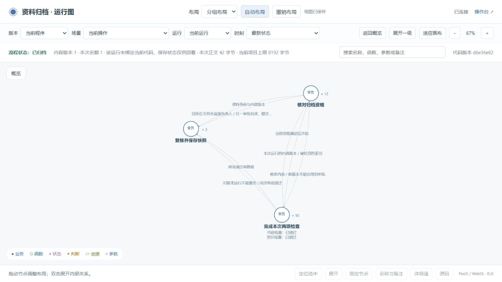
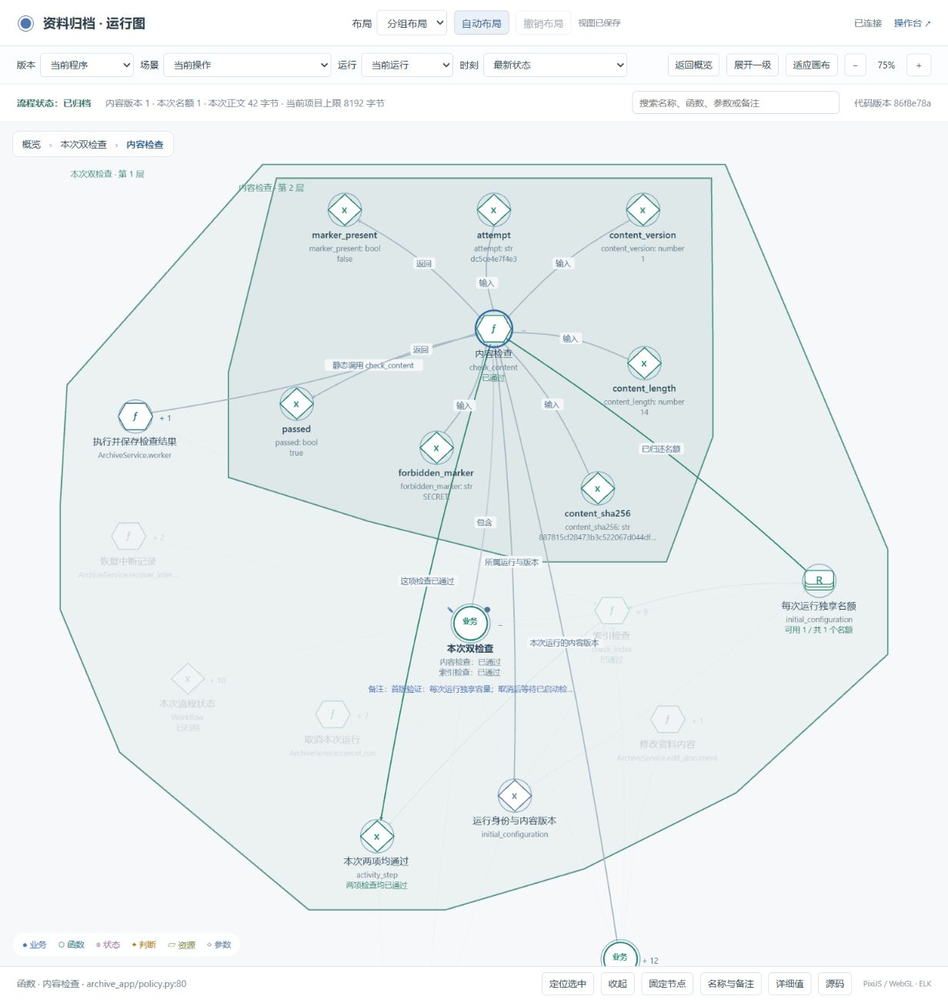

# 层级图交互检查

2026-10-20。对应本地后续修改，尚未发布为新的 GitHub 版本。检查对象是开发者运行图、共享 Skill 模板及两个示例；原有 v0.4.0 审查记录保留。

## 这次改变

- 首次打开只显示高层节点。已有浏览器视图仍恢复原坐标、展开范围、固定、名称和备注。
- 默认“分组布局”按已有 `parent` 安排完整子树，子节点围绕父节点；用逐层嵌套的淡色区域显示归属。
- 点击节点，突出它的直接关联和所属区域；点击展开的父节点，突出其可见内部及对外关系。其余内容淡化。
- 增加层级路径、子节点数量、定位选中（F）和返回概览。双击节点或区域标题展开/收起；点击空白或 Esc 清除高亮。

布局使用项目已有的开源 PixiJS 和 ELK，没有引入新的第三方资源。空间层级参考 [ELK 的包含树](https://eclipse.dev/elk/documentation/tooldevelopers/graphdatastructure.html)。父子包含与调用、传值、判断依赖仍是不同关系。

布局只在首次打开或明确执行自动布局时计算；运行刷新保留坐标。固定位置优先。手动把不同组拖到一起时，区域可能重叠，不能仅靠包围区域判断节点归属，应同时看层级路径。

## 检查与修正

| 检查 | 结果 |
| --- | --- |
| 新浏览器地址首次打开 | 仅 3 个高层节点，默认分组布局 |
| 业务 → 函数 → 参数 | 同一画布逐层展开，内层区域在外层内 |
| 点击参数 | 参数、所属函数、祖先区域突出，无关分组淡化 |
| 拖动、固定、改名、备注 | 刷新、父节点折叠再展开、版本切换后保留 |
| 参数到源码 | 能打开其采集函数的源码；历史绑定显示历史版本 |
| 关闭详情后按 Esc | 首次发现焦点离开图；已修正并复测清除高亮 |
| 固定父节点后自动布局 | 首次发现其他组可能落入其区域；改为先预留固定组空间 |
| 较大子分组展开 | 统一半径造成过大留白；改为按每个子树的尺寸分别留空间 |
| 运行刷新 | 实际运行经历执行、等待名额、两项通过；节点坐标保持不变 |
| 实际效果 | 原资料和已归档快照不变，没有重复生成归档 |

浏览器过程与坐标断言见 [交互结果](browser-checks.json)，真实程序与 SQLite 核对见 [运行结果](runtime-result.json)。测试使用原示例的合成资料；本轮新增两次运行、一条限时测试审批，旧记录保留。

`tools/verify.py` 整体通过，包括澄清、源码与图同步、业务场景、历史事实、HTTP、安装及移除观测层后的业务包。最后修正键盘焦点后，三个项目的实际验证与浏览器交互重新通过。记录见 [验证摘要](verification-summary.json)。

两个仓库示例的 `.release` 保存了本次已验收记录；已在没有本地 `.stategraph` 的新目录验证恢复，见 [干净目录检查](fresh-export.json)。没有把新检查结果写回旧的 `review/v1`、`review/v2` 材料。本次是自动化与代理操作检查，不是真人试用，也未验证大图性能。

## 看图方式

先看高层节点，双击需要理解的业务，再展开函数。颜色区域表示“属于哪里”，节点形状表示“是什么类型”，节点旁的值表示实际采集内容。选中后按 F 查看内部；用左上角层级路径返回上层，用“返回概览”收起内部。

## 后续交互建议

1. **关系筛选**：按调用、传值、状态变化等类型显示边。适合参数较多、连线交叉时追踪一个具体问题；应显示被隐藏的关系数量。
2. **观察位置的前进与后退**：记录每次搜索、展开和定位时的选择与视野。查完下层参数后可回到之前的位置，不必重新缩放。
3. **整组拖动**：通过区域标题移动整组，节点本身仍可单独拖动。需明确固定节点是否随组移动，避免破坏已保存的位置。

这些建议尚未实现。本次已提供的层级路径、定位选中和返回概览可以先覆盖常见的迷失位置问题。
