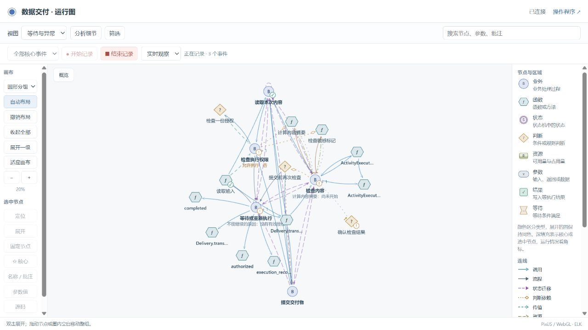
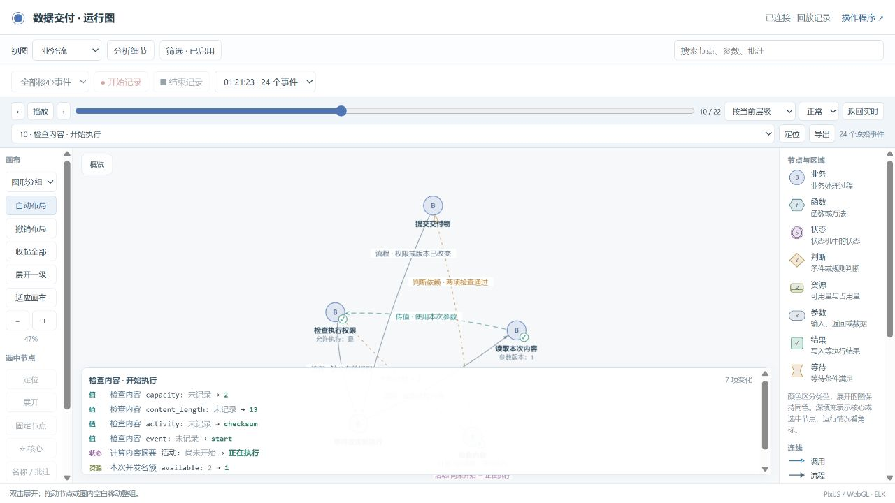
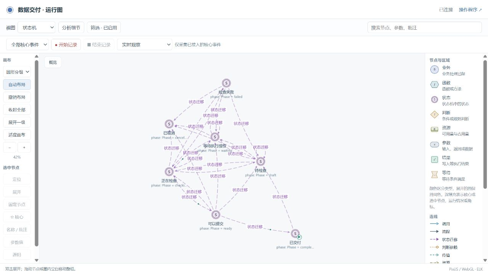
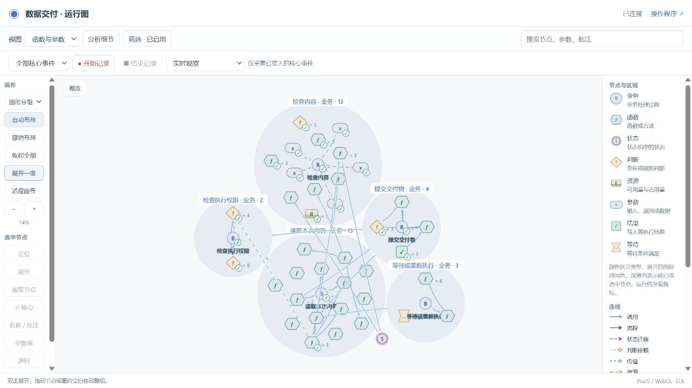

# 实现覆盖与视图关系修复

2026-10-23。本次修改本仓库的 Skill、公共运行模块、图页面及两个示例。原 `file-review` 试用项目只读检查，未修改其代码和数据。基线提交为 `72164b9`。

## 问题与处理

原检查可以验证已经声明的节点，却没有要求所有实现都有对应。试用项目把登录、会话、消息查询等函数写入排除说明；上传函数虽有源码关联，`note` 没有采集要求，检查仍能通过。新检查从源码清单出发，逐项核对功能、图节点、参数和真实场景。业务辅助功能也要纳入，不能以“其他测试覆盖”跳过。

新增 `bo-implementation/v1` 实现覆盖契约，生成器读取 `implementation.json`。功能入口必须具备业务可见节点、源码身份、参数处置和实际事件；辅助实现保留源码节点及可解析调用。新增源码、路由、未归属函数、遗漏参数或漏采字段都会阻止阶段验收。关键值使用独立结果或存储值比较，密码等敏感参数只保留安全摘要。登录、配置等任务之外的事件可显式标记为应用范围，普通任务事件仍保持隔离。

视图的几个遗漏已修复：

| 原因 | 修复 |
| --- | --- |
| 业务视图只认一种节点外形，通知等结果节点被过滤 | 业务归属与节点类型分开，保留操作的原类型和实际关系 |
| 业务节点上的函数参数没有展开节点和连线 | 同样生成输入、输出及传递关系，回放保留自身值变化 |
| 状态机使用生成的状态 ID，已有节点使用另一套 ID | 状态迁移、执行范围及共享关系统一使用声明中的状态身份 |
| 筛选节点后直接丢弃另一端，留下孤立节点 | 保留一跳真实端点，明确标为“筛选边界”；不合成跨越中间节点的直接关系 |
| 调用边在选择与绘制时分类不同 | 使用同一套关系分类；自定义类型、层级和空边集合均受回归测试约束 |

折叠只影响显示；筛选边界不表示执行成功。未发生运行、没有等待或没有相应关系时，空视图是正常结果。

## 失败、修复与复测

| 证据 | 结果和修复 |
| --- | --- |
| [原试用项目只读检查](trial-readonly-audit.json) | 登录、消息接口缺直接源码节点，`note` 缺采集绑定。路由清单同时包含观测接口，不能把清单数量当作遗漏的业务功能数量。 |
| [旧页面回归失败](failure-legacy-view.txt) | 对旧提交运行新增回归，业务视图漏掉通知节点，退出码 1。 |
| [审批事件失败](failure-approval-observation.json) | 新检查查出归档示例的授权事件放错位置，事件及字段均缺失。移至授权成功提交后记录，复测通过。 |
| [首轮完整验收失败](failure-full-suite.log) | 规范脚本与项目核心转发入口的工具指纹不一致。统一等价入口的指纹；改动过的转发代码仍改变指纹，未放松版本绑定。 |
| [折叠边界回归失败](failure-folded-boundary.log) | 浏览器实测发现边界函数保留了，但调用来源折叠后连线被丢弃；[失败截图](failure-view-waiting.jpg)。现在连线连接所属区域，仍保留原始函数端点作为关系依据。 |
| [最终完整验收](retest-full-suite.log) | 保留原有检查并加入实现覆盖及视图筛选测试，最终退出码 0。 |

新增 Python 回归共 17 项，包括漏掉登录、把入口归为辅助实现、排除业务文件、漏采说明、删除通知事件、真实值与采集值不同、删除原有采集要求以及工具入口一致性。Node 回归覆盖所有预设视图、参数归属、状态身份、资源与共享关系、自定义层级、明确关闭连线以及业务节点回放。

两个示例分别通过实现映射、状态约束、业务规则及项目检查；也运行了导出后不含观测器的核心程序。验收记录：[交付示例](delivery-verification.json)、[归档示例](team-archive-verification.json)。另外验证了只从仓库文件恢复的[新副本](fresh-release-check.json)。其中实现覆盖契约分别检查 10 / 19 组功能、19 / 41 条场景事件；这些数量不代表穷尽所有路径。

## 页面复查

通过本机浏览器实际切换业务流、状态机、函数与参数、权限、资源、数据、运行、等待和共享视图。当前显示关系及文本记录在 [浏览器记录](browser-views.json)；该数量是当前层级的关系组，不是完整图边数。

最终使用从仓库文件恢复的独立副本操作：开始记录 → 无授权时等待 → 批准当前版本 → 检查并提交 → 结束记录。实际得到 1 个交付物、24 条事件；业务回放的第 10 步展示参数、活动和资源共 7 项变化。完成后业务、状态、函数和实际运行视图分别显示 6、23、39、30 组关系；此时等待视图为零，因为已无等待活动。此前等待时的关联见下图，原来孤立的 `execution_record`、`authorized`、`completed` 已连回折叠区域。最终页面未记录运行错误。









## 复现和使用

在仓库根目录运行：

```text
python -B -X utf8 tools/verify.py
node tools/test_view_coverage.mjs
python -B -X utf8 tools/test_implementation_coverage.py
```

Skill 已同步要求 AI 在每个编码阶段处理独立源码清单、更新图和探针，再执行 `inspect → verify → accept → check`。用户仍通过对话确认含义，无须维护这份清单。旧项目升级运行模块后，需要补齐实现契约、遗漏的映射和采集；没有清单会明确失败，不会沿用旧的通过结论。具体协议见 [实现覆盖](https://github.com/li-bruce/VibeLens/blob/v0.7.0/skills/business-observer/references/implementation-coverage.md)。

本次没有修改原试用项目，也没有据此宣布其登录和消息图已经修复。静态扫描及有限运行场景不能证明任意动态分派、所有执行路径或自然语言意图；未解析调用、未观测辅助实现仍保留边界。映射正确与业务正确继续分别报告。
