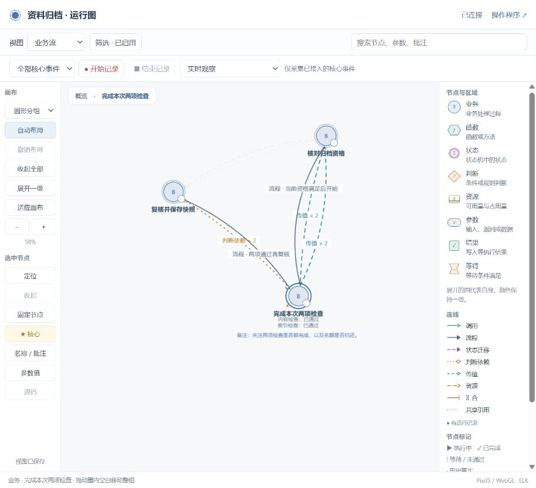

# 独立状态网与两种开发方式

默认由 Skill 在 AI 工作过程中依据状态网引导开发，用户继续提需求、回答必要的业务问题、查看图。用户明确不采用该方法时，AI 跟随其代码设计。**两种方式都必须维护底层监控、按源码调整状态网、参数/函数关联、图和一致性检查。** 不用状态机指导开发，不代表停用观测。

开发引导与执行引擎已分别记录。依据状态网设计普通 Python 函数是支持的方式，不强迫项目引入状态机库，也不在用户界面增加内部开发流程开关。

## 实现

- 独立标准库模块 `bo_stategraph.py`：保留完整声明与关系结构，提供实例查询、迁移核对、定义比较及 JSON 导出。没有运行时仍可查询结构；缺失运行事实保持未知。
- 示例的 `sync.json` 固定模块位置及两种独立选择；无论哪种开发方式，都要求静态和运行探针检查。移除已接入模块/配置或状态声明会失败。切到跟随开发需要记录用户明确选择。
- 完整示例新增 `/api/stategraph` 与 `/api/stategraph/export`；导出包含完整模型、实际配置、保留事件、源码绑定和采集健康情况，不受页面折叠/筛选影响。
- 已同步本机安装的 Skill；下一会话可继续使用 `$business-observer`。旧安装已备份，未安装全局编辑器钩子。

## 实际验证

检查结果见 [verification.json](verification.json)。本次验证：

1. 独立模块 11 项检查：结构常驻、迁移和类型偏差、缺少条件、修订间隙、构建/实例隔离、完整导出、完整性损坏，以及两种开发方式都保留探针要求。
2. [Python 示例](../../../examples/python-modes/README.md) 5 项检查：真实执行等待/恢复/完成、拒绝重复提交、实际参数与提交次数、观测失败隔离、源码改动导致旧绑定过期。两种执行方式导出相同模型和实际实例，参见 [普通代码输出](observe.json) 与 [状态机执行输出](drive.json)。
3. 仓库原有 unittest 集合 46 项通过；交付示例、归档示例和当前运行副本均通过 `verify → accept → check`，包括已有业务、白盒、并发、记录和图检查。
4. 当前服务已加载新构建，源码绑定为 `current`。导出 59 个节点、124 条关系和 15 份实际运行配置，与同一服务的完整图逐项比较一致。
5. 更新前后业务数据一致，原有 5 份记录原文保留；页面已重新加载并显示“已连接”，原核心标记和观察视图保留。
6. [真实 CLI 的 9 步反例检查](policy-checks.json)通过：跟随用户实现仍不能删除运行探针要求、独立模块、状态声明或已接入配置，未表态不能算退出引导。原有需求澄清门禁的 13 步集成演练也通过。

## 范围

模块不是新的业务权限源，图操作不会直接调用业务。`drive` 示例使用 `transitions` 执行；`observe` 示例使用普通 Python 分支，模块只接收实际快照。关闭采集不删除结构，但不能宣称还在获得未采集的运行事实。

源码适配由使用 Skill 的 AI 在每轮开发中完成，静态解析和项目检查帮助发现遗漏；没有声称任意编辑器里的所有修改都会自动正确建模。验证覆盖指定行为与反例，不证明全部动态代码、所有调度或真人易用性。
