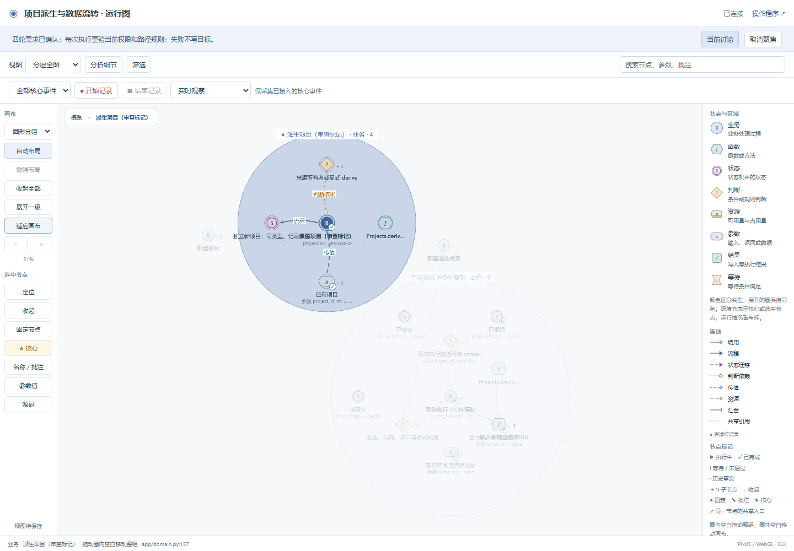
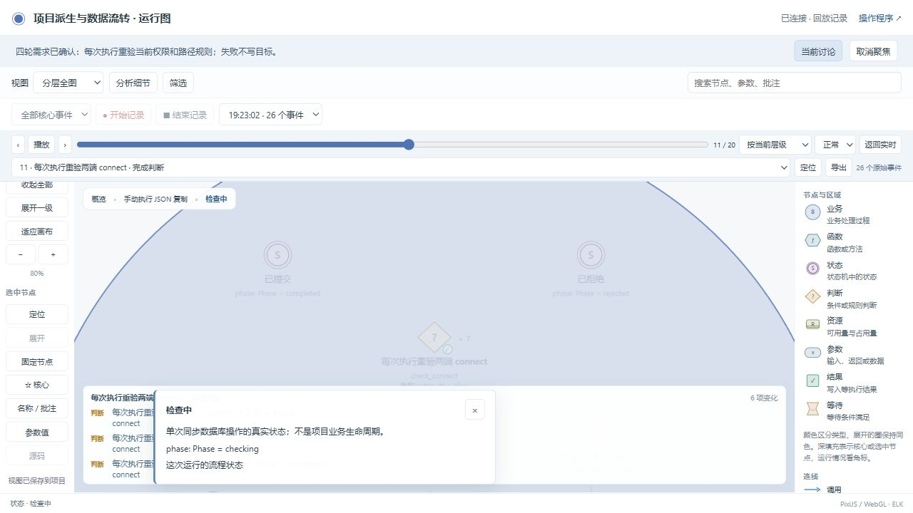
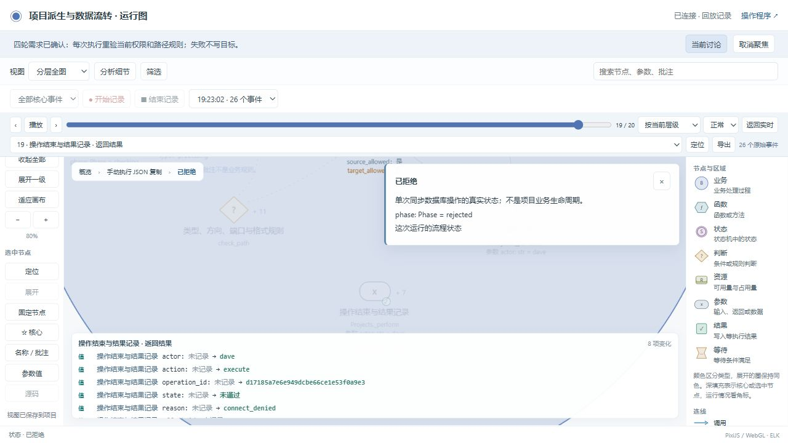

# 项目流转：独立对话试用

状态：首版、监控修复和已授权的跨类型派生迭代均已完成，失败记录保留。日期：2026-10-22。

本次用独立 Codex 会话试用本地 `business-observer`，完成必要澄清、反例确认、设计图、实现、运行监控、失败修复、需求迭代和复测。需求方由协调会话模拟，不是真人易用性试验。

模拟用户的原意在开发会话开始前写入 `intent-fixture.md`。开发助手只接收原始需求和实际问答，不读取该文件或评价规则。问答按真实发送/返回记录，结束后补充检查结果、源码位置和复现方法。[输入完整性复核](execution/input-integrity.json)确认冻结的意图、Skill 主文件和需求对话参考未变，当前安装的 93 个文件与本地源码一致。

## 先看结论

**这次对话符合调整后的职责边界，但首轮实现没有完整遵守 Skill。** 助手用三个问题组澄清派生内容、权限、类型与端口；用一个撤权情境确认“按已有连接执行”的含义。答案清楚后进入实现，没有推荐审批、调度、重试或额外内容校验。首轮白盒约束后补、运行图协议接线不完整，说明现有文字要求和检查还不能保证一次执行不遗漏。

项目接入问题已修复并复测。白盒约束后补是历史流程偏差，不能追认为编码前已完成。本次没有改动共享 Skill 运行库，也没有将项目修复描述成通用工具已解决同类问题。

- [实际对话原文：33 条可见消息](dialogue.md)；包含问题、模拟用户答复、环境协助、审查反馈及后续迭代。
- [最新迭代审查](iteration-review.md)：新类型参数、图更新、旧规则保留、失败和复测。
- [过程观察与失败说明](observations.md)；[审查口径](review-criteria.md)。
- [命令入口分析](command-entrypoints.md)：一个 Skill 入口足够，后台维护无需用户逐条调用。
- [程序](http://127.0.0.1:8870/) · [开发者运行图](http://127.0.0.1:8870/graph)。本机服务已验证可访问，重启方法见下文。

新会话：`项目流转系统 · business-observer 独立试用`，ID `01a1631b-9f3e-7b90-b060-dfd653d19872`。

## 最新迭代结果

派生现可指定已有类型，省略时沿用来源；仍不复制数据、连接或授权。本轮新增白盒约束在实现前冻结，先在旧实现测出失败，再完成修改和复测。规则变更缺少历史副本曾被同步检查拦住，补齐记录后才通过。

完整项目验证为 33 场景、408 次业务断言、24 项白盒检查、19 个 unittest 方法；独立审查新增 25 项检查及原有 18 项回归通过。原有 28 个图节点身份保留，新增 1 个类型判断；坐标、名称、批注和核心标记仍在。新录制的 26 个事件均有实际状态帧。详细证据在[最新迭代审查](iteration-review.md)。

[最新可运行源码](snapshots/03-derive-type.zip) · [最新完整证据包](snapshots/03-derive-type-evidence.zip)。源码包已在新目录实际启动，通过 HTTP 跨类型派生及图导出等 7 项检查。[包验证](execution/iteration-package-smoke.json)

## 对话如何确认原意

| 步骤 | 实际发生的事 | 判断 |
|---|---|---|
| 初始理解 | 助手最初按创建→派生→配置→流转描述；模拟用户明确独立创建的项目也可以连接 | 接受修正，最终图保留独立项目连接关系，不把派生作为前提 |
| 必要澄清 | 询问派生保留内容、两端权限和预设端口规则 | 直接影响节点、条件或实际效果，没有给推荐规则 |
| 新的歧义 | 用户要求手动传 JSON 后，追问执行时的权限 | 只补问新出现的写入条件，没有重问已回答内容 |
| 反例确认 | 用户同时说“执行要有两端权限”和“配置时已经授权”，助手问目标端撤权后还能否执行 | 检验既有表述的两种解释，没有借反例推荐新业务 |
| 停止追问 | 确认每次重验权限和端口规则、失败不写目标后，进入实现 | 没有继续要求完善所有可能的业务规则 |

[13 项记录检查](dialogue-artifact-checks.json)验证问题状态、图节点身份和未回答时的阻塞行为。文字含义由上述逐条审查判断，脚本没有自动证明自然语言语义。

## 首版实现与独立复核

| 范围 | 本次结果 | 证据 |
|---|---|---|
| 独立业务复核 | 18 项通过：创建、派生不继承、两端权限、类型/端口、撤权及规则变化后拒绝、当前 JSON 复制、采集异常隔离、非法状态定义/迁移拒绝 | [实际存储结果](execution/02-initial-repaired/report.json) |
| 项目验证 | 25 场景在开启/关闭/故障三种采集模式运行；222/222 次断言、17 个单元测试方法通过 | [最终验证原件](execution/03-initial-delivery-audit/verification.json) |
| 源码与图 | 87 个实际值见证、1560 项字段对照；当前源码、架构门禁通过 | [独立交付审查](execution/03-initial-delivery-audit/report.json) |
| 状态回放 | 修复前 26 事件、0 帧；修复后 26 事件、26 帧，检查中/已提交/已拒绝分别可还原 | [失败](execution/frame-binding-before.json) · [复测](execution/frame-binding-repaired.json) |
| 导出一致 | 公开导出包含与保存记录相同的 26 个事件帧，当前声明与公开模型一致 | [独立交付审查](execution/03-initial-delivery-audit/report.json) |
| 个人视图 | 设计阶段保存的坐标、名称、批注和核心标记在运行及修复后保留，同一节点可展开 | [浏览器复测](browser/11-repaired-personal-view/report.json) |
| 故意错误 | 两端权限 AND 改为 OR 被业务断言检出；只改源码不更新图、新增未登记文件均被门禁拒绝 | 证据包中的 `evidence/gate-rehearsal/` 与项目回归 |
| Web 与业务隔离 | 关闭图及图 API 后业务和 Python 状态查询仍工作；恢复后图可读 | 证据包中的 `evidence/web-mode-retest.log` 和 `tests/test_observer.py` |
| 源码包启动 | 在新目录解压，实际启动 HTTP 服务，页面、图、渲染资源、创建后存储结果及公开导出共 6 项检查通过 | [源码包复核](execution/package-smoke.json) |

上述数字是执行次数或字段对照数，不是相同数量的独立业务规则。状态帧记录对应操作、关键上下文和选定目标输入，不代表整个数据库或所有局部变量。该业务没有等待、汇合、资源排队或恢复要求，不将 Petri 等未适用能力计为通过。

## 截图

设计图保留待确认项；设计与运行沿用节点身份。截图只辅助审阅，运行事实以 JSON 与测试输出为准。







[普通页面](screenshots/02-initial-repaired/app.png) · [真实 320 像素页面](screenshots/02-initial-repaired/app-320.png) · [成功提交](screenshots/02-initial-repaired/replay-committed.png) · [拒绝判断的源码定位](screenshots/02-initial-repaired/replay-denied-source.png)。展开区域仍可能占用较大画布；本次不作真人易用性结论。

## 材料与复现

- [最新源码：跨类型派生](snapshots/03-derive-type.zip)与[文件哈希](snapshots/03-derive-type.json)，SHA-256 `ddc1c1c4651e35957718131e84583965d0fdb082a4cb01d03afe0eb994a0bca4`。
- [最新原始证据包](snapshots/03-derive-type-evidence.zip)与[证据清单](snapshots/03-derive-type-evidence.json)，保留前轮及本轮材料。

- [修复前源码](snapshots/01-before-runtime-frame-fix.zip)与[文件哈希](snapshots/01-before-runtime-frame-fix.json)。
- [修复后可运行源码](snapshots/02-initial-repaired.zip)与[文件哈希](snapshots/02-initial-repaired.json)，SHA-256 `4639a80bb26fd45e58f796605d9a0c33280cec6079d1f230005c4e5353511941`。
- [项目原始证据包](snapshots/02-initial-repaired-evidence.zip)与[证据清单](snapshots/02-initial-repaired-evidence.json)，包含逐轮设计、失败日志、修复前测试、最终检查和截图。源码与证据均在包内 `project/` 下；不包含运行中的演示库。证据包保留审查用合成数据库，以及门禁演练副本中的合成布局和批注。
- [原始工具调用索引](tool-index.json)。只导出可见对话与调用记录，不导出模型隐藏推理、系统提示或无关文件读取结果。

本机项目：`C:/Users/Lvi_P/Documents/Work/CF/平台软著/project-flow-trial-20261022`。仅用 Python 标准库；本机验证版本为 Python 3.13。

```powershell
Set-Location 'C:/Users/Lvi_P/Documents/Work/CF/平台软著/project-flow-trial-20261022'
python -B -X utf8 server.py --port 8870
```

如果服务已在运行，直接打开页面即可。另开终端执行检查：

```powershell
python -B -X utf8 -m unittest discover -s tests -v
python -B -X utf8 tooling/gate.py
```

演示：小林配置采集 A → 处理 B 的 records 连接，配置本身不传数据；执行一次才复制。再换访客小王执行，应因目标端权限不足拒绝。图中先开始记录，操作程序，再结束记录，按步骤查看判断、参数、状态和值的变化。

## 授权记录与后续改进

额外业务迭代验证“派生时可指定其他已有类型”。首次发送该消息时自动审批认为授权不够具体并拒绝。用户随后明确回复“允许继续测试这条迭代”，消息成功发送到同一开发会话，现已完成并通过所列检查。前轮监控修复和本轮业务迭代都实际走过变更、图更新、验收与个人配置保留。

本次暴露的通用改进点：前置白盒计划目前仍可能被后补；运行图接入完整性不应等到浏览器才发现；页面启动排障不应延迟已准备好的澄清问题。先保留这些实际问题，不用增加一批 `/xxx` 命令来替代流程约束。
