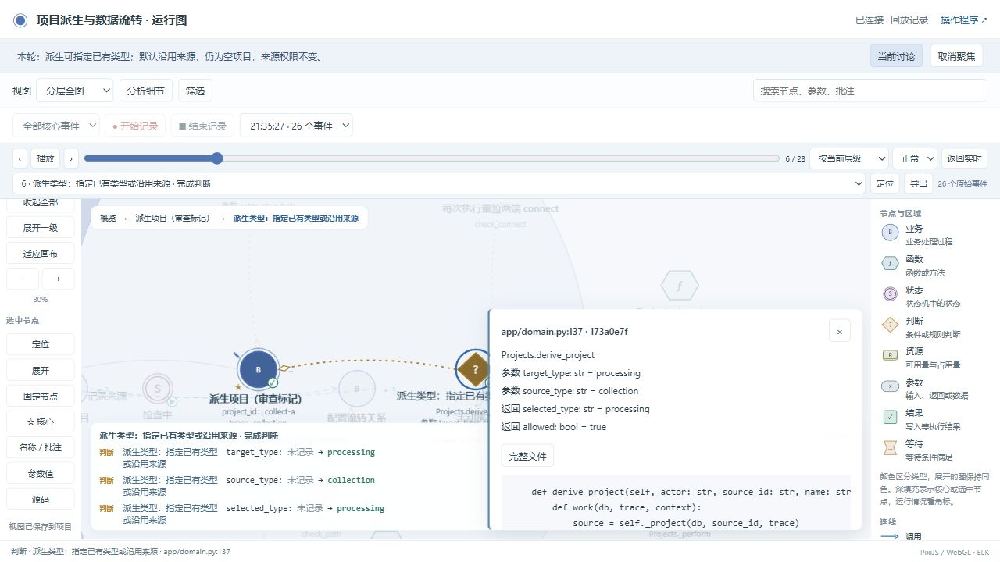
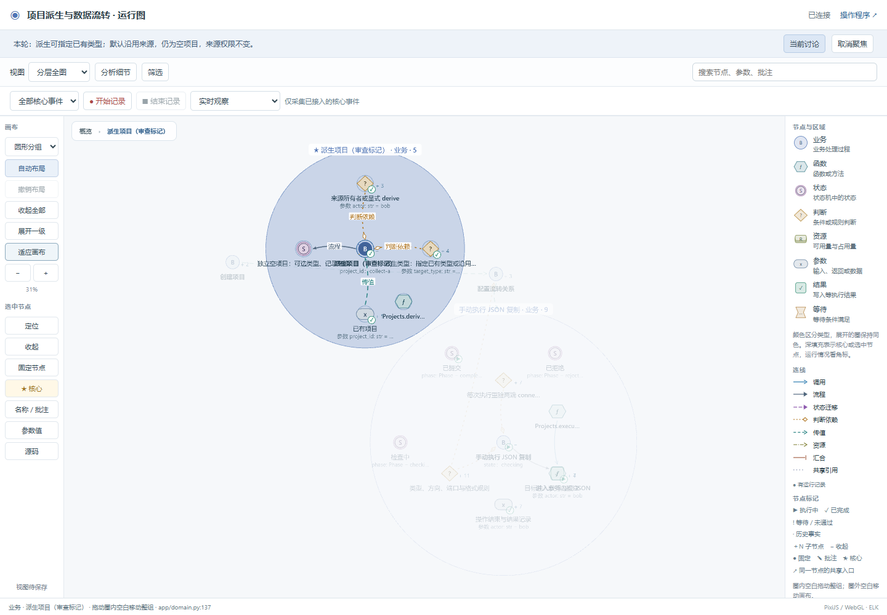

# 已授权迭代：派生时选择项目类型

2026-10-22。沿用原独立会话 `项目流转系统 · business-observer 独立试用`，没有新建另一套项目或覆盖首版记录。

用户明确授权的变化是：派生时可指定另一个已有类型，省略时沿用来源；新项目仍为空，不复制数据、连接或授权。开发助手直接处理这项已明确的变更，没有重复追问，也没有推荐或增加其他业务。

## 图和程序实际改变了什么

- 派生函数与 HTTP 接口新增可选 `target_type`，页面提供“沿用来源类型／采集／处理／报告”。
- 原有 28 个节点身份和源码锚点保留，新增一个 `derive_type` 判断节点；状态仍是检查中、已提交或已拒绝。
- 派生探针新增请求类型与来源类型，保留最终类型、所有者和来源 ID。默认时记录实际的 null 请求值，不把默认推断成用户显式选择。
- 使用派生后的实际类型检查端口。例如，采集项目派生出的报告项目接受处理项目的 result，而不能按其来源项目的采集类型连线。
- 原有坐标、名称、批注和核心标记保留；本轮没有重建整张图来替换旧节点。

## 真实顺序与发现的问题

1. 先从前轮已接受状态开始变更，冻结新增 8 场景、62 项业务断言、7 项白盒检查及测试源码。
2. 在旧代码运行新增测试：21 个子用例因接口不接受 target_type 出错，HTTP 测试则实际创建 collection 而非 processing，产生断言失败。这些是实测输出。
3. 再修改代码、页面、图和探针，新增回归通过。
4. 同步检查拒绝了一次不完整变更：D1 的含义改了，但缺少旧决定的历史副本。助手从本轮开始前的归档补齐 previous 和新来源，保留失败输出后复测，没有改写旧答案或弱化检查。
5. 完成全部业务、状态、映射检查，以及真实页面、录制回放和源码定位。

本轮遵守了先定义新增白盒约束再实现的顺序；首版后补白盒的偏差仍保留，不能由本轮通过抵消。

## 独立复核

| 检查 | 结果 | 证据 |
|---|---|---|
| 新规则和旧规则并存 | 新增 25 项独立检查通过，包含三种类型、默认沿用、无效类型、权限拒绝、无继承和后续端口规则；分别覆盖采集开/关/故障 | [新规则检查](execution/06-iteration-independent/report.json) |
| 原有功能 | 原 18 项独立检查通过 | [原有功能复测](execution/07-initial-regression-after-iteration/report.json) |
| 检查有效性 | 同一独立脚本在封存旧代码上失败，在新代码上通过；仅接口参数名称曾按真实 API 修正，业务断言未改 | [旧实现失败](execution/05-iteration-old-api-binding/report.json) |
| 不弱化旧检查 | 原业务用例、acceptance/whitebox 断言、映射字段与场景保留；图身份、源码锚点和状态定义保留，共 11 项比较通过 | [前后比较](execution/08-iteration-comparison/report.json) |
| 当前交付 | 公开图等于当前模型，运行帧等于保存记录，已接受候选及当前源码/架构门禁通过 | [独立交付审查](execution/09-iteration-delivery-audit/report.json) |
| 回放 | 26 个事件与 26 个实际状态帧对应，包含检查中、已提交、已拒绝，身份和修订相符 | [状态帧检查](execution/frame-binding-iteration.json) |
| 个人视图 | 坐标、名称、批注、核心标记保留，同一节点仍可展开，无页面异常 | [浏览器复测](browser/14-iteration-personal-view-retest/report.json) |

项目自身完整验证：33 场景 × 3 种采集模式，408/408 次业务断言、19 个 unittest 方法、117 个实际值见证和 2112 项字段对照通过。白盒共有 6 条规则、24 项检查。数字表示场景执行或检查次数，不是独立业务规则数量。[最终验证原件](execution/09-iteration-delivery-audit/verification.json)

审查脚本也保留自己的失败：首次个人视图检查把“已展开”节点再次点击收起，却等待展开，导致超时；坐标和批注检查当时已通过。依据真实按钮状态修正脚本后复测通过，未改应用代码。原脚本、截图与错误在 [首次视图检查](browser/13-iteration-personal-view/report.json)。

## 查看与使用

打开[程序](http://127.0.0.1:8870/)，选择小周，从采集 A 派生，类型选“处理”；得到空处理项目。再次派生但保持默认，应得到空采集项目。

打开[运行图](http://127.0.0.1:8870/graph)，展开“派生项目（审查标记）”，可以看到新增类型判断。记录一次操作后，可逐步查看请求类型、来源类型、选定类型与最终状态。

本轮真实记录 ID：`cfd2e4de22224d0d88ca203f57ce9bc0`。首版旧记录继续保留，历史上缺少状态帧的旧记录不会被补造为完整记录。

[完整原始对话](dialogue.md)中的第 28–33 条是本次授权迭代；[可运行源码](snapshots/03-derive-type.zip)、[源码哈希](snapshots/03-derive-type.json)、[完整证据包](snapshots/03-derive-type-evidence.zip)已经封存。源码包在新目录实际启动，通过页面、资源、创建、跨类型派生和公开导出共 7 项检查，见[包验证](execution/iteration-package-smoke.json)。

[默认类型回放](screenshots/03-derive-type/replay-default-type.png) · [跨类型空项目](screenshots/03-derive-type/app-processing-empty.png) · [窄屏派生](screenshots/03-derive-type/app-320-report.png)。

本次是独立 AI 使用与合成需求方对话，覆盖所列业务和检查范围。没有因这个项目引入等待、汇合或资源排队；这些不适用能力不计为本轮通过，也不据此证明任意用户输入都能被正确理解。
