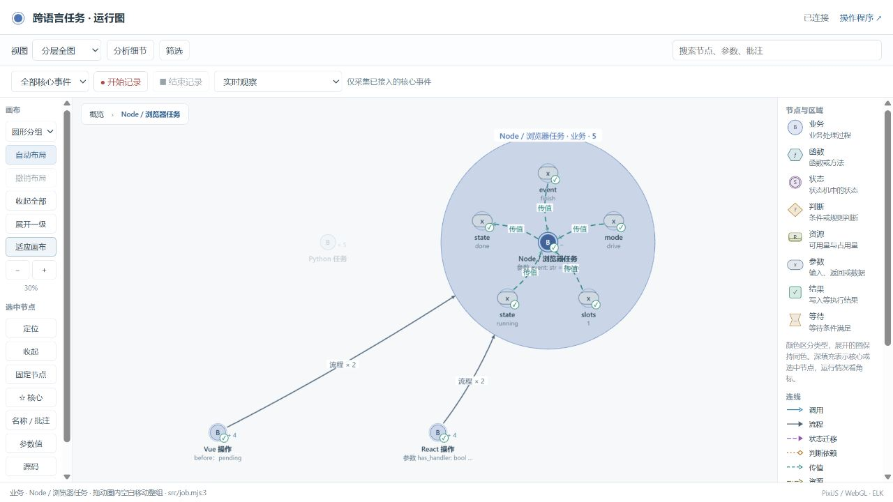
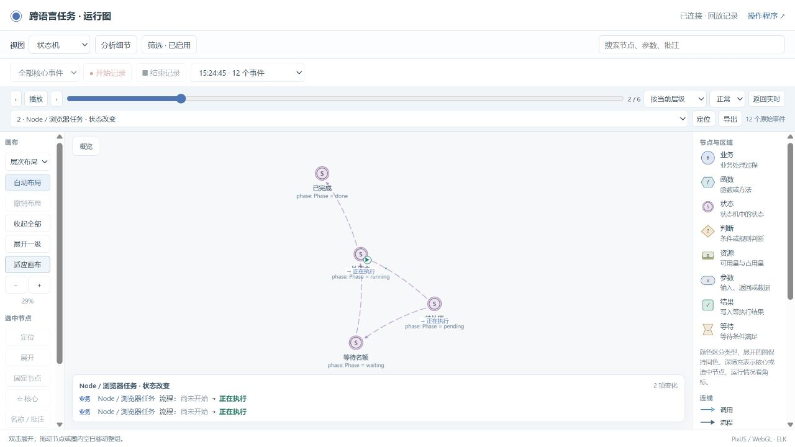

# 多语言重构验收

2026-10-23。本轮在本地完成，GitHub 发布另行进行。

## 改动

Python 公共实现按图模型、开发同步、运行采集、Web、交付和语言适配分类，统一放在 `skills/business-observer/scripts/bo_observer/`。旧命令入口只转发，已替代的两个旧查看器、v1 协议示例和旧启动脚本删除。原有示例、历史失败证据和仍有调用方的兼容入口保留。

项目使用自己的 Python、Node.js、React 或 Vue 实现；公共服务通过 `bo-project/v1`、`bo-source/v1`、`bo-event/v1` 和 `bo-snapshot/v1` 读取声明、源码事实和实际状态。完整导出仍用 `bo-stategraph/v1`。业务函数不依赖 Python 观测服务存活。

首次对话明确选择：`drive` 由项目本地执行器消费状态声明；`observe` 由项目自己的逻辑执行，图跟随实际结果。没有用户答案时不能默认选择。两种模式都维护源码、参数、采集和收尾检查。

业务歧义交给用户确认；动态回调、参数绑定、类型和探针位置由编码过程核对。实现确认绑定当前源码、真实目标和运行用例；旧源码答案不能沿用，也不能用文字代替实际测试。

## 验收范围

| 范围 | 实际检查 |
|---|---|
| 协议与适配 | 不合法定义、引擎版本、JSON 类型、悬空节点、身份冲突、重放和旧源码拒绝；实际违规状态保留并标记 |
| 源码覆盖 | Python AST、JS/TS 编译器、React JSX/TSX、Vue SFC；新增文件和参数独立盘点，未解析内容明确报告 |
| 原生运行 | Python 与 JS 执行真实业务函数；React/Vue 编译后执行真实 DOM 处理函数；两种模式 × 开启/关闭/故障，共 18 个场景 |
| 原有项目 | delivery、team-archive 的原有映射、状态、业务和项目检查；未删除原有断言或重建基线 |
| 观察隔离 | 浏览图、轮询、布局、开始/结束记录不产生业务事件；有界队列、故障隔离与序号缺口诊断 |
| 前端遗漏修复 | team-archive 的实际前端命令、参数检查、编辑状态进入实现清单和事件验证 |
| 交付 | 规范源与项目复制一致、升级冲突与回滚、个人配置保留、安装和无 Web 核心包运行 |

仓库级 `python tools/verify.py` 完整通过，退出码为 0。最终复测见[日志 43](43-full-acceptance-retest.log)；之前的失败日志独立保留，没有用复测输出覆盖。

验收后的示例交付记录已同步到各自 `.release/`；规范源与项目安装副本对同一候选的检查均通过，见[最终记录 44](44-final-receipts.log)。

已核对的具体结果：

| 项目 | 结果与证据 |
|---|---|
| 新协议、语言、同步和回放回归 | 24 项通过：[日志 34](34-replay-export.log) |
| 多语言原生运行 | 18 个场景通过；检查实际状态、参数及修订对应的快照：[结果](native-acceptance.json)、[日志 35](35-native-snapshots.log) |
| delivery | 映射、状态、项目和业务分别通过；201 个实际值见证，96/96 项业务断言：[汇总](gate-summary.json)、[日志 36](36-delivery-complete.log) |
| team-archive | 四类检查分别通过；480 个实际值见证，189/189 项业务断言：[汇总](gate-summary.json)、[日志 37](37-archive-complete.log) |
| 干净安装 | 新目录安装完整 Skill、单独安装锁定的解析器后，源码盘点和静态映射通过。该项不冒充运行验收：[日志 41](41-clean-native-install.log) |
| 旧 Python 双模式示例 | 更新公共模块绑定后 6 项通过；保留源码过期拒绝，新增未选择模式的拒绝：[日志 42](42-python-modes-migration.log) |
| 浏览器实际操作 | 12 个业务事件、4 次真实状态变化，无采集缺口；连续 5 次只读查看不增加事件：[结果](browser-final-receipt.json)、[记录](browser-final-recording.json) |
| 仓库级完整验收 | 原有与新增检查、13 步澄清集成流程、30 组新旧执行对照、安装、HTTP、图交互、两个项目完整验收与去除观测层后的核心包运行全部通过：[日志 43](43-full-acceptance-retest.log) |
| 包与 Skill 检查 | 83 个公共运行模块的示例副本一致，文档链接和依赖许可完整性通过；Skill 格式校验通过：[日志 45](45-package-check.log)、[日志 47](47-skill-validation-utf8.log) |

本地环境为 Windows、Python 3.13、Node.js 20。CI 配置支持的其他环境未在本轮远程执行。

## 失败与修复

| 证据 | 问题与处理 |
|---|---|
| [01](01-first-tests.log)、[02](02-contract-retest.log)、[03](03-runtime-retest.log) | 新夹具与采集诊断字段不匹配，修正后复测 |
| [06](06-legacy-regression.log)、[07](07-contracts.log) | 旧校验和解析器身份边界，保留旧断言后修正 |
| [08](08-expanded-regression.log) 至 [10](10-contract-retest.log) | 测试代码语法和记录返回值假设错误，修正夹具 |
| [11](11-migration-review.log)、[12](12-migration-retest.log) | 不应把已核对散列的第三方打包代码当业务解析；仅对确切文件使用完整性校验 |
| [13](13-archive-gate.log)、[14](14-delivery-gate.log)、[15](15-import-compatibility.log) | 旧调用方通过动态加载器持有转发模块，新增属性转发恢复原 API |
| [20](20-delivery-final.log)、[21](21-archive-final.log)、[22](22-tool-identity-fix.log) | 安装来源文件误计入执行身份，导致同一代码两种入口的候选不同；来源文件继续受托管散列检查，代码及 Schema 仍计入执行身份 |
| [23](23-delivery-retest.log)、[24](24-archive-retest.log) | 手动执行门禁未传共享解析器安装位置；仓库统一验收入口会配置依赖，独立项目按其安装说明安装解析器 |
| [浏览器失败截图](browser-gap-before-fix.png) | 首次传输超时造成缺口；增加一次有限重试并保持事件身份，接收端去重 |
| [25](25-view-migration.log)、[26](26-contract-retest.log) | 新模型未声明可选根节点表时，“展开一级”报错；改用当前可见根节点，并加入无根节点表的回归 |
| [回放缺陷截图](browser-state-replay-before-fix.png)、[31](31-native-replay-test.log) 至 [35](35-native-snapshots.log) | 原生事件进入记录，但未接入逐步状态帧，状态视图只有开始/结束。按实际修订和证据绑定快照，接入现有回放；普通函数事件不要求状态快照，缺少的状态事实仍显示未知。回归夹具也改用真实状态视图 |
| [40](40-full-acceptance.log)、[42](42-python-modes-migration.log) | 旧 Python 小示例复制了新公共校验器，但仍持有旧源码指纹；审阅变更后重新生成并验证，原有防陈旧检查保留。清除该示例中的旧默认模式说明 |
| [46](46-skill-validation.log)、[47](47-skill-validation-utf8.log) | 外部 Skill 格式检查器使用 Windows 默认 GBK 读取 UTF-8 文档而失败；用 `python -X utf8` 重试通过，项目文件未为此改编码 |

另修复跨语言静态连线的布局异常、统一服务的程序入口链接和源码读取格式。主动过滤的事件不再算作丢失；真正的序号跳跃仍进入诊断。

## 浏览器复测

真实操作 React、Vue 页面，从图中开始记录、完成任务、结束记录，再切到状态视图逐步回放。运行源码与图绑定同一个构建 `ce47b83f…`。页面启动时的两个旧实例仍是准备状态，本次操作的两个新实例完成；没有用最后结果覆盖其他实例。





[完成步骤](browser-final-state-complete.png) · [对应源码](browser-final-source.png) · [操作页面](browser-final-application.png)

## 对话流程复现

这是脚本化模拟对话，用于检查路由和约束，不是假称真人或独立会话的使用证据。对应 `tools/test_multilanguage.py` 中 `test_dialogue_choice_confirmation_and_coding_evidence_survive_iteration`。

1. 用户：“任务没有名额时先等着，后面能继续。”模型保留“没有名额时等待还是失败”的待确认项；此时尚未选择开发方式。
2. Skill 提问：“后续基于状态图执行，还是仅观察自己的实现？”并确认等待含义。没有推荐新的排队策略或扩展业务。
3. 用户：“仅观察，继续使用自己的逻辑。没有名额时等待，有名额后继续。”记录 `observe` 及答案位置；已确认问题不再出现。
4. 静态解析发现 `callback(state)`。该问题进入 `confirmations.coding`，不要求用户回答函数绑定细节。
5. 编码过程将目标绑定到 `worker.py::complete`，指定 `complete_job` 验证实际目标和结果。合法记录通过；不存在的目标被拒绝。
6. 修改 `complete` 源码后，原确认被判为过期，需重新核对。这个记录只证明绑定审阅有效，实际映射仍须运行白盒场景。

## 使用

在仓库根目录执行：

```bash
python -m pip install -r skills/business-observer/requirements.txt
python tools/setup_adapters.py
npm ci --prefix examples/multilanguage
python tools/verify.py
python tools/multilanguage_demo.py --mode drive
# 或选择 --mode observe
```

[完整示例说明](../../../examples/multilanguage/README.md)提供操作页面、运行图、录制回放和目录解释。[安装及日常使用](../../usage.zh-CN.md)说明如何在自己的项目中启用 Skill。

## 能力边界

原生 JS/Python `bo.fsm/1` 执行器是严格的平面子集，不宣称已实现通用层次或 Petri 执行引擎。现有 Python 复杂示例保留原来的并发、等待、资源、汇合、恢复及校验；其他引擎需要明确的原生适配，不能静默省略语义。

静态结果是调用候选。动态分派、框架内部调用和未采集局部值仍需实际证据；未支持的语言和解析失败明确报错。有限场景证明列明路径的行为和映射，不证明任意软件的所有语义。watch 会生成维护任务，只有宿主或正在编码的 AI 消费它后才会推进维护，不能自动唤醒任意编辑器。生产负载的性能基线与增量查询仍在后续范围。
