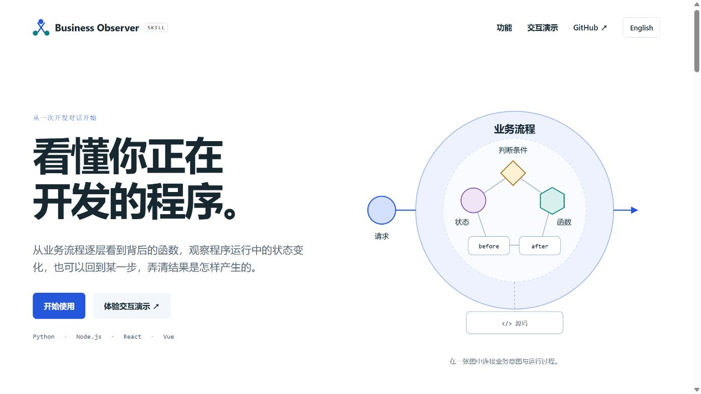
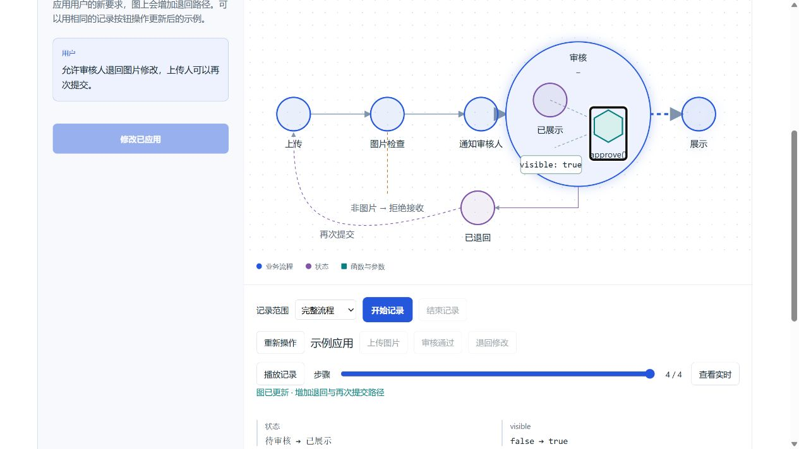
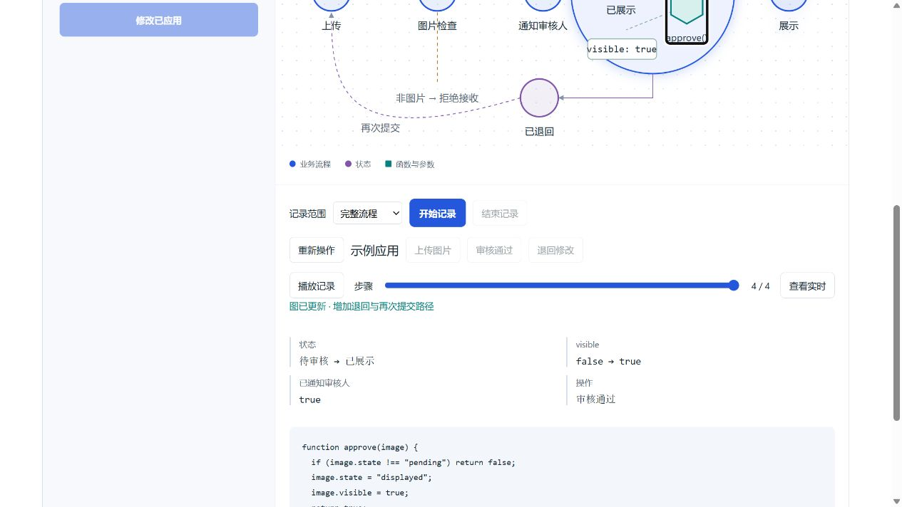
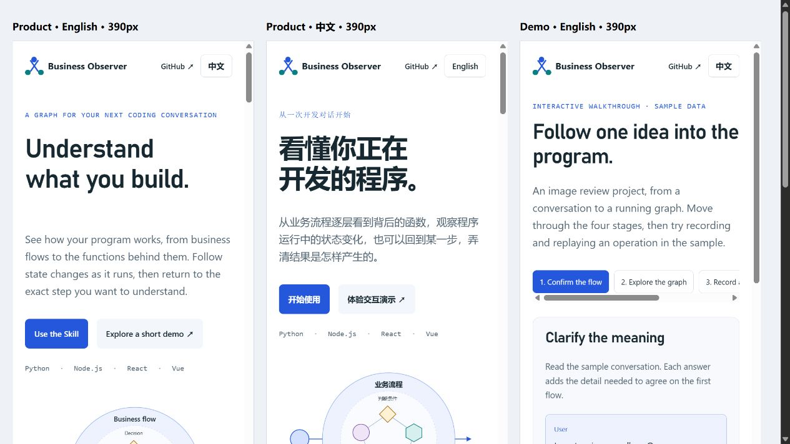

# Source readability and product presentation review

Baseline: `412eb0ad5ab2ea444a06ced3b24a12758cb011cd` (v0.6.0).

This update improves maintained source formatting and function explanations, adds an English/Chinese source guide, and separates the product overview from an interactive sample walkthrough. Business declarations, public IDs, capture requirements, and existing acceptance expectations remain in place.

## Source comparison

- [Python comparison](python-equivalence.json): 74 modules have equal executable ASTs after excluding documentation and positions.
- [JavaScript comparison](javascript-equivalence.json): 16 owned modules have equal syntax trees after excluding comments, positions, and redundant parentheses.
- The [first JavaScript comparator run](javascript-comparator-first-run.json) incorrectly included the SourceFile's full source text. Removing that non-executable parser metadata produced the comparison above. No runtime change was needed.

Syntax equivalence supplements runtime regression checks. It does not establish behavior outside the existing tested scope.

## Acceptance record

Example source bindings and managed copies are regenerated from the canonical implementation, inspected against the preserved baseline, then verified and accepted as a new iteration. Previous frozen evidence is preserved.

| Check | Evidence and result |
|---|---|
| Python executable syntax | [74 maintained modules](python-equivalence.json), unchanged after excluding docstrings and locations. |
| JavaScript executable syntax | [16 maintained modules](javascript-equivalence.json), unchanged under the documented syntax comparison. |
| Formatting | [Pinned Black and Prettier check](13-formatting.log), passed. Vendor bundles and old evidence are excluded. |
| Delivery example | [Accepted and checked](17-example-acceptance.json): 201 value witnesses, 303 projection checks, 19 events, 10 features, 96/96 business assertions. |
| Team archive example | [Accepted and checked](17-example-acceptance.json): 480 value witnesses, 1,113 projection checks, 53 events, 22 features, 189/189 business assertions. |
| Viewer regressions | [Existing checks](03-view-regression.log), passed after repairing the test loader described below. |
| Python modes | [Six tests](11-python-modes-retest.log), passed after rebuilding current source bindings. |
| Product walkthrough | [Transition, scope, replay, iteration, and localization checks](10-product-demo.log), passed. |
| Complete repository acceptance | [Final run](12-full-acceptance-retest.log), exit 0: clarification, source/graph synchronization, business scenarios, history, HTTP, installation, and both independent core exports. |
| Documentation | [Six link checks](14-document-links.log), passed. |
| Publication inputs | [404 staged files](18-staged-input-byte-check.json) match the accepted inputs and shipped executable adapters byte for byte. |

Both full examples passed mapping, state rules, business assertions, and project checks separately. Their new `readability-20261023` acceptance records are stored beside earlier iterations. Canonical and installed entry points passed the final acceptance check.

Captured logs retain their original Windows line endings and terminal whitespace. Source formatting checks apply to maintained code; they do not rewrite these records.

### Failures, repairs, and retests

1. Prettier changed quote style in module imports. Three repository viewer test loaders and the archive graph test loader matched only single-quoted relative imports, causing a data-URL import error. The loader now accepts either quote style. The original assertions remain intact. [First failure](delivery-first-failure.log), [initial verification](02-example-verify.log), [viewer retest](03-view-regression.log), [both example retests](07-example-verify-retest.log).
2. Two sandboxed example-copy attempts encountered Windows `OSError: [Errno 22]` on different files. The same reviewed operation completed outside that sandbox. These were environment failures; no runtime workaround was added. [Attempt one](04-example-review-retest.log), [attempt two](05-example-review-retest.log), [successful review](06-example-review-retest.log).
3. The first complete repository run correctly rejected stale hashes in the small Python modes example after its managed source was formatted. Its existing build script regenerated the source bindings, then the unchanged six tests passed. The freshness gate remains enabled. [Failed complete run](08-full-acceptance.log), [targeted retest](11-python-modes-retest.log), [complete retest](12-full-acceptance-retest.log).
4. During browser review, the initial sample graph displayed details before the illustrated user had confirmed them. It now starts with upload, review, and exhibition; validation and notification appear after the sample reply. A completed sample also prevented trying the next operation, so the walkthrough now provides a new-operation button and starts a fresh operation when applying its illustrated iteration. Tests cover preserving the updated flow while resetting sample events.

### Browser review

The product overview and walkthrough were exercised in the Codex in-app browser against the local static server. See [the check record](browser-checks.json).

- Product: all six views, keyboard selection, mixed-type filtering, English/Chinese switching with the selected filter retained, and language-specific documentation links.
- Walkthrough: progressive conversation, review expansion, sample source lookup, four-event complete recording, one-event review-only recording, exact before/after replay, and timed playback.
- Iteration: add return/resubmit, record an eight-event return-and-resubmit sequence, replay to `visible: false → true`, then start another operation while retaining the new flow.
- Presentation: desktop review and 390 px embedded viewport checks in both languages. This is a responsive visual check, not a full accessibility certification.
- Browser console: no captured warnings or errors in the reviewed product and demo tabs.

The walkthrough is a deterministic browser sample. It illustrates the interaction and does not claim to run a coding agent or record an external project. Live project behavior is covered by the independent example checks above.









## Reproduce

Install the repository dependencies and native parser dependencies as described in the usage guide, then run:

```bash
python tools/check_readability_equivalence.py --base 412eb0ad5ab2ea444a06ced3b24a12758cb011cd
node tools/check_js_readability_equivalence.mjs --base 412eb0ad5ab2ea444a06ced3b24a12758cb011cd
node tools/test_product_demo.mjs
python tools/verify.py
```

Source navigation and optional formatting commands are in the [source guide](../../source-guide.en.md).
