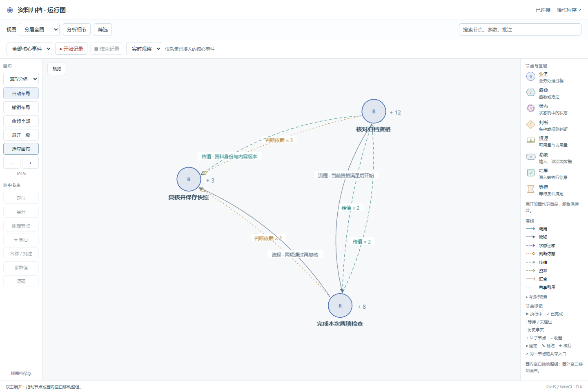
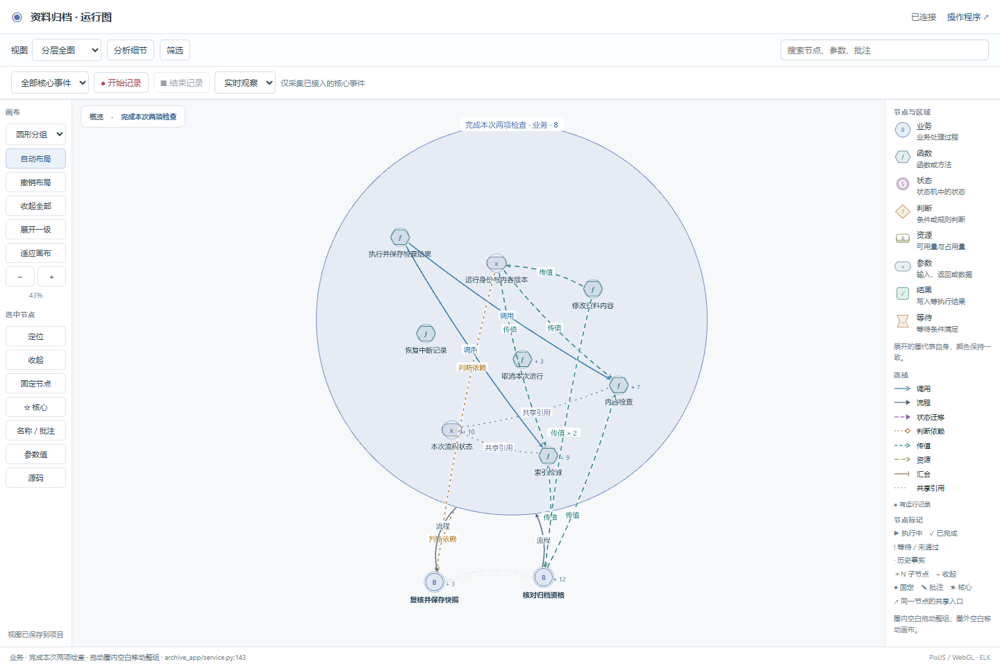
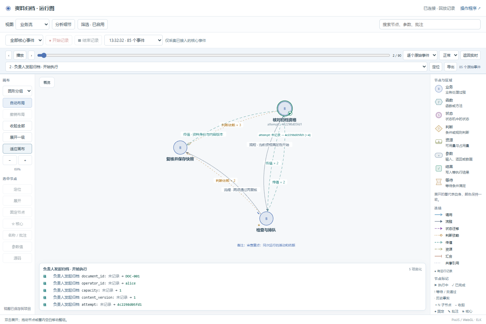
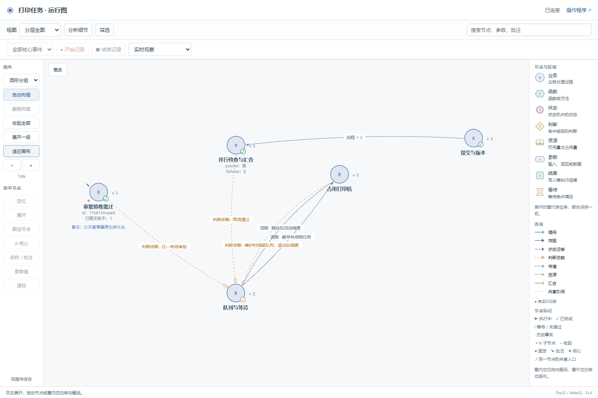

# 第一轮整体重构审查材料

本轮以本地评估的代码问题为主：完整迁移状态机制、统一协议与实例、补齐开发维护检查、隔离个人配置、限制事件保留，并使 Skill 与实际代码一致。原评估见 [开发方案](../../assessment/2026-10-21/NEXT-DEVELOPMENT.md)。

本轮以代码重构为主，页面调整和 Skill 文本跟随实际接口。结果分为实现映射、状态约束、业务规则和项目检查；不把“图如实显示了错误”误报成业务正确。

- [代码结构与职责](architecture.md)：模块替换、公共协议、兼容路径、升级、保留和配置。
- [逐功能验收表](feature-matrix.md)：F1–F10、M01–M15 和图交互的对应检查。
- [问题、修复与复测](failures.md)：产品问题与测试流程问题分别记录。
- [公共图实际操作结果](ui-final-result.json)、[重启与换端口结果](ui-resume-result.json)：真实浏览器、SQLite 和工作线程。
- [交付示例检查](checks/delivery/verification.json)、[归档示例检查](checks/team-archive/verification.json)：映射、状态约束、业务规则和项目检查分项。
- [最终完整回归日志](checks/release7-regression.log)：从 Git 导出的干净目录执行，包含旧新执行比较、协议反例、核心包实际启动和安装检查。
- [独立对话全过程](dialogue-trial/README.md)：澄清、实施偏离、修复、维护功能迭代、源码移动及最终截图；[最后一次结果](dialogue-trial/round-04/stage.json)绑定源码与证据散列。
- [机器可读汇总](results.json)：本轮候选 7 的结果和范围。

## 已落实的代码变化

完整执行器与协调逻辑进入 `bo_stategraph/`；旧入口只委托。查询、页面、记录和导出读取同一实际快照。未授权等待、内部活动、资源和旧运行不会因高层折叠而消失。运行中真的出现错误值时保留原值并报告问题。

开发检查从源码范围发现新增文件和符号，生成 AI 内部更新任务；空范围、关闭分类、空模式或缺少实际值对照不能通过收尾。实际公共导出也纳入检查，不能另写同名简化类绕过协议。图仍默认只显示高层，进阶关系按需打开。

同步检查拆成源码清单、配置、迁移、实际值对照和阶段验收模块；页面拆出绘制与对象释放、保存、轮询和精确历史帧。升级检查公共文件散列，拒绝覆盖项目自行修改的副本，失败时回滚。旧入口只作兼容委托；历史协议仅供旧项目复现。

个人视图写入 `bo_stategraph/config/views/local.json`，支持修订冲突检测和原子保存，生成与升级保留个人文件。事件缓存和日志有保留边界；用户保存记录不跟随缓存过期。

## 最后一次验收

| 检查 | 结果 |
|---|---|
| 仓库完整回归 | 干净 Git 导出执行 `tools/verify.py` 通过；其中本轮针对性回归 28 项 |
| 两个完整示例 | 映射、状态约束、业务规则和项目检查均通过；分别有 201/480 项实际值对照、96/189 项业务断言 |
| 公共图实际操作 | 19 项通过：拖动、下钻、筛选、源码、录制、回放、保存、重启换端口及窄屏 |
| 新会话使用 Skill | 打印任务项目从澄清到实现，再切换普通 Python 开发并增加维护功能；原基线和检查保留 |
| 独立项目最终检查 | 69 次场景运行、2,013 个事务快照、437 项映射见证、333 项业务断言、29 项浏览器检查通过 |
| 故意错误 | 到期边界、尺寸边界、绕过维护三个错误均被原业务预期检出；如实重建图后，映射仍可通过 |
| 交付包复现 | 主会话解压最终源码包，重新执行正常门禁和 69 次场景测试，均通过 |

新会话中的需求方由主会话模拟，提问、回答和修订逐轮保留；独立 AI 实际编程、执行命令和操作浏览器。首次出现的同名简化核心和 SVG 页面被判定为接入失败，并保留在 `deviation-01`，不计入最终通过结果。后续已改为公共核心与完整图；不是仅修改报告措辞。

最后一轮还发现并修复了普通函数路径移动被当作删除探针、全局管理事件错误归入打印任务的问题。22 处源码移动有明确身份对应，原探针和白盒检查没有弱化。[失败及修复](failures.md)与[独立项目记录](dialogue-trial/round-04/failures.md)给出细节。

## 公共图截图

初始只显示三个高层节点：



展开后整圈可拖动，子节点相对位置保持：



在新端口和新浏览器中恢复个人配置，并读取已保存记录：



异领域打印项目使用同一公共查看器，先显示五个业务节点：



## 复现

仓库检查：

```bash
python tools/verify.py
```

浏览器脚本为 `ui-test.cjs` 与 `ui-resume.cjs`。前者必须对新的隔离归档副本运行；后者停止并重启同一个副本、换端口后执行。使用 Playwright 与 Chrome，服务和浏览器应在同一执行环境内。环境变量 `PLAYWRIGHT_MODULE` 指定本机模块位置，`BO_TEST_URL` 可改服务地址。

打印项目使用 Python 标准库和 SQLite。将 [最终源码包](dialogue-trial/round-04/accepted-source.zip) 解压到新的空目录后，在其中执行：

```bash
python tooling/gate.py check
python tests/test_project.py
python server.py --demo --port 8897 --db data/reproduce.sqlite
```

打开终端输出的本地地址。服务持续运行；其他命令另开终端执行。包内 README 的 `$trialPython` 是原测试机解释器路径，其他机器直接使用自己的 `python`。浏览器与故障注入脚本、依赖定位方式在包内 `tooling/`；主会话解压复测日志见 [门禁](checks/independent-extracted-gate.log)和[场景](checks/independent-extracted-project.log)。

本机已安装候选 7 的 88 个 Skill 文件，原安装有备份，见 [安装记录](local-install.json)。真实项目的新对话输入 `使用 $business-observer 开发……`，描述业务要求即可；已有项目可以要求先接入现状并检查映射。项目内的维护命令由 AI 执行，不要求用户逐步运行。

截图验证表达与交互，不代替协议、实际值和业务效果对照。有限自动化场景不证明所有调度、所有动态调用或真人易用性。一般 Petri 网求解、通用 ReBAC 引擎、全对象堆、图上执行业务命令、增量 API 与性能基线未列为已完成。
