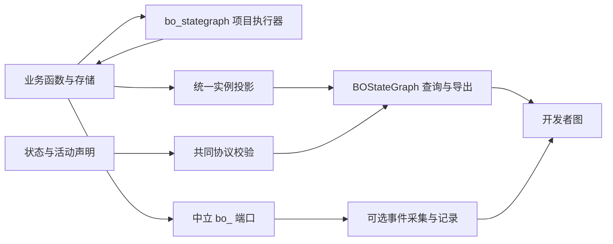

# 第一轮重构：代码结构

本轮针对本地评估中的代码问题。原始评估和旧结果保留在 [2026-10-21 评估](../../assessment/2026-10-21/README.md)，不以新结果覆盖历史证据。

## 状态机制只保留一份

两个完整示例的执行声明、状态推进、活动、资源、等待、汇合、停止和恢复协调迁入各自的 `bo_stategraph/workflow.py`。业务服务保留领域计算、权限求值、数据库操作与线程接线。原事务和锁的边界保留，没有拆成两个数据库。

原 `app/workflow.py`、`archive_app/workflow.py` 仅保留兼容导入。运行库中的旧 `bo_stategraph.py`、`bo_contracts.py`、`execution_contract.py` 也只委托独立包；测试比较的是同一个类/函数对象，不是两份碰巧相同的源码。

业务执行依赖的状态模块会保留在核心包中。可剔除的是采集器和页面。`execution_mode=observe` 时，普通代码决定实际结果，独立模块读取它，不再模拟一条“应该发生”的执行路线。

## 协议和真实状态

| 职责 | 实现 | 约束 |
|---|---|---|
| 图、类型、层级声明 | `bo_contracts.py` | 项目检查和独立查询共用；布尔值不等于整数枚举；拒绝缺目标、缺条件、循环层级 |
| 活动、资源、汇合 | `execution_contract.py` | 校验同次运行的活动配置和实际日志，不另建 Petri 权威层 |
| 真实实例 | 项目 `bo_stategraph/query.py` | 读取全部实际运行，保留完整修订号、构建、参数版本和停止原因 |
| 查询与导出 | `BOStateGraph` | 使用快照提供者或显式观测，两种来源互斥；页面与导出派生自同一快照 |
| 运行错误 | 查询诊断 | 保留实际非法值并报告 mismatch；缺少身份、修订或构建依据时报告 partial |

`behavior v3`、`event v3`、活动配置和录制格式仍有各自职责。统一的是公共含义和校验入口，不是把不同数据挤成一种 JSON。小型离线模型明确标为 `bo-model/v1`，不能冒充完整项目 v3。旧 v1 工具仅用于旧项目复现。

独立试用发现过“目录和类名相同、实际协议却另起一套”的偏离。因此观测命令必须交出真实运行的 `stategraph_export`；公共校验核对其 schema、内容摘要、model/build 和同源实例。项目扩展约束另放，不替换公共查询类或改变导出协议。

对于没有运行内活动日志的项目，`runtime_frames.py` 接收与事件精确绑定的真实事务投影。`runtime-frames.js` 回放它并计算可见状态差异；共享资源按图节点 ID 全局保存一份。缺失修订显示未知，最终状态不填入过去。该协议不代替项目的全局资源约束测试，也不会凭状态变化推导因果。原活动日志方式保留兼容并持续回归。

层级支持已声明的父子状态、父级迁移和并行活动集合。历史状态、非默认分隔符和一般 Petri 网求解不在支持范围，接入时应拒绝或说明。单名额等待、真正并发、资源归还和 ALL 汇合由现有执行器直接提供事实。

## 开发检查按职责拆开

| 模块 | 职责 |
|---|---|
| `bo_sync.py` | 从源码范围枚举变化，产生内部维护任务；扫描不自行清除任务 |
| `sync_config.py` | 配置、候选快照、源范围和必需检查约定 |
| `sync_io.py` | JSON 原子写入与结果路径读取 |
| `change_sync.py` | 阶段基线、变更影响、内部审阅、接收和收尾检查 |
| `sync_verify.py` | 执行真实检查并分别报告映射、状态约束、业务规则和项目检查 |
| `mapping_contract.py` | 实际存储/函数事实与观测投影的值对照 |
| `source_migration.py` | 核对显式源码移动，更新探针/白盒源码位置，同时保留原断言与人工图节点身份 |

源码清单从项目范围独立产生；新增入口未登记时失败，即使旧图完全没有这个节点。未选进图的符号仍须分类并说明理由。排除目录是显式的检查边界，不代表工具理解这些目录内的任意行为。

`watch` 可以发现变化、写任务；AI 是否被唤醒取决于宿主接线。项目指令与阶段 gate 负责强制执行这些步骤，不宣称安装一个 Skill 就能拦截所有编辑器。业务错误若如实显示，映射检查可以通过，业务检查仍失败。

源码位置也属于需要维护的身份。移动函数时，内部 `review.source_moves` 逐项记录基线符号与当前符号，分别从 AST 清单核对；它只重绑定探针和白盒规则的位置，不允许顺带改阶段、参数约束和业务预期。它不重建基线，也不把一次代码整理伪装成需求变化。

## 页面和配置

绘制、命中区域及 Pixi 对象生命周期移到 `renderer.js`；`viewer.js` 协调操作。既有 `layout.js`、`graph-core.js`、`analysis.js`、`recording.js`、`replay-steps.js` 各自保留布局、投影、筛选和回放职责。新增 `preferences.js` 和 `polling.js` 分别处理持久保存与单次在途刷新。协调器由 814 行降至约 645 行；仍有后续可拆分空间，不以行数作为正确性证明。

个人配置在 `bo_stategraph/config/views/local.json`，有项目身份、修订比较、进程间锁、原子写入和容量限制。稳定 ID 延续布局；显式一对一改名可迁移；冲突和旧节点批注保留，不按相似名称猜测。共享/核心包默认排除个人文件。

事件缓存按数量和时间保留，JSONL 按大小轮换。录制直接订阅采集入口，避免 UI 缓存淘汰造成遗漏。保存记录、业务数据库和当前实例不随普通缓存清理删除。增量 API、数据库历史分页和性能基线仍为 TODO。

## 复制与升级

`bo_upgrade.py plan/apply` 使用版本和散列清单，拒绝覆盖自行修改的公共文件；失败回滚。项目执行器、查询适配和配置不属于复制清单。仓库用 `tools/sync_runtime.py` 同步规范源，`tools/check_package.py` 检查所有运行库、图模板及第三方许可证。

升级必须继续已有变更基线，重新生成图、完成真实运行和收尾检查。单纯复制或重新记录散列不表示迁移完成。
