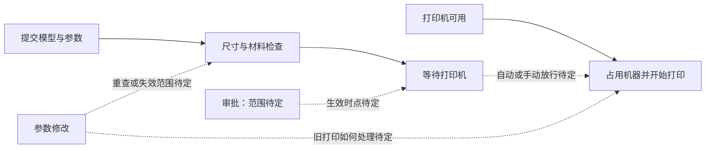

# 第 1 轮：需求与候选局部图

日期：2026-10-22（Asia/Shanghai）。验收方式：独立 AI 对话；需求及后续需求方回答由主会话模拟，不是真人可用性测试。

首轮输入原文保存在 `discovery.json` 的 U01。已知：提交模型；检查尺寸与材料；占用打印机；忙时排队；区分提交和审批能力；需要真实函数、参数、等待和运行路线。尚无业务源码和运行证据。

图是需求候选关系，不是执行日志。虚线表示未决业务规则；检查目前合并展示，不代表已经决定串行或并行。

本轮提问：

1. 审批权是整个工作室通用，还是只对指定打印机有效？有审批权的人能否批准自己提交的任务？
2. 检查和审批通过后，机器空闲时是否按排队顺序自动开始，还是必须有人再点一次开始？
3. 改尺寸、材料或打印参数后，旧检查和审批是否全部作废？如果旧版本已在打印，是继续打完，还是停止后重新排队？

设计决定：采用稳定节点身份保存候选图；暂不实现依赖上述答案的行为。后续根据回答细化检查方式、审批时点/撤销、打印机选择、取消和恢复、成功效果以及真实设备接入范围。不把内部待细化事项当作已问或已答。

差异：从空项目新增需求来源、7 个候选业务节点、8 条关系和 3 个未决问题。源码/运行图差异：不适用，尚未建立业务源码与执行图。
