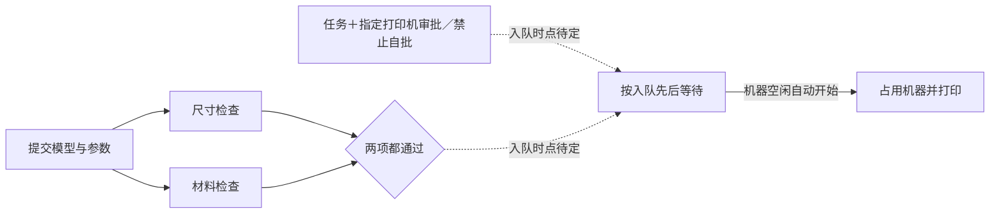

# 第 2 轮：并行检查、指定机器审批与自动队列

需求方来源：2026-10-22 主会话模拟答复，完整原文保存在 discovery.json 的 U02。非真人测试。

已确认：

- 审批权限定打印机，每份审批限定任务，禁止提交人自批。
- 同一人可提交多份任务；机器空闲后按入队先后自动开始。
- 尺寸、材料同时检查，两项都通过才能使用机器。

未确认：参数修改对检查、审批、队列及在途打印的影响。需求方明确要求不代定，D03 继续 open/blocking。本轮不重复要求回答 D03。

检查分支与审批可以怎样重叠尚未确定；图不表示审批必须等待检查完成。队列边仅表达已确认的自动放行；取消、撤权和参数更新仍可能影响资格，不能把图解释为始终无条件启动。

本轮提问：

1. 是否由提交人指定一台打印机，尺寸、材料都通过且该任务获批后，才进入这台机器的队列？还是先入队，再等待检查和审批？
2. 排队期间审批被撤销或审批人失去该机审批权，任务应退出队列，还是保留位置等待重新审批？已经开始打印的任务是否继续？
3. 本轮先使用本地模拟打印机，还是需要连接真实设备？打印完成或取消时，是否收到设备的完成／停止确认后才释放机器？

差异：D01/D02 从 open 转 resolved，新增 D04 并行汇合规则；D03 不变，新增 D05–D07 三项问题。保持原 7 个节点身份，新增尺寸、材料与设备确认 3 个节点；新增 5 条关系，细化 3 条原关系。机器选择、入队时点、撤权、完成确认均未当作已确认。没有业务源码和运行事件；update_records.py 仅用于重现文档变更。

规则检查计划（尚未运行）：错误打印机或错误任务的审批不得使用；自批拒绝；一个检查失败时不得占用机器；两项检查实际执行重叠；同一提交人的两份任务都保留；空闲后按已确认入队顺序启动。未定规则对应的预期仍待回答，不能补造默认值。
