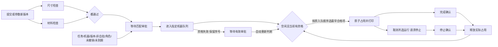

# 第 3 轮：实现与验收

来源：U03 为主会话模拟需求方的完整实现要求，U04 为实现期间补充。不是新的真人测试。完整原文在 discovery.json；历史 round-01/02 原样保留。

U03 解决了 D03/D05/D06/D07，并新增两台机器独占、检查失败与异常可见要求。开发前核对发现两个未决语义：D08 取消的运行范围；D09 尺寸输入来源及边界。本对话已用普通进度消息说明这两项；准备阶段将具体问句写入记录，但尚未作为最终问题消息发出，主会话即补充 U04。因此 A03 是拟提问记录，不能声称模拟需求方回答了已发送的最终表单。

U04 明确：只取消选中运行；毫米三边由提交人填写，不解析模型；必须有限正数，恰好等于机器上限允许；材料先限 PLA/ABS，并按机器能力判断；审批带到期时间，实际开打前取当前时间；其他不改变已定规则的技术细节可自行选择。

最终行为：

源码差异：从空源基线建立 app 的校验、审批谓词、SQLite 存储、中立观测端口；bo_stategraph 保存完整声明、实际执行器、统一实例查询和共享资源检查；integrations 连接观测、记录、页面；独立 CLI/HTTP 本地操作者入口与只读图分离。

稳定身份：沿用最初 submit/checks/approval/queue/printer/printing/parameter-change；新增检查分支、逐份审批、取消和确认节点。完整模型以 behavior.json 与 manifest.json 为准；不是另建一套权威业务状态。

实现选择：普通 Python、SQLite BEGIN IMMEDIATE 保护入队序号和机器占用；ThreadPoolExecutor 两个工作线程并行检查；线程仅检查，无独立采集进程；设备用 SQLite 中真实执行过的 start/complete/stop 效果表示。配置 P1=200×200×200 mm/PLA，P2=300×250×250 mm/PLA+ABS，是合成测试配置。

历史帧：每个成功业务事务在同一事务里保存完整状态快照。页面、导出和实例查询使用这份权威存储。探针 commit 只在事务成功后发出，关联 revision；一个事务内的中间语句不被伪造为持久状态。事件时间顺序不标成因果。

失败与修复见 failures.md。代码级/浏览器自动验收不能推断真人易用性或真实打印机可靠性。
