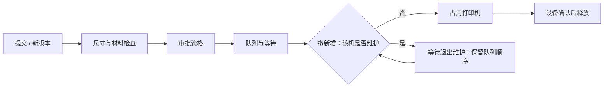

# 第四轮：维护功能与开发方式切换

本轮已完成。以下保留澄清与实施过程；最终源码、验证和基线对照见 [stage.json](stage.json)。

来源：主会话于 2026-10-22 发送模拟需求；不是新的真人试用。先完成并保留 candidate-4 公共组件迁移的 accepted 结果，才处理本轮。前轮源码与基线保存在 ../candidate-4/accepted-source.zip。

## 已明确

新增打印机维护；维护时不接新任务，已开始的打印不中断；退出维护后原队列按原顺序继续。用户明确要求后续普通 Python 函数实现，不再以状态机指导开发；运行图和监控继续维护。这是 development_mode=observe 的直接用户授权，不能以 Skill 默认 guided 覆盖。尚未改动上一轮实现及验收配置。

## 对当前图的影响

当前链：submit（提交/版本）→ checks（并行检查）→ approval（当前审批）→ queue（队列与等待）→ printing（占用设备）→ printer-stopped（确认释放）。

维护开关属于全局 printer.P1/P2；开始打印的事务要读取它。维护等待原因应映射到 queue，并在图上显示。退出维护调用普通调度函数，沿用已有 queue_seq；审批、过期与停止确认的原规则保持适用。已在 printing/stopping 的运行不会因维护开关被强制停止。

以下是讨论用投影，尚未计作实现事实：

## 一个待确认问题

维护期间，新提交给该打印机的任务是：

- A：照常提交、检查和审批，满足条件后排队；维护只阻止开始打印。
- B：在提交入口直接拒绝；已在队列中的任务保留。

这决定 submit 是否增加拒绝分支，以及新任务是否会取得 queue_seq。其余非业务实现选择不再追问。未收到答案前不以 A 或 B 当作既定规则。

## 下一步验证

退出维护恢复原队列；新提交行为按答复；维护与获取设备在 SQLite 写事务中串行化；在印任务不中断；两台机器互不影响；审批撤销/到期与维护同时存在时仍按现有资格规则调度。验证普通函数实现的 source inventory、状态/资源实例、actual-value witnesses 和 runtime_frames。收尾按协调通知通过 bo_upgrade 更新 candidate-5，再绑定最终构建做浏览器截图。
## 已收到答复 U06

选 A：维护期间仍然可以提交、检查、审批和排队，只阻止开始打印。由工作室管理员切换维护开关；普通提交者和审批人不能切换。维护手动结束，没有自动到期。

所有本轮问题现已明确。新增管理员为本地配置 `config/studio.json` 的独立资格，并持久化到 SQLite administrators；审批角色不授予维护权。当前演示管理员为 admin。身份认证边界仍为原先本地合成操作者，不宣称网络登录系统。

已将开发模式和执行模式设为 observe，保留 workflow.py 原路径保证基线探针和批注稳定；内部业务结果由普通函数条件和 SQL 决定，不消费状态声明。

## 最终实施结果

上述暂留旧路径的中间方案已结束。公共 candidate-7 经 bo_upgrade 安装后，按 22 条显式 source_moves 将执行器真正迁至 `app/workflow.py`，原 `bo_stategraph/workflow.py` 已不存在。普通函数与 SQL 决定业务；状态声明只描述观察结果。两种模式均为 observe，图、源码映射、参数、监控与精确运行帧继续维护。

U06 的管理员手动维护规则全部实现；69 次场景运行、333 项独立业务断言和 29 项完整浏览器检查通过。管理事件归属问题由浏览器检出并修复，未替换公共查看器。所有结果仍属于模拟需求方和合成设备的工程验证。
