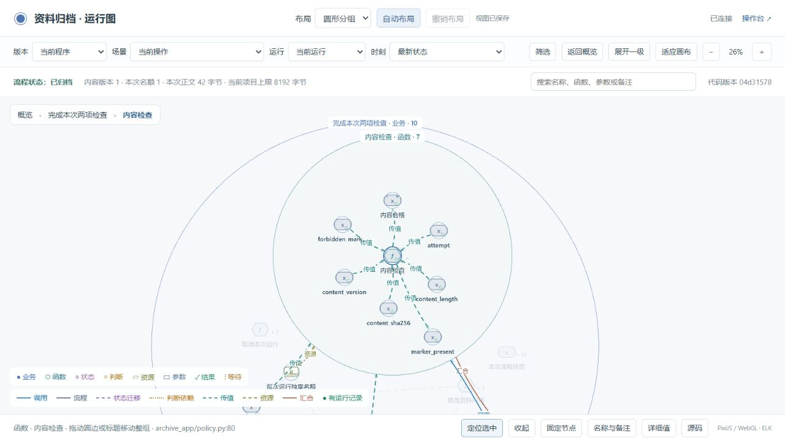
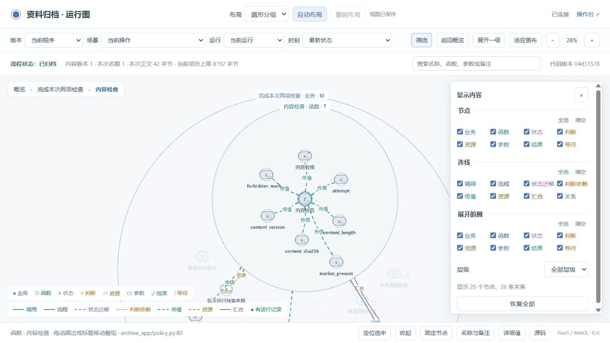
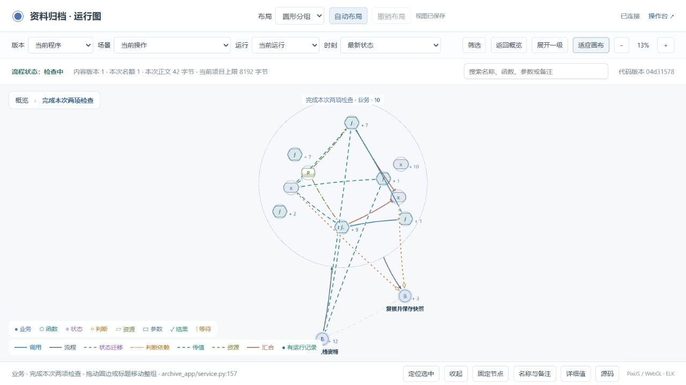

# 展开圈、筛选与稳定性检查

2026-10-20。演示加载版本：`04d3157872cd3eab5e96f01618f06706b7134cc3ab0018c2d314f0526a596713`。

## 本轮行为

- 任意类型的节点展开后，都由同类型颜色的圈代表。内部没有实际关系连接原节点时，不重复显示中心节点；有实际关系时，在圆心保留自身节点。
- 上层关系连接圆边；两个展开圈的内部节点之间连接时，保留实际端点，并绘制在区域上方。包含关系由包围圈表示。
- “筛选”可分别选择节点、连线、圈的类型和层级。设置会保存，隐藏内容的位置、标注和展开记录保留。
- 圆边和标题可拖动整组，隐藏的后代也随之移动。



这里“内容检查”是函数，展开圈为函数的青绿色；外层“完成本次两项检查”是业务节点，圈为蓝色。函数的输入输出与自身有实际关系，因此中心节点保留。八种类型的共同规则另外由自动检查覆盖，并非只验证业务节点。



## 稳定性修正及证据

原代码每 400 毫秒把变化的时钟值当作图变化，闲置时也重建图；每次重绘都销毁并重新创建图形、文字及纹理。本轮去掉仅时钟变化触发的重建，同时保留授权到期边界更新；按节点和关系身份复用对象，最多留下 128 个未使用对象。后台页暂停绘制和轮询，关闭时释放资源。

参考了 [PixiJS 官方性能 Skill](https://github.com/pixijs/pixijs/blob/dev/skills/pixijs-performance/SKILL.md) 中的对象复用、文字更新及资源释放方法。未新增第三方依赖，也未更换现有开源库。

[浏览器记录](browser-checks.json) 包含 14 项通过的检查：

- 真实拖动圆边后，全组位移一致，其他组不动；折叠后移动、再次展开和刷新恢复一致。
- 节点、连线、圈和层级筛选符合选择；刷新后恢复；清除筛选不改变坐标。
- 闲置 39 秒期间绘制次数保持为 4，没有随轮询增加。
- 三批共 462 次缩放、展开收起和方向键移动操作。从第 36 轮至第 66 轮，新建图形数保持 270、新建文字数保持 173；采样时池中 183 个对象，其中 68 个正在显示。每次采样的未使用对象均不超过 128。
- 历史版本切换与当前运行分开；函数展开圈使用原类型色，自身节点位于圆心。

三批操作之间包含服务重启和其他检查，不能把总经过时间当作连续性能测试。重启期间记录了两次请求失败；此后恢复正常，没有其他页面警告或错误。

原崩溃标签页受浏览器策略限制，无法读取内部崩溃原因或自动刷新。上述资源开销是源码中确认的问题，测试证明本次场景能稳定操作；未获得原始崩溃转储，也没有量测 GPU 内存或验证任意规模的图。

同步示例时还修正了本轮辅助脚本对换行差异的处理，统一换行后合并，并检查关键实现仍完整。该问题在交付前发现，没有把缺失代码的页面作为结果。

## 真实运行与原数据



[运行记录](runtime-check.json) 核对了当前加载版本和真实数据库：

- 新增第 9 次运行 `b26a26b2c34a`，两个名额，两项检查并发完成。
- 新增第 10 次运行 `509e83d16396`，一个名额，索引检查先等待，释放名额后完成。图页实际显示“检查中”和本次名额 1，最后恢复“已归档”。
- 两次运行均使用已有归档记录；原资料、归档快照和此前八次运行的数据库行保持原样。
- 新增一条合成审批，权限数据版本因此从 15 增为 16，这是预期变化。
- 探针写入 154 条记录，错误和丢弃均为 0。

## 检查与复现

[项目检查结果](verification.json) 对应交付示例、资料归档示例和独立演示项目，均经过 `inspect → verify → accept → check`。原业务、状态机和探针未改；本轮只更新图呈现、交互、刷新及相应检查。

在仓库根目录运行：

```text
node examples/delivery/tests/test_graph_layout.mjs
node examples/team-archive/tooling/graph_tests.mjs
python tools/check_package.py
```

布局检查使用实际 ELK 库，覆盖三种布局、八种可展开类型、中心关系、跨圈真实端点、筛选保存、隐藏后代移动及授权到期边界。既有业务正反例、资源与汇合、历史事实、源码绑定和生成归属仍由项目验证入口检查。

打开演示后，双击节点逐层展开；拖动圆边或标题移动整组；在工具栏点“筛选”选择所需内容。名称与备注仍通过选中节点后的对应按钮修改。偏好保存在当前浏览器、同一网站地址下，`localhost` 与 `127.0.0.1` 的偏好各自独立。
