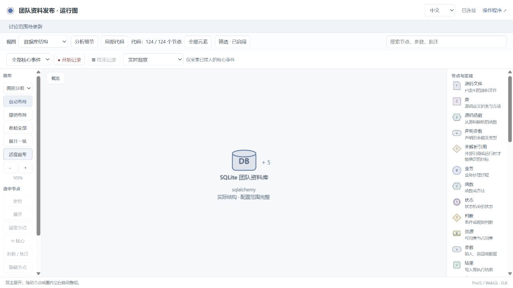

# v0.7.0 release evidence

This release combines database observation and optional source exploration with
an independent application trial. The trial uses a real separate Codex
conversation, a simulated user and a running Python/SQLite application.

## Read in this order

1. [Ordered work table](../../development/code-vis-release.md): branch sequence,
   commits and acceptance status.
2. [Trial plan](trial-plan.md) and [independent business oracles](trial-oracles.md):
   expectations prepared before implementation and reserved clarification.
3. [Accepted v1 result](v1-summary.md): login, submission, review, private messages,
   resubmission and anonymous publication.
4. [Requested v2 iteration](v2-summary.md) and [visible dialogue](dialogue.md):
   confirmation, message migration, repeated marking and graph changes.
5. [Failures and public repairs](repairs.md): original failures, fixes and strict
   positive/negative regressions.
6. [Whole-project assessment](../../assessment/2026-10-24/README.md): implementation,
   architecture, readability, guidance, limitations and further repairs.
7. [Final runtime acceptance](runtime-summary.md): the final four reports,
   source identity, view preservation, retention boundaries and true missing
   events after upgrading the same application to `fa37289`.
8. [Publication verification](publication/README.md): the fixed `v0.7.0` tag,
   five main CI jobs, six release attachments, actual GitHub Pages checks and a
   fresh installation from the public tag.

The requested follow-up adds explicit per-message read state and the recipient's
unread count. It retains the same project and graph identities. The original v2
is accepted and frozen; the final public runtime upgrade has its own receipt.

## Evidence already frozen

| Scope | Actual evidence |
| --- | --- |
| Database branch | [Changes and acceptance](../db-vis/README.md), published as `af5ae5a` |
| Optional code branch | [Source and browser acceptance](../code-vis/README.md), `7e80f2c`, merged as `96f28f7` |
| Public trial repairs | [Full regression](data-fix-full-repository.log), [native/live database results](data-fix-native-live.json), `920c015` |
| Trial v1 | [Four categories](trial-v1-verification.json), [accepted candidate](trial-v1-accepted.json), [independent SQLite checks](independent-business-v1-final.json) |
| Reproducible v1 source | [Frozen application and evidence](archives/team-publishing-v1-source-and-evidence.zip), [archive inspection](v1-archive-inspection.json) |
| Trial v2 | [Four categories](trial-v2-verification.json), [accepted candidate](trial-v2-accepted.json), [source and evidence](archives/team-publishing-v2-source-and-evidence.zip), 44 independent business/migration checks |
| Final public runtime | [Acceptance and browser review](runtime-summary.md), [four categories](runtime-final/runtime-fa37289-verification.json), `fa37289`; 28 protected files unchanged |
| Reproducible final source | [Final source and evidence ZIP](archives/team-publishing-final-runtime-source-and-evidence.zip), [new-directory extraction and 44 independent checks](extracted-acceptance.json) |
| Assessment repairs | [18 source cases](../../assessment/2026-10-24/code-final.log), [real catalog checks](../../assessment/2026-10-24/final-live-catalog.json), [runtime operations](../../assessment/2026-10-24/final-live-runtime.json), [Node operations](../../assessment/2026-10-24/final-native-live.json) |
| Complete release regression | [Local full run](../../assessment/2026-10-24/full-retention-result.json), [five CI jobs](../../assessment/2026-10-24/ci-final-core.json), [GitHub clone/fresh installation](../../assessment/2026-10-24/github-install-final/result.json) |
| Introduction | [English/Chinese browser checks](../../assessment/2026-10-24/site-final/result.json), including 390-pixel layout |

The source ZIPs exclude virtual environments, node modules, live databases,
collector credentials and process IDs. It includes synthetic recorded events
and frozen verification inputs. v2 also includes its explicitly identified
synthetic pre-migration SQLite fixture. Each archive's manifest and SHA-256 support
checking its contents.

## Selected screenshots

The initial graph is shown before behavior implementation:

The running application can be inspected at a recorded step:

Source relationships open around a selected business region:

The same viewer also exposes the indexed source and data structures:

## Scope of the conclusions

The four report categories remain separate: implementation mapping, state
constraints, business assertions and project checks. A correct graph can reveal
a business defect; those outcomes must not be merged into a single mapping
claim. Source parsing is bounded by its adapters and explicit scope. Supported
schema reflection and selected query facts do not establish arbitrary lineage.
These results also do not establish all possible schedules or production load.

Historical failures are retained. The assessment's first full run was
deliberately interrupted after a new conditional-binding defect was reproduced;
its [partial log](../../assessment/2026-10-24/full-interrupted.log) is not a passed
release test. Final acceptance uses the corrected candidate.
