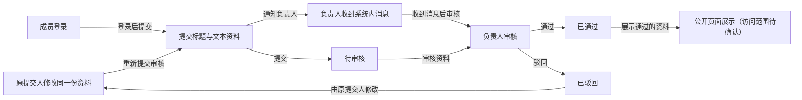
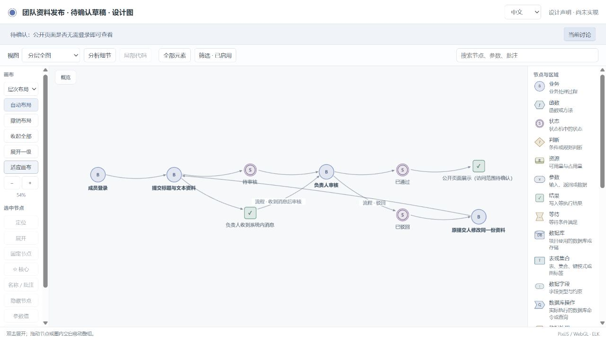
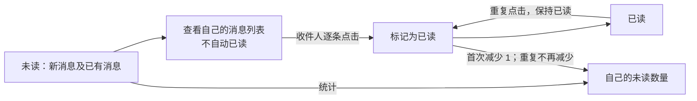
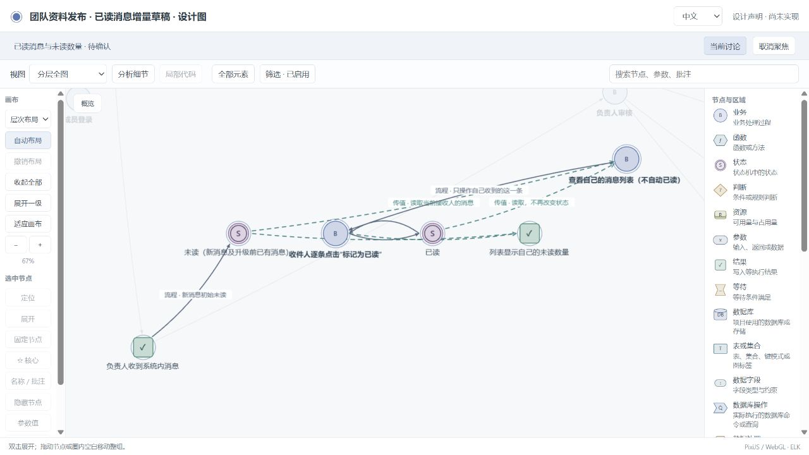
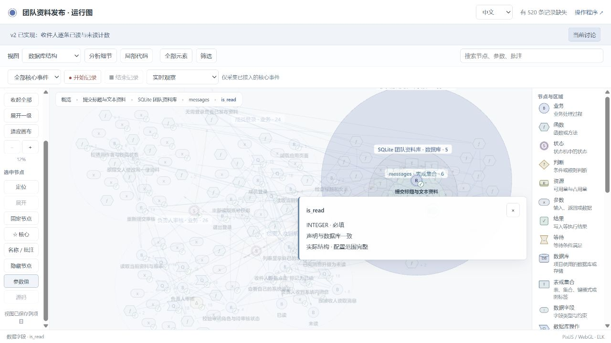
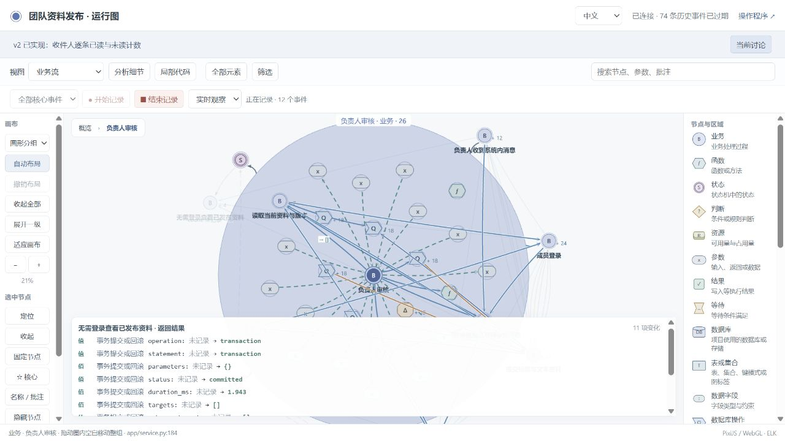

# Independent application trial: visible dialogue

This is an actual separate Codex conversation. The user role was simulated by the coordinating agent; application execution and browser evidence are real. Technical coordination is labeled. Internal reasoning and tool output are excluded.

The [JSON transcript](dialogue.json) preserves original wording and link destinations. This readable copy maps local links to repository screenshots or the corresponding frozen source archive.

Thread: `01a16a61-af8a-7881-82f5-c46f78fe533d` · Stategraph v0.7 · 独立资料发布试用

Status: `complete`.

## Turn `01a16a61-b229-7ec1-8b64-3933b784c2dd`

### 1. Test coordinator

Message `fco_01a16a61-b22a-7603-a24c-01f1e747712b`

请在这个新会话的独立目录中创建一个 Demo 项目，使用本地最新 Skill：C:/Users/Lvi_P/Documents/Work/CF/平台软著/SoftwareStatusObserverSkill/skills/business-observer/SKILL.md。请读它并使用该目录的实现，勿使用另一个旧的已安装副本，也不要修改 Skill 仓库或其它项目。

我想做一个简单的团队资料发布 Web：成员登录后提交带标题的文本资料，负责人收到系统内消息后审核，通过的资料放到公开页面，驳回的资料要能继续处理。用 Python 和简单的 JavaScript 前端即可。我希望开发时能从业务图看清实际做了什么，也能往下查看状态、参数、函数、数据库和局部代码关系。

请先通过必要的澄清确认我的意思，在对话里给我看业务图并告知可打开的实际图地址，我确认后再实现，不要主动替我扩展业务。之后我还会提出一轮迭代。

这是发布验收中的模拟真实用户对话，后续会收到模拟用户的实际回答。不要自行代答或把尚未得到的答案写成确认。保留对话所形成的要求、失败、修复、复测和实际运行截图；使用英文源码及维护文档，界面和这次对话使用中文。最终需要可运行程序、完整源码映射、实际录制回放和四类分开的验收报告。你可以在本会话独立目录中安装所需依赖、运行本地服务及测试。

### 2. Assistant

Message `msg_0bc22cae1bfff2fe016adbbeeb67d48191ae21f7eccf87e5cc`

我会先读取你指定的本地最新 business-observer Skill，确认它的澄清与业务图流程，再梳理需要你决定的业务问题。实现会等你看过实际业务图并确认后开始。

### 3. Assistant

Message `msg_0bc22cae1bfff2fe016adbbf06f9fc8191903c0441bc8a7f9d`

我已读完指定版本，正在按它的流程准备可打开的业务图草稿。当前最关键的业务歧义是“驳回后继续处理”的含义；另外，这个 Skill 要求明确运行模式和数据库选择。图中会保留待确认标记，尚未得到的回答不会记为已确认。

### 4. Assistant

Message `call_72804fe1d6b94c2992c8213e2c0e4a52`

“驳回的资料要能继续处理”具体指什么？
- 原提交人修改同一份资料后重新提交审核
- 负责人可直接重新审核已驳回的资料
- 上述两种方式都需要

开发模式选哪一种？两种都有业务图与监测。observe 由 Python 业务代码执行、图负责观测；drive 由状态声明驱动执行。这个简单 Demo 建议使用 observe。
- observe：业务代码执行，图负责观测（建议）
- drive：状态声明驱动执行

资料、账号及系统内消息需要持久保存。这个本地小型 Demo 建议使用 SQLite + SQLAlchemy，安装和运行较简单；PostgreSQL 更适合独立部署的多人共享服务，但需要额外数据库服务。你选哪一种？
- SQLite + SQLAlchemy（建议）
- PostgreSQL + SQLAlchemy

### 5. Simulated user

Message `fco_01a16a62-cfd3-7930-823e-a1dec3fa2740`

模拟用户回答：
1. 驳回后由原提交人修改同一份资料，再重新提交审核。负责人不能替作者修改内容。
2. 选 observe，业务代码自己执行，图用来观察。
3. 选 SQLite + SQLAlchemy。就是本地运行的小 Demo，不要外部邮件服务。

### 6. Assistant

Message `msg_0bc22cae1bfff2fe016adbbf6e5a70819195c8bc007ec46694`

已记录：驳回后由原提交人修改同一份资料并重新提交，负责人不能替作者修改；采用 observe 和 SQLite + SQLAlchemy，本地运行，不接外部邮件。我会把这些回答更新到同一张业务图；“公开页面是否允许未登录访问”仍保留为待确认项。

### 7. Assistant

Message `msg_0bc22cae1bfff2fe016adbbfc245e88191b159ad62f1e2af51`

业务图已更新为“驳回 → 原提交人修改 → 重新提交审核”的闭环。草稿首次格式校验发现了几处记录格式错误，已修复并复测通过，失败记录也已保留。现在正在检查实际图页面能否正常打开；此时仍是设计图，没有业务运行或录制数据。

### 8. Assistant

Message `msg_0bc22cae1bfff2fe016adbc0247cf08191b8f69115cb1e84f5`

图服务首次启动后，浏览器连接超时，不能算作已交付。我已改为在本机启动仅供本地访问的服务，正在重新核对页面和图数据。剩余确认仍只有公开页访问范围，以及你是否认可这张业务图。

### 9. Assistant

Message `msg_0bc22cae1bfff2fe016adbc073697481919e191de2c93803c2`

已记录你的选择：**observe、SQLite + SQLAlchemy、本地运行、不接外部邮件**；驳回后由原提交人修改同一份资料并重新提交，负责人不能替作者修改。

[打开实际业务图](http://127.0.0.1:51221/graph?lang=zh-CN)——已验证页面可访问。当前是设计图，尚未实现业务程序。

请确认两点：

1. **公开页面是否无需登录即可查看？**
2. **这张图是否准确，可以据此开始实现？**

实际页面截图如下；首次校验和启动失败、修复及复测均已保留。

等待确认遵循你“确认后再实现”的要求，也对应指定 [business-observer Skill](../../../skills/business-observer/SKILL.md) 的 “continue once that scope is confirmed”。

## Turn `01a16a68-4e3f-7b32-851f-9ec6799d2294`

### 10. Simulated user

Message `fco_01a16a68-4e41-7463-b6b4-9ef3e2e22d72`

模拟用户确认：
公开页面无需登录即可查看。我看过这张图，流程是对的，可以开始实现。

把权限含义也写清楚：Demo 里先用两个固定测试账号，一个成员、一个审核负责人。成员不能审核；负责人能审核所有待审核资料，但不能替作者改内容。驳回后只允许原作者修改并重新提交；通过后的资料本版只读。消息只给接收人查看。每次操作都按当时的账号权限和资料状态检查，通过时展示被审核的那一版内容，重复审核不要重复发布。

这些就是本版范围，不增加其它业务功能。完成后请给我实际的程序和运行图地址，让我能走一遍并录制回放；也请展示局部代码和完整代码视图。

### 11. Assistant

Message `msg_0bc22cae1bfff2fe016adbc09af4108191838eb73cb64c0550`

确认已收到。我会按这版范围实现两个固定测试账号、资料提交与审核、接收人专属消息和匿名公开页，并把每次操作的权限、状态检查及被审核版本关联到运行图。接下来会完成程序、源码与数据库映射，再用真实操作验证录制回放、局部代码和完整代码视图。

### 12. Assistant

Message `msg_0bc22cae1bfff2fe016adbc0d3035481918fc20b64754d466b`

实现会把“资料内容版本”和“资料状态”分开保存：审核操作必须匹配当前待审核版本，发布保存该版本的内容快照；重复审核会被拒绝。权限检查放在服务端的实际读写事务中，页面按钮只负责展示可用操作。

### 13. Assistant

Message `msg_0bc22cae1bfff2fe016adbc24bf3c88191afea38bef2d1c50e`

核心业务逻辑已写好，正在接入界面和观测层。审核、修改、重新提交都会重新读取账号角色、资料状态和版本；公开页读取单独保存的发布快照。后续测试会覆盖越权、旧页面提交、重复审核和两个审核请求同时到达的情况。

### 14. Assistant

Message `msg_0bc22cae1bfff2fe016adbc39575008191a221d6823ab04bda`

界面和核心流程已接上：成员可提交、保存驳回后的修改并重新提交；负责人只看到待审核资料；公开页无需登录。现在在做源码和数据库映射，接着会运行独立测试，再到浏览器实际走完整流程，检查图中的值是否与数据库一致。

### 15. Assistant

Message `msg_0bc22cae1bfff2fe016adbc482b7d48191b619c9db695a6efd`

首轮测试遇到本机应用控制策略阻止 SQLAlchemy 二进制扩展加载，业务代码尚未执行到断言。我正在改用它的纯 Python 构建，并保留这次环境失败记录；业务要求和测试预期不变。

### 16. Assistant

Message `msg_0bc22cae1bfff2fe016adbc5070634819184484864a1d509e0`

业务独立测试已通过 20 个断言，覆盖权限拒绝、版本冲突、重复与并发审核、消息隔离和事务回滚。映射校验另行发现了数据库默认值声明与 SQLite 实际元数据的表示差异，我正在对齐声明；不会用业务测试通过来替代映射验收。

### 17. Assistant

Message `msg_0bc22cae1bfff2fe016adbc5f8590c819194e0f961a585fcb2`

业务流程的 20 项独立断言已通过。目前正在收尾源码映射与真实浏览器验证；映射检查发现了观察器对数据库可选字段的处理差异，我会保留原始失败记录，核实原因后再给出四类报告的结论。

### 18. Assistant

Message `msg_0bc22cae1bfff2fe016adbc65e95348191a97626295be61bdb`

已确认一个 Skill 集成问题：数据库同步会重建数据节点，而源码映射检查要求这些节点保留另一组派生信息，两个检查目前不能同时通过。我会保留这项失败，不改动指定的 Skill 实现；程序、状态验证和实际录制仍继续完成，报告会分别标明结果。

### 19. Test coordinator

Message `fco_01a16a7f-988a-7633-b03e-0bba0f5de441`

验收协作说明（不改变已确认业务范围）：我读取了 runtime-coverage-initial.json，数据库 operation 自动生成的可选输出字段（例如正常查询的 error_type、transaction 的 rows）被通用实现覆盖检查当成了必有字段。这需要核对并修复公共模块，不能通过伪造字段、删掉数据库特性或放宽项目检查绕过。请保留原始失败证据，暂时保持 observer_runtime 原样；可继续独立的浏览器和业务测试准备。我会在主 Skill 修复并提供可更新版本后通知你重测。另一个已记录的公共问题是 SQLAlchemy server_default='1' 与 SQLite 的带引号默认值导出差异。请在本会话说明公共缺陷和项目接入错误的区别，无需向别的会话发送消息。

### 20. Assistant

Message `msg_0bc22cae1bfff2fe016adbc6991ad08191b364dc2fef764235`

我会保持 `observer_runtime` 原样，等公共修复版本到达后重测。当前分清两类问题：数据库可选输出字段被当作必有字段、默认值导出表示差异属于待核实的公共问题；数据库连接未及时关闭、观察器导入路径和接入配置错误属于本 Demo，已在项目内修复并复测。现在应用和运行图已启动，继续验证实际操作与回放。

### 21. Assistant

Message `msg_0bc22cae1bfff2fe016adbc6fdfcf48191a459f6cae1cf8f48`

真实浏览器已走通“提交 → 驳回 → 原作者修改 → 重新提交 → 通过 → 匿名查看”。录制保存了 508 个实际事件，回放中能看到审核版本 2、状态变为 `approved`、发布数为 1；接下来检查局部代码和完整代码视图。

### 22. Assistant

Message `msg_0bc22cae1bfff2fe016adbc7c8a648819194dc84da110b4fcc`

关闭观察和注入观察传输故障两种模式，也已在浏览器中走完相同流程，最终都发布了第二版。完整代码视图现已加载 619 个索引节点；静态未解析调用仍明确保留为未知，不会当作已执行的调用。正在整理这些证据，并补做源码失配、队列受限和测试敏感性检查。

### 23. Test coordinator

Message `fco_01a16a84-9bad-78f3-a435-9612cc66f993`

技术修复已准备好，可继续 v1 验收。主库 dev 工作区的公共代码已修复两个问题（尚未 commit）：1. export_sqlalchemy_metadata 正确引用/转义 SQLAlchemy 字符串 server_default，支持可选 dialect。2. 新增 bo_observer/data/evidence.py，共用数据库事件条件字段检查。implementation_coverage.runtime_errors 增加可选关键字 root；公共 CLI/change_sync 已自动传入。你独立调用此 API 的地方请传 root=项目根目录，否则维持旧严格检查，不能凭 managed 标记自动免除字段义务。请先复制保留 runtime-coverage-initial.json 等原始失败证据，然后从主库 skills/business-observer/scripts 更新 observer_runtime 整套公共代码，保留项目自身配置/图/业务逻辑，确认版本散列。不要自行修改公共核心。32 个数据库目录/同步测试及原有实现覆盖回归已通过，包括正常查询无需假造 error_type、事务无需假造 rows，但漏结果/错误/提交或回滚信息、类型错误、伪造 capture 仍报错。请保留当前设计/业务条件，完成 v1 四类 gate 与浏览器、数据和代码视图验收。若 ORM 模型使用 text("'1'")仅为了规避旧工具问题，可恢复正常 server_default='1' 并重测真实结构一致性。不需要向其他会话发消息。

### 24. Assistant

Message `msg_0bc22cae1bfff2fe016adbc7f60d088191af0c14b8da343c98`

已收到公共修复版本通知。我会先冻结刚才的失败报告和录制，再用指定主库更新项目内的公共代码，恢复常规的 SQLAlchemy 默认值写法后重测。旧录制将保留为历史证据；更新后的构建会重新录制，避免把旧版本结果当作当前验收。

### 25. Assistant

Message `msg_0bc22cae1bfff2fe016adbc835aca08191a81adffb381d943e`

公共字段修复已复测：对先前真实事件调用检查器并传入项目根目录后，运行字段覆盖错误已清零。另有一个独立问题仍可复现：`bo_db sync` 删除 11 个数据库操作节点的 `code_evidence`；重新 enrich 后，数据库检查又判为过期。复现结果已保存到 `evidence/checks/public-fix-and-projection-reproducer.json`，目前不绕过这道 gate。

### 26. Test coordinator

Message `fco_01a16a86-d1af-7030-a53c-fa08abba5100`

已看到 public-fix-and-projection-reproducer.json，确认 bo_db 投影与源码 enrich 对同一操作节点的 code_evidence 所有权冲突属于公共模块问题。我正在加回归并修复，保留原始复现，不需要删掉操作节点或跳过任一检查。现有字段条件检查已通过主库全部数据库专项。你可继续完成独立业务/UI证据；公共投影修复后我会通知。

### 27. Test coordinator

Message `fco_01a16a87-f98c-73f3-b3de-9ecc230656d0`

投影衔接修复已加入主库公共 data/projection.py，并通过 test_database_sync 全部 15 项（含原始失败复现→修复后的稳定性）。数据库刷新保留相同 source 绑定的 code_evidence 和原有节点/边顺序；源码检查仍独立重算 AST 信息，数据库检查仍能识别篡改的 capture。请再次更新这个公共文件、重建并执行 bo_db check + enrich/check + v1完整验收。保留之前复现。

### 28. Assistant

Message `msg_0bc22cae1bfff2fe016adbc93671288191b4f7b39641772a7c`

第二个公共修复也已接入：数据库检查现为通过，重新扫描后源码映射不再出现互相覆盖。额外检查已确认：源码失配会被拒绝、真实数据库结构变化会被识别、队列丢弃不改变业务结果，移除作者限制或篡改发布内容的测试变异也能被检出。现在进行更新后构建的最终录制和四类验收。

### 29. Simulated user

Message `fco_01a16a8b-2bc6-7b60-8632-dba8549cebc7`

模拟用户的下一轮需求（先完成并冻结当前 v1 验收，再开始这一轮）：我想把系统消息标记为已读，并在我的消息列表里看到未读数量。其他业务流程保持原样。请按 Skill 判断是否还有必须确认的语义，先给我这一处业务图的变化和可打开的实际图地址；我确认后再实现。请保留 v1 的独立证据与源码快照，不要覆盖 v1 录制、失败或验收报告。技术提醒：本轮要检验新增功能/字段的源码映射、数据库实际变化、当前记录清空和个人视图保存，但不要把这些技术检查转成新的用户业务需求。

### 30. Assistant

Message `msg_0bc22cae1bfff2fe016adbc99f7c048191be306636325b6b82`

已收到“消息标记为已读、显示未读数量”的下一轮需求。我会先完成并冻结 v1 的源码、录制和四类报告，再只针对这处变化给出业务图与需要确认的语义；确认前不实现已读功能。

### 31. Assistant

Message `msg_0bc22cae1bfff2fe016adbca66b43c819187e58bf0c35df54d`

v1 的四类 gate 已全部通过：实现映射、状态约束、业务规则、项目检查均无错误。最终录制包含 508 个事件和 5 个真实资料状态快照；之前提前结束、只收集到部分事件的录制也会保留并标为不完整。现在冻结 v1，再准备“已读消息”的增量业务图。

### 32. Assistant

Message `call_b42ebd1e40e242b28fd8981b858ff073`

v1 已冻结。下一版的“标记为已读”由什么动作触发？这个选择决定状态何时变化。
- 逐条点击“标记为已读”（建议）
- 打开消息列表时，将当前列表消息全部标为已读

升级前已经存在的消息，初始如何处理？这个选择会直接影响首次看到的未读数量。
- 已有消息全部按未读处理（建议）
- 已有消息全部按已读处理，仅新消息计入未读

### 33. Simulated user

Message `fco_01a16a91-c59e-7672-a781-fd00dcb22070`

模拟用户回答：逐条点击“标记为已读”才改变状态，打开列表不自动已读。升级前已有的消息都按未读处理。只允许收件人标记自己的消息，重复点击保持已读且未读数不再减少；这里不加“全部已读”或恢复未读等功能。请把这一处变化画出来并给我实际可打开的图地址，确认后再实现。

### 34. Assistant

Message `msg_0bc22cae1bfff2fe016adbcb5525a48191996575f51a31d863`

已记录你的选择：逐条手动标记、打开列表不改变状态、已有消息按未读处理；仅收件人可操作，重复点击不再减少未读数。v1 已冻结，我会在保留相同业务节点身份的下一版工作副本中画出这处变化，确认前只更新设计记录。

### 35. Assistant

Message `msg_0bc22cae1bfff2fe016adbcc227ba88191b0b2f1ede9f0b9a4`

v1 已完成并冻结，**四类验收全部通过**。最终录制包含 **508 个事件、5 个实际状态快照**。

- [打开程序](http://127.0.0.1:51230) · [运行图与回放](http://127.0.0.1:51231/graph?lang=zh-CN)
- 测试账号：`member / member-demo`；`reviewer / reviewer-demo`
- 报告：[实现映射](archives/team-publishing-v1-source-and-evidence.zip)、[状态约束](archives/team-publishing-v1-source-and-evidence.zip)、[业务规则](archives/team-publishing-v1-source-and-evidence.zip)、[项目检查](archives/team-publishing-v1-source-and-evidence.zip)
- [冻结的 v1 源码与证据包](archives/team-publishing-v1-source-and-evidence.zip)

下一轮目前只完成设计，业务代码尚未修改。[打开“消息已读”增量图](http://127.0.0.1:51234/graph?lang=zh-CN)。

**这张增量图是否准确，可以据此开始实现？** 按你的要求，确认后再进入本轮开发。

## Turn `01a16a96-05a6-7261-841b-baa15878a490`

### 36. Simulated user

Message `fco_01a16a96-05a8-7730-bf66-87fe89defb44`

模拟用户确认：这张消息已读增量图准确，实际图页面也能打开，可以按已确认的内容实现。保留收件人权限、首次标记减少 1、重复标记不再减少、打开列表不自动已读、已有消息升级后未读这些要求，其他业务不变。请完成 v2 的实现、代码与图同步、实际数据库迁移、真实浏览器记录及完整验收，并保留失败、修复和复测。技术补充：公共修复已提交并推送 dev 的 920c015，主库全部回归及四种真实数据库的 Python/Node.js 验收已通过；v1 我另外做了 24 项与图无关的业务/SQLite断言，也全部通过。最终请给出 v1→v2 的可复查差异和每项试用证据路径。不要向其他会话发送消息。

### 37. Assistant

Message `msg_0bc22cae1bfff2fe016adbcc539f2081918d1785253ef619a0`

我会按已确认的增量图实现 v2：迁移已有消息为未读、增加收件人逐条标记和未读数量，并同步源码映射与运行图。v1 保持冻结；v2 会单独保留迁移、失败修复、真实录制和验收证据。

### 38. Assistant

Message `msg_0bc22cae1bfff2fe016adbcd1b348c8191bcc080aaba9f779e`

业务层会在同一事务内重新检查当前账号和消息收件人，再执行首次标记并返回未读数，保证重复或并发点击只生效一次。迁移会只新增消息的已读字段；启动时检测字段是否已存在，避免后续重启把已读消息重置。

### 39. Assistant

Message `msg_0bc22cae1bfff2fe016adbce8d4aec81919b1f3cede34d2991`

我继续核对 v2 的运行证据，重点检查未读计数、重复点击和迁移结果；接着会完成真实浏览器流程与 v1→v2 差异报告。

### 40. Test coordinator

Message `fco_01a16a9d-4de8-7332-8175-81582c9e25fd`

技术协调（不改变已经确认的 v2 业务需求）：主仓库正在完成整体评估，发现并修复了代码索引损坏误通过、源码查询阻塞事件接收、默认源码范围排除自有状态代码三个公共问题。你先继续完成当前 v2 真实实现与完整验收，保留失败和修复，不要中途更换公共 runtime。v2 通过后保留冻结证据，我会提供最终公共版本，再做一次只更新 Skill/runtime 的回归。最终请提供 v1→v2 图变化、真实用户式对话、迁移和消息权限测试、截图、源码和证据归档的路径。请不要向其他会话发送消息。

### 41. Assistant

Message `msg_0bc22cae1bfff2fe016adbce93b0308191b55d41ae36bee84f`

收到：当前 v2 保持已安装的公共 runtime 版本，先完成并冻结本轮验收。后续最终公共版本的回归会单独记录，避免混入本轮证据。

### 42. Assistant

Message `msg_0bc22cae1bfff2fe016adbced1eb5c81919f2b1e92330d74f3`

独立业务测试已通过 37 项断言。映射检查发现了两个接入问题：迁移函数位于条件块内，现有源码解析器无法定位；数据库引擎参数的映射类别也需调整。我会只修改 Demo 的接入代码，保留失败记录并重跑检查。

### 43. Assistant

Message `msg_0bc22cae1bfff2fe016adbcf7669108191963e255f29518802`

新增的 11 组场景已在观察开启、关闭和传输故障三种模式下执行；开启模式没有丢弃事件或数据探针错误。现在进入浏览器验收，包括两个已打开页面对同一条消息重复点击，检查未读数是否只减少一次。

### 44. Assistant

Message `msg_0bc22cae1bfff2fe016adbcfe2e8c08191b09384cedfbfe79e`

迁移还有一个明确边界：当前公共 runtime 能识别 DML 的读写目标，但不支持解析 `ALTER TABLE` 的访问方向。Demo 已改用其现有的显式目标接口记录这条迁移命令；迁移是否成功、旧数据是否保持不变，仍由真实数据库检查验证。此限制会写入报告。

### 45. Assistant

Message `msg_0bc22cae1bfff2fe016adbd07dbd2881918192c96c6b8e3342`

浏览器已验证：原有 6 条消息刷新后仍是未读；首次点击后变为 5，另一个陈旧页面重复点击后仍为 5。资料的“提交→驳回→修改→重提→发布”流程也已完成。当前录制出现了采集缺口提示，我会保留这份记录，并核对最后的提交帧。

### 46. Assistant

Message `msg_0bc22cae1bfff2fe016adbd1a384c88191a65011268a1d83b6`

三种模式的浏览器业务结果一致。四类验收中，状态约束、业务规则和项目检查已通过；映射检查还指出迁移命令名不符合接口格式。我已修正这一接入格式，并会重录最终构建，旧录制和失败报告都会保留。

### 47. Assistant

Message `msg_0bc22cae1bfff2fe016adbd25c69608191b9dec57fc426aee3`

最终构建的数据库映射复测已无错误，新录制目前也没有缺口。测试中还遇到同一浏览器跨本地端口共享 Cookie 的会话冲突，已通过重新加载并分别登录恢复；这属于并行测试实例的操作记录，会保留说明。

### 48. Test coordinator

Message `fco_01a16aae-81cb-7261-bd58-fc1d26a9ec4c`

技术协调：最终公共修复现已提交并推送到 dev，commit 9134c61efed2ec74d6111acebc7cb6350753fcce，canonical Skill 路径仍是 C:/Users/Lvi_P/Documents/Work/CF/平台软著/SoftwareStatusObserverSkill/skills/business-observer。新增修复也让条件块内函数能被源码绑定定位，18 项源码回归和真实四库/Node 测试已通过，主仓库完整回归与远端 CI 正在执行。请先完成并冻结当前 v2（包括最终无缺口录制），之后在同一项目继续一次只升级公共 Skill/runtime 的验收：保留 v1/v2 冻结材料和业务预期；通过正式升级流程接入该 commit；应用每轮图相关检查，确认四类 gate、真实录制、局部/全代码和数据视图、旧记录清理与个人布局保留。不得新增业务需求或弱化检查。若你改进新写代码的可读性，只做等价格式和必要注释并记录。最终交付包含 v2 原验收与最终 runtime 复测的明确区别、源码与证据 ZIP、哈希和全部关键截图。主会话另行用真实 v1 数据库做迁移与消息权限核对，20 项独立业务检查已通过。

### 49. Assistant

Message `msg_0bc22cae1bfff2fe016adbd2a753488191bff176cce5e12f66`

最终 v2 录制已收齐 922 个事件、5 个真实资料提交帧，首次和重复已读结果均已记录，且没有缺口。按新增安排，我会先冻结这版验收，再通过正式升级流程接入 `9134c61`，单独保存 runtime 回归证据。

### 50. Assistant

Message `msg_0bc22cae1bfff2fe016adbd300037881919bf36fccdd009a90`

当前 v2 的四类 gate 已全部通过，正在完成验收签收与冻结。冻结包会包含无缺口录制、迁移前数据库、权限与并发测试、图和源码差异，以及失败修复记录；随后再开始公共 runtime 升级。

### 51. Test coordinator

Message `fco_01a16ab2-bf87-7f92-a458-bc94570aded1`

技术协调：9134c61 的干净 Git 导出和重新安装已通过，完整回归仍在进行。主仓库正在核实一个录制 UI 边界：回放中不应提供只属于当前源码的 Code structure 视图，以免空图或混淆源码版本。请继续冻结原 v2 和做公共 runtime 升级的独立业务验证；暂缓把 9134c61 作为最终发布运行时的冻结点。若证实需要小修复，我会发准确的新 commit；不增加任何业务需求，不修改独立预期。

### 52. Assistant

Message `msg_0bc22cae1bfff2fe016adbd3bcb52c8191b7b6477aec3294b2`

收到：`9134c61` 先用于独立回归，暂不作为最终发布冻结点。另一个需要保留的结果是：原 v2 的首次布局重载比对不一致，涉及尚未保存完成的视图状态；我会在升级前保存稳定布局，升级后单独核对位置、展开状态和视图选择。

### 53. Assistant

Message `msg_0bc22cae1bfff2fe016adbd48bcf448191aeba2cd88eda6fc1`

`9134c61` 的四类 gate 复测已通过，业务源码和独立预期哈希均未变化，升级前的稳定布局也完整保留。另有 8 项隔离检查通过，覆盖损坏代码索引的拒绝、检查过程不自动修复证据、自有状态代码的索引范围，以及条件块内函数定位。

### 54. Test coordinator

Message `fco_01a16ab6-fd36-7ba0-85db-d44f8406d4d7`

技术协调：录制/代码视图边界修复已通过真实浏览器，包括打开录制时从 Code structure 转到概览，回到 live 恢复代码视图。当前 canonical viewer.js 和 messages.zh-CN.js 已更新；运行时 Python 未再变化，两个仓库示例正执行严格验收，之后提交准确 SHA。可先保留 9134c61 独立回归，再用此 canonical 工作树做最终 UI 升级验证，标注最终 SHA 待主仓库提交补齐。请把 v2 原版、9134c61 回归和最终 UI 版分开冻结，失败保留，不需要新增业务。

### 55. Assistant

Message `msg_0bc22cae1bfff2fe016adbd4db97f08191adc529f5be4a2f29`

已收到最终 UI 修复安排。我会把原 v2、`9134c61` 回归版和最终 UI 版分别归档。`9134c61` 这轮已在录制期间打开全代码视图并继续执行发布流程，目前没有采集缺口；最终 UI 版将重点核对回放与实时源码视图的切换边界。

### 56. Test coordinator

Message `fco_01a16abb-a0f2-70e0-bae4-795f7f2bd1c7`

最终公共运行时提交已确定：e8e922eb4f33fe5b2fe2046975b40fa092935130（dev），只增加录制回放与实时源码视图边界处理。canonical 本地内容与该提交相同，两份仓库示例均已严格 verify/accept/check 冻结通过；新的完整回归正在运行。请把最终升级验收、运行包和清单绑定这个 SHA。验证录制中 Code structure 选项的原生 DOM disabled 属性，不要用当前 Playwright 的 option.isDisabled()，本环境该 API 对 option 返回了错误结果；还要实际检查回放节点和返回 live 后恢复代码节点。其他业务要求与独立预期保持不变，完成后给出所有材料路径及最终 app/graph URL。

### 57. Assistant

Message `msg_0bc22cae1bfff2fe016adbd6038de081918898ae4779648b9e`

最终提交已确定为 `e8e922eb4f33fe5b2fe2046975b40fa092935130`。最终 UI 版的四类 gate 已通过，实际回放也已自动切到概览。我会补上原生 DOM `disabled` 属性检查、返回实时后的代码节点检查，以及一份最终版本的实际消息录制。

### 58. Assistant

Message `msg_0bc22cae1bfff2fe016adbd68bd634819186091c4a7a106904`

最终版本的原生 DOM 检查通过：回放时 `Code structure` 选项的 `disabled` 为 `true`，业务节点仍可见；返回实时后，代码选项和源码节点恢复。最终消息录制也已完成：307 个事件、无缺口，未读数从 9 降到 8，重复点击后保持 8。

### 59. Assistant

Message `msg_0bc22cae1bfff2fe016adbd787835081918799f3eea4978028`

重载检查发现一个界面限制：节点位置和展开状态保留，但整页刷新会把分析视图切回概览；从回放点“返回实时”则能恢复代码视图。另有一次页面加载停滞，重试后恢复，三份静态资源均返回 200。这些结果会如实写入最终清单。

### 60. Test coordinator

Message `fco_01a16ac3-1fd5-73c3-818c-4cac4a35e4b0`

你发现的整页重载丢失分析视图需要核实，这是用户已要求的个人配置连续性，不作为可忽略限制发布。我正在查 viewer.loadAnalysis 和回放临时切换。请保留已完成材料，暂缓最终冻结；补充复现时是否刚从录制回到实时、是否已显示“视图已保存”，以及服务端 preferences 中 analysis.selected 在重载前后的值。不要改 Demo 的业务或预期，也不要改主仓库；若修复必要我会发新 SHA。

### 61. Assistant

Message `msg_0bc22cae1bfff2fe016adbd800ad8c8191aac0983564613551`

收到，最终冻结暂停，已完成材料保留。先前复现确实发生在从录制返回实时之后；服务端配置记录了 `analysis.selected` 从 `code` 变为 `overview`。当时没有单独确认“视图已保存”提示，我会补做明确等待保存完成的重载复现。

### 62. Assistant

Message `msg_0bc22cae1bfff2fe016adbd84759888191b8a01d4ad493a167`

已稳定复现，且这次不是刚从回放返回实时：

- UI 明确显示“视图已保存到项目”。
- 重载前 `/api/preferences`：revision 74，`analysis.selected = code`。
- 重载后：revision 76，`analysis.selected = overview`。

证据已保存为 `evidence/checks/reload-repro-direct-*` 和截图 070–071。`loadAnalysis()` 恢复选择时只检查 presets/custom，未包含特殊的 `code` 视图，这与现象吻合。最终包尚未冻结。

### 63. Test coordinator

Message `fco_01a16ac5-3bd8-7392-ad2c-abd7f543de39`

原因已定位：conversation.js 每次整页加载都把同一条讨论当作新讨论，自动 showDiscussion 切回 overview。已补持久化讨论修订和清除状态；已见过的讨论只恢复高亮，不改变保存的分析视图/相机。旧配置首次升级也保留已有视图；新的讨论和用户主动点“当前讨论”仍可引导聚焦。独立 JS 回归已从失败修复为通过，真实浏览器重载测试正在跑。请保留 e8e922e 为独立检查点；暂不要自行工作树升级，等我完成两份内置示例的严格迁移后给最终提交。

### 64. Assistant

Message `msg_0bc22cae1bfff2fe016adbd87b62f8819196c8705fc22de21f`

收到，等待新提交，不再升级工作树。会保留 `e8e922e` 的独立检查点，包括 gate 结果、307 事件录制和重载失败证据。此前提到的 `loadAnalysis()` 只保留为排查线索，不作为已确认根因；最终以新提交的真实重载复测为准。

### 65. Assistant

Message `msg_0bc22cae1bfff2fe016adbd94d95248191b2eeba8d458f6b95`

我先核对 e8e922e 检查点归档是否完整，并保留重载失败证据；最终升级继续等你提供新的提交号。

### 66. Assistant

Message `msg_0bc22cae1bfff2fe016adbd96ae84c81919e7e7d28a86de5f3`

e8e922e 检查点已归档，共 504 个文件。它明确标记为“非最终发布”：四项原生 gate 通过，但整页重载仍会把已保存的代码视图切回总览。接下来核对归档哈希和包内文件，确保这份失败证据可以独立复查。

### 67. Assistant

Message `msg_0bc22cae1bfff2fe016adbd9ba444c8191ac0de2e21a4e166d`

已保留 [e8e922e 独立检查点](archives/team-publishing-runtime-e8e922-checkpoint.zip)，504 个文件的哈希验证通过，前三份归档保持不变。

四项 gate 通过，但已保存代码视图在整页重载后仍切回总览，因此未封最终包。等待你提供最终提交号后，再正式升级并复测。

### 68. Test coordinator

Message `fco_01a16aca-6e22-74e1-9be7-605fdba2564b`

最终修复提交已完成并推送 dev：1bfeb39853a88ac5b9d02b675a010486b0832574。两份内置示例严格 verify/accept/check 均已通过；真实浏览器验证了保存代码视图后重载、清除讨论聚焦后重载、录制往返、源码更新和已保存位置。请用正式 runtime 升级更新你的同一个 Demo，并将最终报告/源代码归档绑定此 SHA；保留 e8e922e 检查点和重载失败。按新 iteration-graph-checks 复测四类 gate、业务源码与独立预期哈希不变、稳定保存后实际重载（代码视图和一个非代码视图）、取消讨论聚焦后重载、布局/注释、旧录制清理、实际录制与 source/data 视图。已有 37 业务断言及并发/迁移规则保持原样，不增加业务。完成后列明最后的 app/graph URL、所有最终报告与可分享 ZIP 路径和哈希。

### 69. Assistant

Message `msg_0bc22cae1bfff2fe016adbd9c041b88191954b0d0c63fa9e99`

我会将同一个 Demo 正式升级到 `1bfeb39853a88ac5b9d02b675a010486b0832574`，保留 e8e922e 检查点和重载失败记录，再按新的检查清单完成实际浏览器复测与最终归档。

### 70. Assistant

Message `msg_0bc22cae1bfff2fe016adbd9f7a91c8191a1e0ce9097919f11`

已确认源仓库 HEAD 是指定 SHA，Skill 子目录没有未提交改动。我会保留原有业务断言和独立预期，重点复测保存视图、讨论聚焦、录制往返与源码/数据视图，并单独验证这些观察操作不会产生业务事件。

### 71. Assistant

Message `msg_0bc22cae1bfff2fe016adbdaa489908191809d46713ee713dd`

升级后的四项 gate、accept/check 和 8 项独立负向检查均已通过。实际页面已能在整页重载后保留代码视图；我正在补做非代码视图、批注和取消讨论聚焦的前后对照，随后验证新录制与回放。

### 72. Assistant

Message `msg_0bc22cae1bfff2fe016adbdb373fe481919725ca315401d324`

非代码业务视图重载前后配置完全一致，批注、位置和缩放均保留；取消讨论聚焦后，代码视图重载也未再跳回总览。新的实际操作中，未读数从 8 降到 7，重复标记保持 7；录制期间完整代码图加载了 674 个节点、946 条关系。

### 73. Assistant

Message `msg_0bc22cae1bfff2fe016adbdbdf7ea88191838d014c0fa0596e`

三组实际重载对照全部通过：业务视图、取消聚焦后的代码视图、录制往返后的代码视图，前后完整偏好配置均相同。新录制包含 307 个事件、无缺口；源码和数据库视图也已核对。现在整理最终四类报告、检查源码哈希，并生成绑定指定 SHA 的分享包。

### 74. Assistant

Message `msg_0bc22cae1bfff2fe016adbdc3ccd0c81919edb8925f208145d`

另一个实际观察：本次运行已超过实时历史的 30 分钟保留窗口，界面提示 919 条旧事件已过期。接收序号没有断档，新保存的 307 事件录制仍完整、无缺口。我会在报告中区分实时历史淘汰与录制缺失，并保留这一现场状态。

### 75. Test coordinator

Message `fco_01a16ad8-52f7-7e12-8139-63b68f47545a`

技术协调：我复查 084-final-local-code.jpg，顶部实际是“有 359 条记录缺失”。service.py 将 gaps + evicted_events 共同赋给 dropped，既误导页面，也会让长录制将正常历史过期认作采集缺口。正在主仓库做一个限定修复：dropped 只表示实际丢失，evicted_events 单列；页面明确历史过期，补保留期限跨越/录制回归。请先完成并冻结当前 1bfeb39 检查点的报告和 ZIP，保留原始 health/截图及 retention harness 失败，不要改业务和预期。新 SHA 发出后只需升级并检查这些最后受影响的边界，不重复扩展业务。请继续已有归档，不必等待我，也不要修改公共源。

### 76. Assistant

Message `msg_0bc22cae1bfff2fe016adbdd75fc088191b47ad1faf54f9760`

收到。我会把 `1bfeb39` 冻结为独立检查点，保留原始 health、截图和 retention 检查失败，并在报告中标明：当前 `dropped` 混合了实际缺口与正常历史过期，尚待公共修复。业务和独立预期保持不变；先完成这份归档。

### 77. Assistant

Message `msg_0bc22cae1bfff2fe016adbddf2dc8481918db1a1c254f3288c`

`1bfeb39` 检查点已封包，604 个文件的哈希和 ZIP 完整性均验证通过，前四份归档也保持原字节。四类报告、原始验收回执、路径及哈希已汇总到检查点索引；最终发布继续保留为未完成，等待限定修复后的 SHA。

### 78. Assistant

Message `msg_0bc22cae1bfff2fe016adbddfa16a0819184c9bf80c05716b4`

已冻结 **1bfeb39 检查点，尚非最终发布**。四类 gate 和三组实际重载复测通过；retention 问题、原始截图及失败记录完整保留。

- [应用](http://127.0.0.1:51235) · [运行图](http://127.0.0.1:51236/graph?lang=zh-CN)
- 全部报告与归档索引 (`C:/Users/Lvi_P/Documents/Codex/2026-10-24/observer-release-demo-20261024/outputs/CHECKPOINT_INDEX.md`)
- 完整路径与哈希清单 (`C:/Users/Lvi_P/Documents/Codex/2026-10-24/observer-release-demo-20261024/outputs/CHECKPOINT_MANIFEST.json`)
- [源码与证据 ZIP](archives/team-publishing-runtime-1bfeb39-checkpoint.zip)：604 个文件，逐项验证通过。

ZIP SHA256：
`b50f73a2992c8509e97a63e5792be7099d7c484538aff287b81ee29f04ef7279`

## Turn `01a16ade-355b-7fb1-8649-0953c9dc5674`

### 79. Test coordinator

Message `fco_01a16ade-355e-7573-a18b-2baca6970cc4`

最终限定修复已提交并推送 dev：fa372897d69f0b6096392020ed3012284a011b4e。canonical Skill 路径不变。dropped 现在只计真正 producer gaps，evicted_events 保持独立；页面明确“历史事件已过期”，录制不会因正常清理误报缺口。两项计数/时间保留+真实缺失负例、27项多语言回归、真实SQLite/browser（实时只留2事件但录制完整10事件、EN/ZH）均通过，两份仓库示例严格verify/accept/check通过。请在同一试用项目正式升级，保留1bf检查点，做最终限定验收：四类gate和保护源码/预期哈希；用临时测试保留设置或隔离克隆，以少量事件跨过count/time界限，确认真实操作录制完整、gaps为空、网页显示过期而非缺失；另用隔离测试明确跳过一个producer事件，必须仍报gap，不污染交付演示。保留设置恢复正常；核实view/replay仍可用、观察器操作不入业务采集。不要新增业务。然后冻结最终源码/证据ZIP和SHA、所有报告与最后app/graph URL。归档和报告标明最终commit fa37289，其余原始检查点保留。

### 80. Assistant

Message `msg_0bc22cae1bfff2fe016adbdec982d48191a3c3f6f15731fd61`

我会将同一个 Demo 正式升级到 `fa372897d69f0b6096392020ed3012284a011b4e`，保留现有检查点。在隔离环境中验证数量/时间过期和真实丢失事件的区别，再核对四类 gate、源码与预期哈希、视图回放，最后封存最终源码和证据。

### 81. Assistant

Message `msg_0bc22cae1bfff2fe016adbdf65aef881919bb3f67f1f26987c`

正式升级只改动了 4 个公共运行时/界面文件，28 个受保护文件和保存的视图配置均未变化。四类 gate 正在运行；接下来会重启 Demo 以加载新的 Python 服务，并用独立克隆验证过期边界，交付 Demo 的保留设置保持默认值。

### 82. Assistant

Message `msg_0bc22cae1bfff2fe016adbdfefd2488191bd8892b150e42665`

四类 gate、accept/check 已通过。隔离负例也已通过：故意省略 producer 的第 2 个事件后，即使两条已接收事件都过期，`dropped` 仍为 1，录制明确报告缺口。克隆准备时遗漏的数据模块和解析依赖已补齐，并保留了失败记录；现在开始真实浏览器的正常过期录制测试。

### 83. Assistant

Message `msg_0bc22cae1bfff2fe016adbe07e9f548191b70659be7948559a`

正常过期的真实浏览器测试已通过：两次“刷新公开页”产生 12 个录制事件。实时历史先因数量上限只保留 2 条，再因时间上限归零；录制仍保留完整 12 条，`gaps` 为空。中文显示“历史事件已过期”，英文显示 “earlier events expired”，均未误报缺失。

### 84. Assistant

Message `msg_0bc22cae1bfff2fe016adbe15403588191a2c47b4b8d6efc10`

隔离测试服务已停止，测试保留配置已恢复默认值；交付 Demo 始终保持 10,000 条／30 分钟设置。交付页面的数据视图、既有录制回放和返回实时代码视图均可用。剩下最后的重载与零业务事件核对，然后生成绑定 `fa37289` 的最终报告和 ZIP。

### 85. Assistant

Message `msg_0bc22cae1bfff2fe016adbe2562f7881919c280e1bdf37756b`

最后一组重载前后配置完全一致，代码视图、批注、位置和已清除的讨论聚焦都保留。交付图的源码/数据查看、回放和重载操作产生了 0 个业务事件。升级后首次加载仅省略了无效的 `codeFocus:null` 字段，其余设置未变；这项对照和夹具准备失败也会如实写入报告。

### 86. Assistant

Message `msg_0bc22cae1bfff2fe016adbe36a49388191931421f3301fe1ca`

最终包已生成：绑定 `fa372897d69f0b6096392020ed3012284a011b4e`，包含 702 个源码与证据文件。包内逐文件哈希、ZIP 完整性及报告哈希均验证通过；此前五份归档保持原字节。全部最终报告、路径和 SHA256 已汇总到交付索引。

### 87. Test coordinator

Message `fco_01a16af0-3bb6-7862-8146-09964dea3481`

收尾协调：主仓库 fa37289 本地完整回归、远端五项 CI、GitHub 重新 clone/安装172个Skill文件均已通过。我已取得你生成的最终 ZIP（SHA256 f77d84c6619168678dec07c87d73778ee4088a72d054f459887d7dff45ab0632），完成归档路径/凭据字段检查，并在全新解压目录核对131 managed、28 protected哈希，再独立通过24业务+20消息迁移检查。现在不再扩展测试范围；请完成现有索引和最终回复，列明最终 app/graph URL、最终源码包SHA和报告路径即可。保持冻结包不再改写；已有全部检查点都已保留。

### 88. Assistant

Message `msg_0bc22cae1bfff2fe016adbe38c5f0c8191b0d6d6d32456e475`

最终交付已冻结，绑定提交 `fa372897d69f0b6096392020ed3012284a011b4e`，所有检查点保留。

- [应用](http://127.0.0.1:51235) · [运行图](http://127.0.0.1:51236/graph?lang=zh-CN)
- [最终源码与证据 ZIP](archives/team-publishing-final-runtime-source-and-evidence.zip)
- 交付索引：四类报告、保留边界专项报告及验收回执 (`C:/Users/Lvi_P/Documents/Codex/2026-10-24/observer-release-demo-20261024/outputs/DELIVERY_INDEX.md`)
- 全部报告绝对路径与哈希 (`C:/Users/Lvi_P/Documents/Codex/2026-10-24/observer-release-demo-20261024/outputs/DELIVERY_MANIFEST.json`)

ZIP SHA256：
`f77d84c6619168678dec07c87d73778ee4088a72d054f459887d7dff45ab0632`

