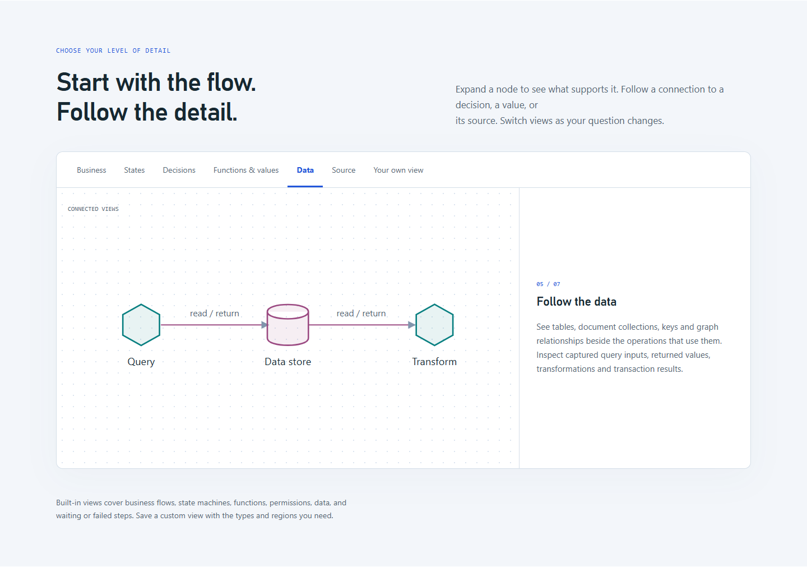

# v0.7.0 publication verification

Published on 2026-10-24 (Asia/Shanghai). The fixed release is
[`v0.7.0`](https://github.com/li-bruce/SoftwareStatusObserverSkill/releases/tag/v0.7.0),
pointing to `c63fbfde302924d03a5faa21f0f9059608e1064a`.
Later documentation commits record these post-publication checks without moving
the tag or changing its Skill/runtime implementation.

| Distribution check | Result and evidence |
| --- | --- |
| Merged release source | `db-vis` and `code-vis` were merged through `dev` into `main`; [ordered work table](../../../development/code-vis-release.md) records the sequence. |
| Main CI | [Five jobs passed](https://github.com/li-bruce/SoftwareStatusObserverSkill/actions/runs/40035861027): Windows/Linux, Python 3.11/3.13, and real database servers. [Receipt](main-ci.json) binds them to the release commit. |
| Tag CI | The tag-triggered run independently repeated the same five jobs; [all passed](https://github.com/li-bruce/SoftwareStatusObserverSkill/actions/runs/40036537451). [Receipt](tag-ci.json) also retains the completed publication and Pages workflow results. |
| Release publication | [Workflow passed](https://github.com/li-bruce/SoftwareStatusObserverSkill/actions/runs/40036537443). [Public release verification](release.json) confirms the tag target, published status, exact notes and all six attached archives by size and SHA-256. |
| Fresh installation | Cloned the public `v0.7.0` tag into a new directory, checked its exact commit, installed locked parsers, checked the package, restored both examples and installed the Skill into an empty project. [All five checks passed](install/result.json); all 172 installed Skill files match the release and the accepted local runtime. |
| Deployed introduction | [Pages deployment passed](https://github.com/li-bruce/SoftwareStatusObserverSkill/actions/runs/40035861032). [Seven deployed text assets](pages-identity.json) match the release source byte for byte. |
| Public browser behavior | [Passed](site/result.json) against the actual [GitHub Pages site](https://li-bruce.github.io/SoftwareStatusObserverSkill/): seven perspectives in both languages, language switching, 390-pixel layout and the separate recording/replay walkthrough. |
| Publication documentation | [Package/reference checks passed](package-final.log), including all 104 copied runtime modules; [six document-link regressions passed](document-links-final.log). |

The [application trial](../README.md) and [whole-project assessment](../../../assessment/2026-10-24/README.md)
provide the functional evidence behind this distribution check. The trial's user
role is simulated; application execution, database effects and browser actions
are real. Preserved failures and repaired retests remain in those records.

## Install the tested version

```bash
git clone --branch v0.7.0 https://github.com/li-bruce/SoftwareStatusObserverSkill.git
cd SoftwareStatusObserverSkill
python tools/install_skill.py --project /path/to/your-project
```

Start a new conversation in that project and request `$business-observer`.
The initial conversation confirms the business graph and drive/observe mode;
Local code can be enabled later for a selected region.

The installer retains an existing Skill directory. For an already observed
application, use the documented managed-runtime upgrade and its checks so that
business code, stable identities, layout and annotations are preserved.

## Published screenshots




