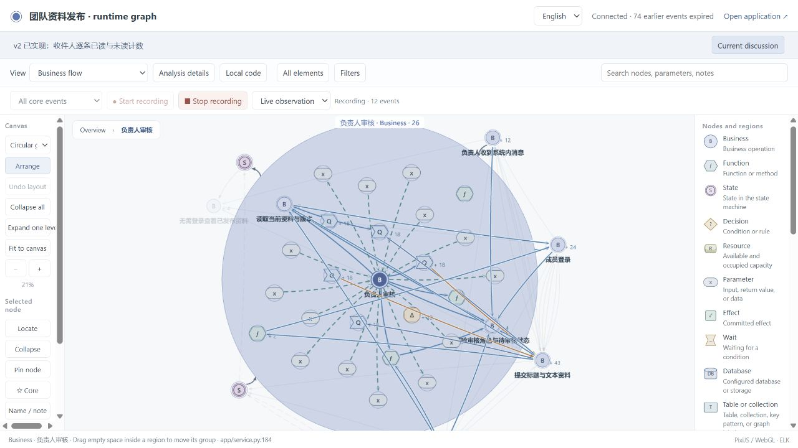
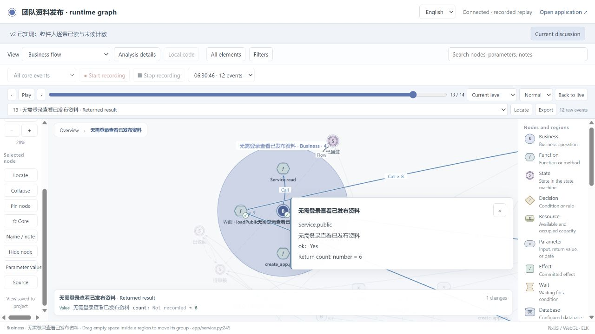
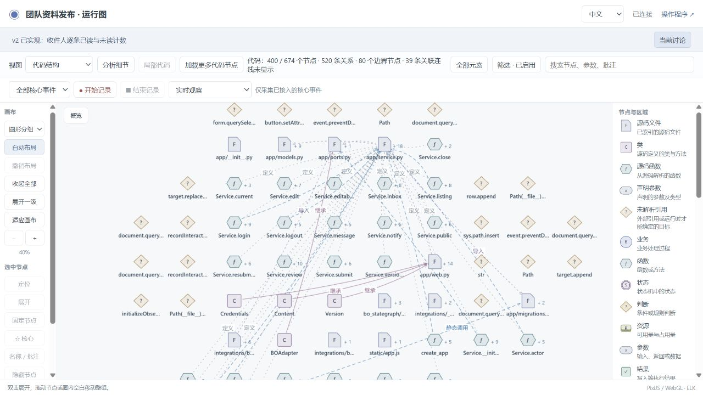

# Final public runtime acceptance

The v2 application was upgraded through the normal managed-runtime procedure to
`fa372897d69f0b6096392020ed3012284a011b4e`. Its business requirements remain the
confirmed submission/review flow and explicit recipient-only message marking.

The [verification](runtime-final/runtime-fa37289-verification.json),
[acceptance](runtime-final/runtime-fa37289-accepted.json) and
[current check](runtime-final/runtime-fa37289-check.json) agree on candidate
`328977a54f6c35b7399420318de64f8a61a360b4899e2537e4630dd685c90b66`.
All four categories passed: mapping, state rules, business and project checks.
The report includes 18 implementation features, 171 witnesses, 396 projection
checks and all 108 required business assertions. Source exploration contains
674 indexed nodes and 946 relations.

## Preserved application and view

- [Source identity](runtime-final/runtime-fa37289-source-identity.json): all
  131 managed files match their manifest; 28 protected application and expected
  result files are unchanged. The public runtime/viewer bytes match the named
  commit.
- [Actual delivery regression](runtime-final/runtime-fa37289-delivery-regression.json):
  saved perspective, notes, positions, camera, filters and dismissed discussion
  focus survive a full reload. Source/data browsing, replay and reload add zero
  business events. Recordings from the current business build remain available;
  obsolete application builds are filtered out.
- [Preference comparison](runtime-final/runtime-fa37289-preference-serialization.json):
  initial loading omits an inactive `codeFocus: null` field. All effective values
  survive; the subsequent saved-before/reloaded-after entries are identical.
- After extracting the final archive into a new directory, independent reviewer
  checks exercise [24 existing business assertions](extracted-business.json)
  and [20 message/migration assertions](extracted-messages.json) against
  application code and SQLite, separately from graph expectations.

## Runnable source archive

[Download the final source and evidence](archives/team-publishing-final-runtime-source-and-evidence.zip).
SHA-256: `f77d84c6619168678dec07c87d73778ee4088a72d054f459887d7dff45ab0632`.
The [archive inspection](team-publishing-final-runtime-source-and-evidence-inspection.json)
checks path containment and excluded files. The [fresh extraction check](extracted-acceptance.json)
verifies all 131 managed and 28 protected files before executing the 44
independent application assertions. The earlier application and upgrade archives
remain available for reviewing failures and changes.

The [original delivery manifest](trial-delivery-manifest.json) preserves the trial
conversation's paths, archive hashes and report index. An [independent live check](independent-live-delivery.json)
confirms that the running application and graph use the same current build.

## Retention, recording and a real negative control

An isolated clone used the same application with a live-history limit of two
events and three seconds. Two actual browser clicks on Refresh public page
produced 12 recorded events. The [count/time boundary observations](runtime-final/runtime-fa37289-count-time-boundaries.json)
show live history shrinking first to two events and then to zero. The
[saved recording](runtime-final/runtime-fa37289-retention-positive.json) retains
all 12 events with no gaps. English and Chinese display history expiration
separately from missing capture.

A [separate negative control](runtime-final/runtime-fa37289-retention-negative.json)
deliberately sends producer sequences 1 and 3. The missing sequence 2 remains
reported as one lost event after the received events expire, and its recording
still reports a gap. These injected facts are explicitly synthetic and never
enter the delivery application's recording list.

The [fixture restoration](runtime-final/runtime-fa37289-retention-restored.json)
preserves the delivery application's normal 10,000-event / 30-minute settings.
The isolated services were stopped. Earlier fixture-copy/parser setup failures
and the first late count-boundary observation remain in the evidence.

## Upgrade history

| Checkpoint | Purpose and result |
| --- | --- |
| Original v1/v2 on `920c015` | Business design, implementation and requested message-read iteration accepted; independent application checks passed. |
| `9134c61` | Source fidelity and request-lifetime repairs accepted. |
| `e8e922e` | Replay/source separation passed; full reload then exposed lost view selection. The failure remains preserved. |
| `1bfeb39` | View persistence passed; final review of its screenshots exposed normal retention mislabeled as missing capture. |
| `fa37289` | Count/time retention, genuine missing capture, four project gates and final browser checks passed. |

Original checkpoints are retained in [the source/evidence archives](archives/).
They are historical results, not substitutes for this final acceptance.
