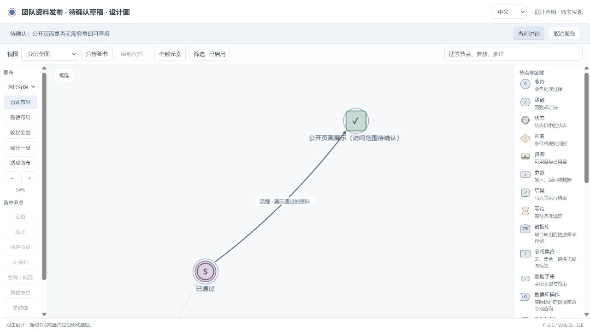
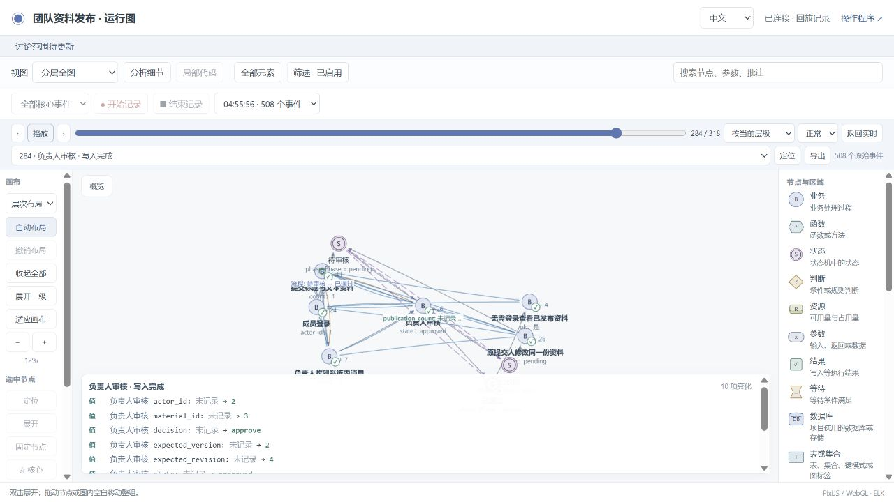
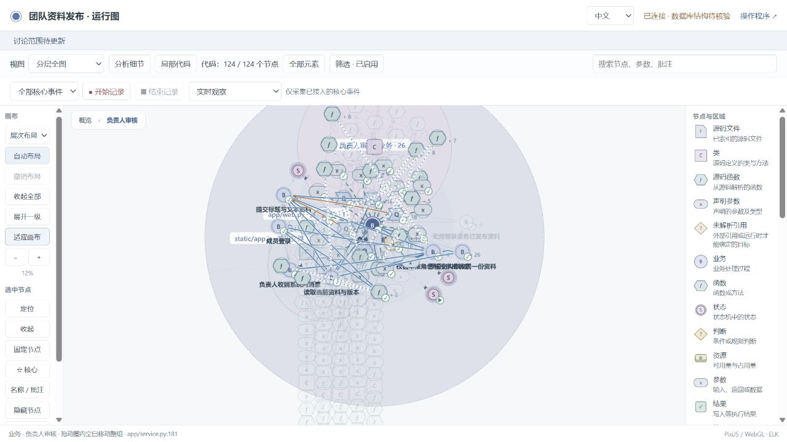
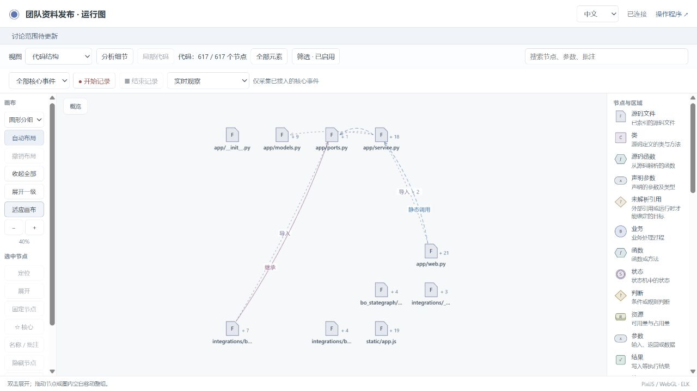
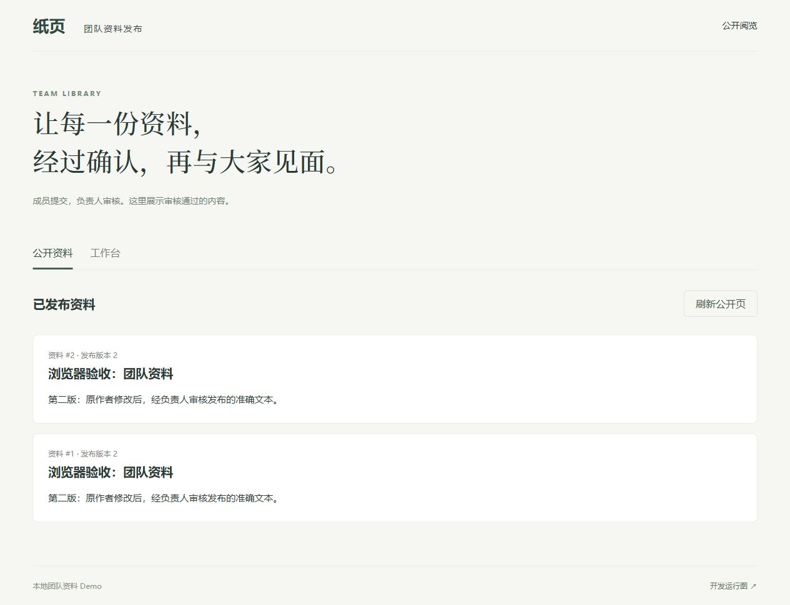

# Independent publishing application: first accepted version

The separate conversation is `01a16a61-af8a-7881-82f5-c46f78fe533d`:
**Stategraph v0.7 · 独立资料发布试用**. The user persona is simulated; the
conversation, generated application, browser operations and test results are real.
See the [prior intent](trial-plan.md), [independent expectations](trial-oracles.md)
and [public defects discovered and repaired](repairs.md).

The initial clarification established observation mode, SQLite/SQLAlchemy,
author-only revision after rejection, anonymous reading of approved snapshots,
fixed member/reviewer accounts and recipient-only messages. A conversation graph
and a live design URL preceded implementation. The simulated user explicitly
confirmed the graph before coding continued.

## Acceptance

Candidate `b444ab1fc0532911fac226c48f76e252781c6a54998188fbd97908a8533158de`
passed and was [accepted](trial-v1-accepted.json).

| Check | Executed result |
| --- | --- |
| Source/runtime mapping | 15 features, 218 checked feature events, 54 independent value witnesses, 135 projection comparisons |
| Optional source index | 617 nodes, 854 relations; independent recomputation passed |
| Database | Real SQLite metadata and generated projection agree; selected operation evidence passed |
| State constraints | Passed |
| Business expectations | 57 required assertions executed |
| Project checks | Passed |
| Separate reviewer test | 24 independent business/storage checks passed with observation off |

The [four-part receipt](trial-v1-verification.json) gives the exact scope. The
[separate reviewer result](independent-business-v1-final.json) includes source
hashes and checks permission rejection, current-role changes, content/version
conflicts, recipient privacy and concurrent publication exactly once. It does
not substitute for runtime mapping or browser evidence.

The browser exercised submission, rejection, author revision, resubmission,
approval and anonymous reading. The final recording contains 508 actual events
and five document-state snapshots. It is separate from earlier incomplete or
superseded recordings. Replay shows recorded values and the approved version.

The trial also exercises operation with observation disabled and transport
failure. Its application core runs with observer files removed. Static unresolved
calls remain explicit; this does not establish a complete dynamic call graph.
Other languages, databases, compound state/resource semantics and installation
paths require their separate repository tests.

The next explicit user iteration adds message read state and unread counts. Its
conversation, source changes and acceptance must be recorded separately.
