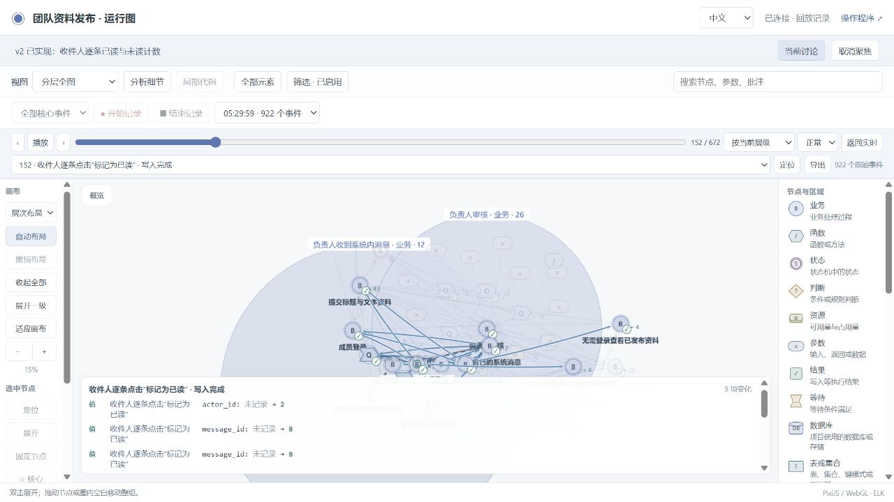
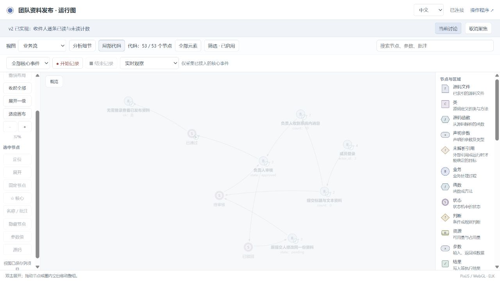
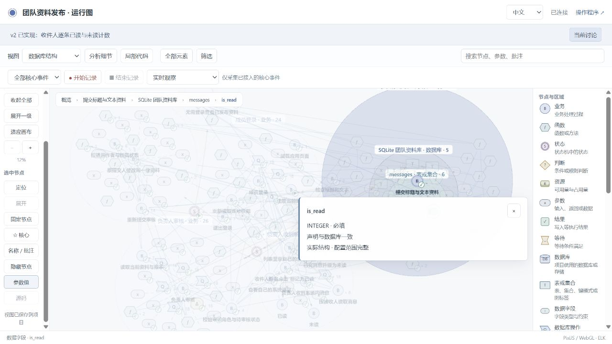

# Requested message-read iteration

The simulated user requested explicit per-message marking and the recipient's
unread count. The agent asked whether opening a message should mark it and how
existing messages should migrate. The confirmed answers were: explicit click,
existing messages start unread, recipient only, and repeated marking has no
additional effect. No mark-all or restore-unread feature was added.

The incremental graph was shown in conversation and at an actual Web address
before implementation. See the [visible dialogue](dialogue.md).

## Accepted application version

The original v2 was frozen with public runtime `920c015`, before the later public
runtime regression. Its [verification](trial-v2-verification.json) and
[acceptance receipt](trial-v2-accepted.json) identify candidate
`0356d463d785dad562014c5c45cb2882b06799f145ddfd2c6df276f819fb4436`.
All four report categories passed: mapping, state rules, business and project
checks. The mapping report includes 171 witnesses and 396 projection checks;
all 108 required business assertions executed.

The [graph difference](trial-v1-v2-graph-diff.json) preserves the project identity
and original business nodes. The [schema difference](trial-v1-v2-schema-diff.json)
records the real SQLite migration. The original material state machine remains
separate from message-read values within the same graph.

The coordinating reviewer also ran independent application/SQL checks:

- [24 existing business checks](independent-business-v2-final.json): login,
  submission, recipient isolation, review, resubmission and published snapshots.
- [20 message and migration checks](independent-messages-v2-final.json): old
  schema migration, unchanged identities, explicit marking, no-write denials,
  idempotence, concurrency, restart and new-message counts.

These oracles read the actual application and database without using the graph
as the expected result. Their scripts and original preliminary result remain in
this folder.

## Source and evidence

[Download the frozen v2 source and evidence](archives/team-publishing-v2-source-and-evidence.zip).
SHA-256: `b7c54752f8a08ca51f1d234905788facf1ea562a160dd7230bf9c681319fab91`.
The ZIP contains source, declarations, original failures, fixed verification,
screenshots and the synthetic pre-migration database. Its
[inspection report](team-publishing-v2-source-and-evidence-inspection.json)
distinguishes that explicit fixture from live database and collector files.

The actual browser tested first and repeated marking in two already-open
pages, then the complete submit/reject/edit/resubmit/publish flow. The final v2
recording contains 922 events and five material commit frames with no recorded
gaps. Earlier gaps and format failures are retained in the archive.

## Public runtime regression

The same application subsequently tests public runtimes `9134c61`, `e8e922e`
and `1bfeb39`. These are separate upgrade checkpoints. Their final
record is linked from the [release index](README.md); they do not rewrite this
original v2 acceptance or its archive.
