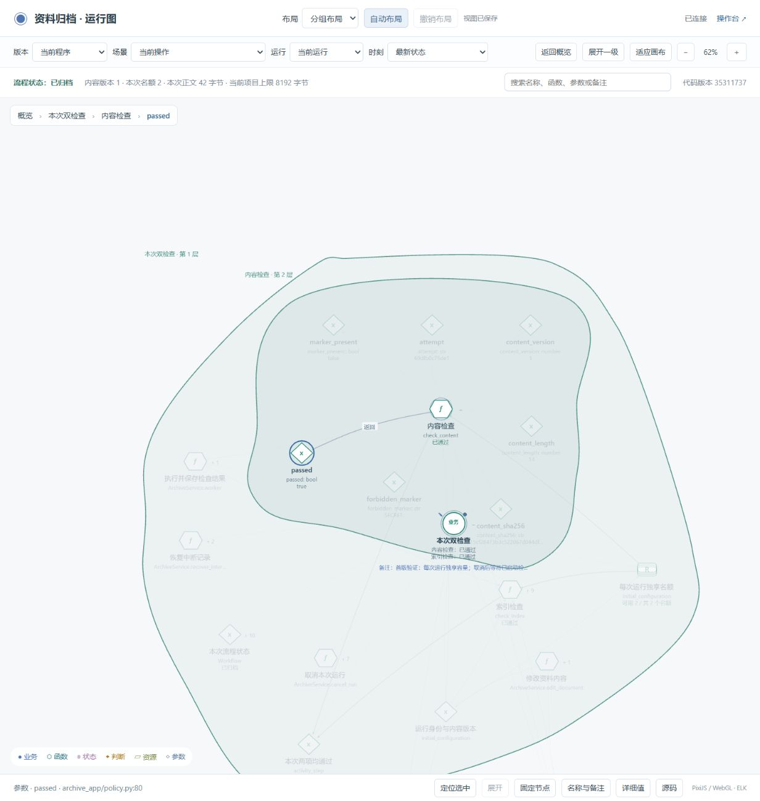

# 圆滑的层级区域

区域轮廓改为平滑闭合曲线，拖动节点时随之更新。外层区域包含内层曲线；自动布局按实际包围范围预留空间。节点身份、个人名称、备注和运行事实保持原有机制。

已同步 Skill 模板、两个公开示例和 8824 演示。检查覆盖曲线闭合及切线连续、节点标签与内层曲线的包含关系，以及既有展开、固定位置、布局和历史事实测试。三个项目的正常检查均通过，见 [验证结果](verification.json)。

浏览器首次刷新前后的节点坐标一致，随后完成展开、高亮和一次真实演示运行。后续交互期间的两次快照中，`content_check` 的坐标发生变化；这些快照不作为受控的刷新保存测试，保留原始比较结果供核对。演示的新运行使用当前构建，采集写入 51 条、错误及丢失均为 0；原资料和唯一归档记录未改变。

