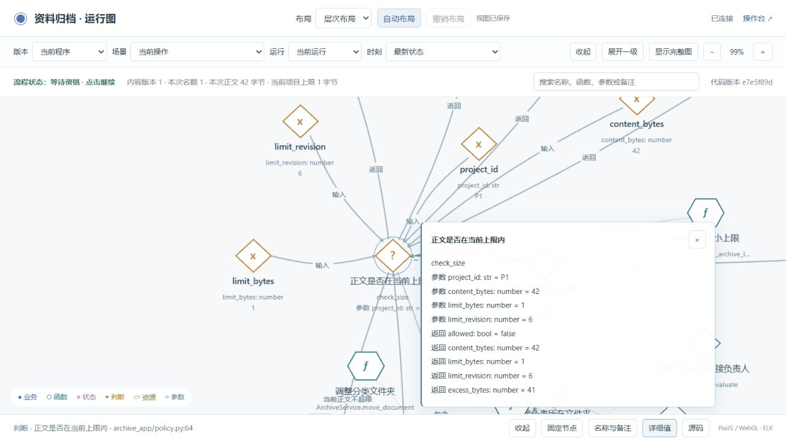
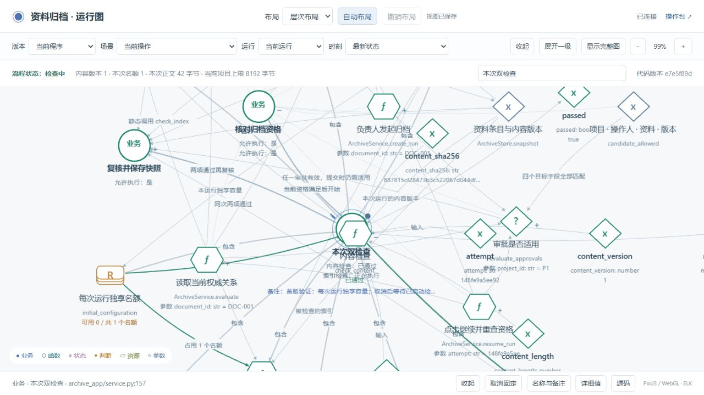

# v0.4.0 开发与测试记录

本版让 AI 在正常开发过程中持续维护状态图、关键参数、源码关联和验证。使用者先讨论软件应该怎样工作，之后照常提出需求，每轮结束查看更新图；不用手填同步文件。

开发方法由项目决定。本 Skill 维护的是贯穿开发的必需部分：真实状态机、核心函数与参数、探针、独立预期，以及它们之间的一致性。

## 独立演练

新会话“business-observer v0.4 独立使用：团队资料归档”从一份冻结 Skill 和初始需求开始。开发会话没有收到原仓库示例或预设实现答案。主会话扮演需求方，按开发会话实际提出的问题回答；以下是 **AI 模拟对话和自动化测试**，不是外部真人试用。

会话记录标识：`01a157ff-2a7d-72f3-98d5-41f654c89090`。最终使用 candidate-8，完整 63 文件清单见 [Skill 清单](../../../examples/team-archive/review/round-04/candidate8-manifest.json)。

| 阶段 | 实际讨论和产物 |
|---|---|
| 初始需求 | 为团队资料建立有审批、两项检查和归档快照的程序 |
| [第一轮](../../../examples/team-archive/review/round-01/dialogue.md) | 明确文件夹与资料的区别、负责人范围、审批绑定内容版本、归档保存方式 |
| [第二轮](../../../examples/team-archive/review/round-02/dialogue.md) | 明确替代审批、审批者与操作者分离、每次运行的并发名额 |
| [第三轮](../../../examples/team-archive/review/round-03/dialogue.md) | 明确检查条件、取消、内容改版、旧活动收尾及手动继续 |
| [首版开发](../../../examples/team-archive/review/round-04/dialogue.md) | 先记录预期与白盒要求，再实现、采集、检查和实际页面操作 |
| [第二次需求](../../../examples/team-archive/review/round-05/dialogue.md) | 增加可调整的大小上限；追问项目范围、UTF-8 字节、等值边界、运行中超限和恢复行为 |

局部图、需求记录和实现前保存的预期都在对应轮次目录。已确认规则转成代码、图中的条件和测试；没有把对话中的草图当成运行证据。

## 两个版本实际验证了什么

| 验证 | 首版 | 增加大小上限后 |
|---|---:|---:|
| 场景 | 30 | 40 |
| 开启、关闭、故障三种观测模式 | 90 次运行 | 120 次运行 |
| 业务预期 | 41 | 63 |
| 模型约束 | 8 | 9 |
| 关键函数规则 / 参数及判定检查 | 5 / 8 | 6 / 11 |

首版原有业务预期在第二版全部保留。第二版增加 4 个模型节点，保留原有 55 个节点 ID，未删除旧节点；项目和布局身份不变。[图的差异](../../../examples/team-archive/review/v2/node-changes.json)可逐项查看。

运行中的大小限制不是一次性缓存：开始、继续和提交都读取当前项目上限。实际页面中，将 42 字节正文的上限调到 1 字节后，已经启动的检查自然结束，未启动的检查等待，归档数保持 0；图显示当前大小、上限和等待原因。



拖动、固定、名称和备注在第二次开发后继续保留：



更多证据：

- [首版完成记录](../../../examples/team-archive/review/v1/completion.md)、[浏览器操作记录](../../../examples/team-archive/review/v1/browser-evidence.json)。
- [第二版实际运行](../../../examples/team-archive/review/v2/observations.json)、[参数检查](../../../examples/team-archive/review/v2/whitebox-results.json)、[验收记录](../../../examples/team-archive/review/v2/verification.json)。
- [第二版最终报告与命令](../../../examples/team-archive/review/v2/completion.md)、[实际页面核对](../../../examples/team-archive/review/v2/final-audit.json)；原始变更基线保存在 [review/changes](../../../examples/team-archive/review/changes)。
- [首版五种故意错误](../../../examples/team-archive/review/v1/mutations-final.json)、[第二版四种故意错误](../../../examples/team-archive/review/v2/size-mutations.json)。测试实际执行改错后的程序，检查过期边界、版本绑定、权限范围、替代审批、正文规则、字节计量、大小边界、提交重查及手动继续。
- [遗漏探针演练](../../../examples/team-archive/review/v1/gate-rehearsal.json)：正常验证入口拒绝缺少探针的副本；补回后重新验证通过。
- [独立核心包运行](../../../examples/team-archive/review/v1/core-smoke.json)：实际完成归档、验证快照不可变和取消收尾，没有加载观测模块。

## 发现的问题与修复

| 实际问题 | 处理及复验 |
|---|---|
| Windows 环境的相对目录解析重复拼接 | 新工具和安装器先转绝对路径；在新目录实际调用相对路径复验 |
| 局部图边界可能丢失规则操作数 | 保留完整原始关系；不把省略的多跳路径改成直接权限 |
| 同名参数搜索结果难区分 | 结果注明所属函数、输入或输出和类型 |
| 后续复核、最终状态污染历史画面 | 采用首次精确事件边界；历史帧不借用最终字段，缺失记录显示未知 |
| 输入和返回分开采集，最后事件覆盖参数 | 仅在调用、运行、对象和构建身份一致时合并；身份不足时不拼接 |
| 本机解释器路径和换行影响复现 | 使用 `{python}`、PATH 中的 Node 和固定 LF；从实际 Git 树导出后重新验证 |
| SQLite 连接未关闭，Windows 迁移测试不能清理文件 | 显式关闭连接；保持原预期，重跑迁移与完整场景 |
| 运行完成后改变上限，图顶部仍显示最后判断值 | 当前项目配置与历史判断分别标明；旧历史帧不显示未来配置，完整复验后重新执行页面任务 |

原始失败、修复脚本和重测结果保存在 `examples/team-archive/review/round-*`。这些材料记录实际执行，不用新编的对话替换失败过程。

独立试验最后通过的代码构建为 `e7e5f89d72093f5d99d37f9bb1f19a8b978a31e4cfecaced8a225b8409b3edc3`，验收对象为 `bc2c0f65658e721d78f9404ed2cbf2d0aabf5f55686ec2c745df60965902a530`。首轮大小功能的失败画面也保留在第二版目录，文件名以 `before-fix` 标明；上面的大小判断截图来自修复后的最后一轮。

发布副本另外记录了 `release-v04`：将项目指令改为仓库内 Skill 路径，去掉机器专属命令，再执行完整运行验证。应用构建不变；发布副本的验收对象为 `2078cc1a2a5d94307d8aa77f89d0d1eee4d94621e8b112eeaa3a770b2ec5aa93`。查看[变更审阅](../../../examples/team-archive/.release/stategraph/release-v04/review.json)和[复制清单](../../../examples/team-archive/review/publication-copy.json)。

首次从 Git 树导出时，[完整检查拒绝了源码字节变化](../../../examples/team-archive/review/publication-first-git-export-failed.txt)：示例内部的换行规则覆盖了仓库规则，改变了包初始化文件。随后以 [release-bytes-v04](../../../examples/team-archive/.release/stategraph/release-bytes-v04/review.json) 单独记录修复，保留原始文件字节并重新执行验证。最终发布验收对象为 `befadbdd157ea321dbc4039c9e793db228255e79db68c06faa87c0c20b44c384`，应用构建仍是 `e7e5f89d…`。

修复后的 Git 树 `9ee987c524a1cc5393f778ccb5a246580045386d` 已导出到新目录，完整 `tools/verify.py` 返回 0，两个剔除观测层的业务包也实际运行通过。[验证摘要](publication-validation.json)和[完整通过日志](../../../examples/team-archive/review/publication-full-git-export-passed.txt)保留了这次结果。随后加入的文件是本段说明及该次验证记录。

## 复现

按[安装说明](../../../README.md)准备 Python 环境和依赖，安装 Node.js 20+，然后在仓库根目录执行：

```bash
python tools/verify.py
python tools/archive_demo.py --port 8824
```

前者检查 Skill、交付示例和独立归档项目；后者启动[操作台](http://127.0.0.1:8824/)与[开发者图](http://127.0.0.1:8824/graph)。新目录只恢复随版本发布的已审阅记录；修改代码后不会自动被视为已验收。

真实项目的使用方法见[安装与使用](../../usage.zh-CN.md)。对 AI 说清本次需求，回答影响结果的业务问题，之后查看更新图即可；内部检查由 AI 执行。

## 验证范围

这是 Python 本地参考实现和有限场景验证，未证明所有线程交错、未建模函数或生产权限系统正确。ReBAC 文档覆盖多类规则；归档示例只实现它已确认的规则，没有集成通用 OpenFGA/SpiceDB 引擎。页面和图使用合成数据。

Skill 已要求将约定写入项目 AI 指令，并接入正常验证入口；安装文件本身不会在后台监听任意编辑器。图可以查看、搜索和下钻，尚不能通过改节点直接操作业务。浏览器操作记录证明这些测试任务执行过，不代替真人可用性评价。
