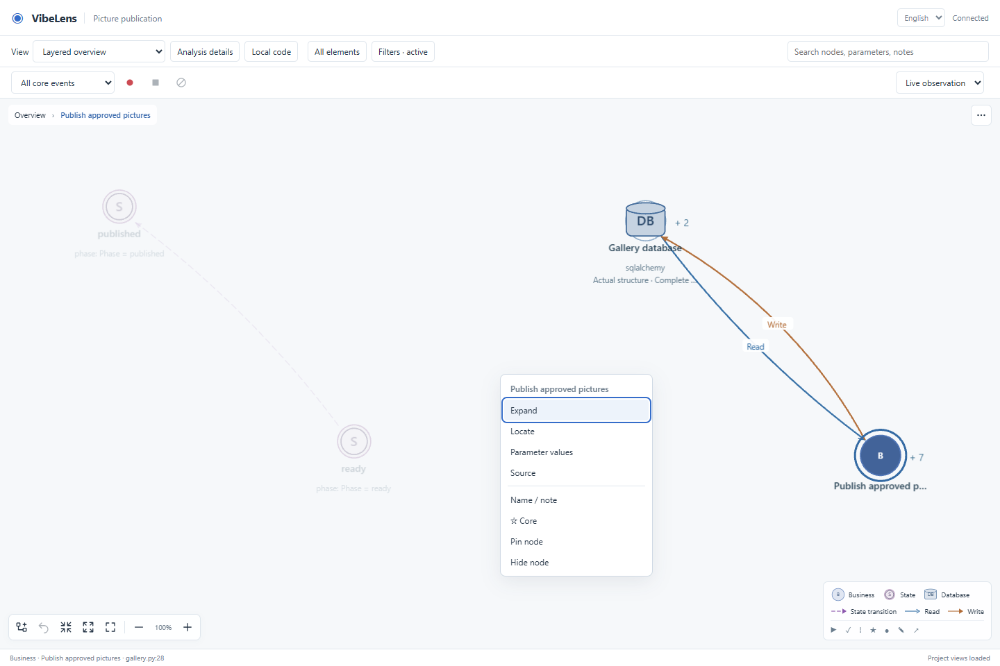
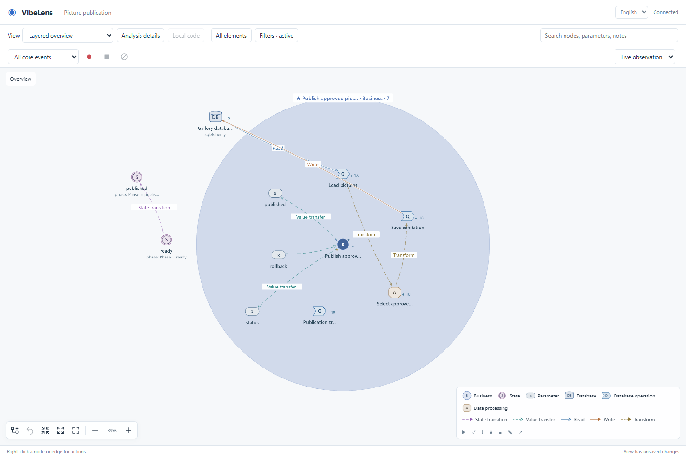
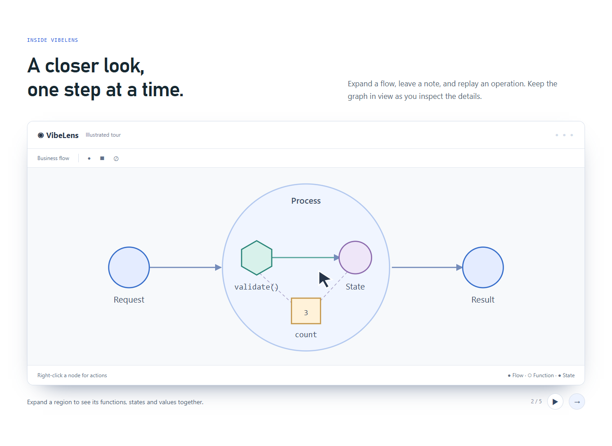

# VibeLens viewer acceptance — 2026-10-24

Scope: English-first conversation language, VibeLens branding, recording icons,
compact legends, context actions, the Pages viewer tour, and removal of the entire
discussion bar. Business rules and graph/state validation remain unchanged.

## What changed

The canvas fills the work area. Node and edge actions move into context menus with
pointer and keyboard access. Legend entries reflect visible types; tooltips retain
their meaning. Recording icons have accessible names in both languages.

Conversation language is saved separately from a personal language choice. The
initial interface is English. User notes, labels, IDs, source and layouts retain
their values. Confirmed conversation focus appears directly on the graph. Clicking
empty canvas or pressing Escape dismisses it, including after a reload. A stale or
missing scope clears its focus silently.

Clear deletes one selected stopped recording. It rejects active capture, wrong
versions, invalid IDs and loading races; it never changes application storage.

## Failures, corrections and retests

| Finding | Correction and evidence |
|---|---|
| The new language test used a system temporary directory inaccessible in the Windows sandbox. | Tests now create disposable projects under the repository's `.validation`. The CLI and invalid-config tests pass without relaxing assertions. |
| [Recording icon labels remained English](controls-round1/result.json) after the conversation changed language. | Added the icon labels' translation keys. Subsequent real-browser language checks pass. |
| [The database browser test used the removed left toolbar](database-browser-round1/database-browser-results.json). | The same assertions now open the selection menu before invoking an action. No business, relation or value assertions were removed. |
| [An old animation read an unloaded graph](database-browser-round2/database-browser-results.json). | Cancel animation on view disposal and stop ticks when graph/presentation is absent. [Database retest](database-browser-round3/database-browser-results.json) has no page errors. |
| [The new control test assumed two published rows](controls-round2/result.json), although the fixture seeds seven approved pictures among twelve. | Corrected that new fixture assertion to seven, based on the fixture's independent seed rule. Existing database expectations remain intact. |
| [Clearing during a record switch deleted the previously loaded record](controls-round3/result.json). | Clear is disabled during loading, and older requests cannot replace newer selections. [Final test](controls-verified/result.json) delays the fetch deliberately and checks that only the selected record is removed. |
| [The acceptance gate rejected an outdated review](examples-prior-candidate/delivery-verification.log) after the runtime changed. | Retained the baseline and failure, re-inspected the candidate and re-bound the review before running the original checks again. |
| [A new conversation scope stayed inactive after saving a layout](controls-canvas/result.json). | Record an initially empty scope separately from legacy preference migration. A later confirmed scope now highlights correctly; dismissal and legacy saved-view preservation still pass. [Retest](controls-canvas-retest/result.json). |
| [The revised code-view test checked the selector before the page had loaded](code-browser-canvas/browser-result.json). | Wait for the code nodes before asserting the same saved-view value. [Retest](code-browser-canvas-retest/browser-result.json) retains the original source-update and persistence assertions. |
| [The full gate detected outdated example assets](repository-before-canvas-sync/repository-verification.log) after the final request removed the bar. | Keep the already accepted UI change, begin a separate canvas change, synchronize canonical assets and run the existing review/verify/accept gates again. |

## Verification

- [Final control browser test](controls-canvas-retest/result.json): English fallback on a Chinese browser,
  live conversation language, manual override, right-click and Shift+F10, notes/core/pin
  persistence, DOM-free focus, Escape/blank-canvas dismissal, stale focus removal,
  real recording/replay, active/slow-load/failed-load clear guards,
  zero observer-only events and a 390px menu.
- [Code browser](code-browser-canvas-retest/browser-result.json): lazy/local/full code views,
  source edits/errors/deletion, preserved layout and notes, real recording and bilingual reload.
- [Database browser](database-browser-canvas/database-browser-results.json): real SQLite
  read/process/write, commit/rollback, source/schema refresh, observation exclusion,
  replay, layout/filter persistence and both languages.
- [Pages browser](site-release/result.json): seven views, English/Chinese, 390px layout,
  independent runnable sample, five-step viewer tour, language change and reduced motion.
- [Complete repository verification](repository-verification.json) passed with exit
  code 0; the [full log](repository-verification.log) retains all output. It covers
  clarification, source/graph synchronization, multi-language adapters, database
  observation, runtime HTTP, installation and independent business-core exports.

Both final example verifications pass mapping, state rules, business assertions and
project checks. Delivery executes 96/96 authored business assertions; team archive
executes 189/189. These are explicit expectations and observed source bindings,
not a claim that every possible user intention has been proven.

The final example records are [delivery](../../../examples/delivery/.release/stategraph/viewer-canvas-20261024/verification.json)
and [team archive](../../../examples/team-archive/.release/stategraph/viewer-canvas-20261024/verification.json).

To repeat the checks, run `python tools/verify.py --database`. Browser harnesses are
`tools/test_viewer_controls.mjs`, `tools/test_code_browser.mjs`,
`tools/test_database_browser.mjs` and `tools/test_site_browser.mjs`. They use Playwright;
`BO_BROWSER_EXECUTABLE` selects the browser and `BO_BROWSER_EVIDENCE` sets the output
directory. This run used Chrome. These are development-test dependencies.

The Pages animation is an illustration. The runtime browser checks above operate
an actual local application and its canonical graph service. This change does not
claim a new independent human trial or a performance benchmark.

## Publication

The tested code is commit `03bad7facd42868c9c8553948475447ab91618fa`, published on
`main`, `dev` and [v0.7.2](https://github.com/li-bruce/VibeLens/releases/tag/v0.7.2).
The `main` and `dev` [CI runs](publication/ci.json) pass on Windows and Linux with
Python 3.11/3.13, including the separate live-database job. The tag also triggers a
repeat of those checks against the same commit; the receipt records its status at
the stated observation time.

- [Release receipt](publication/release.json): tag target, notes and ZIP digest match.
- [Public installation](publication/installation.json): all 175 Skill files match
  GitHub, a fresh project installation and the updated local VibeLens installation.
- [Pages asset comparison](publication/pages.json): all nine deployed assets match.
- [Deployed browser checks](site-deployed/result.json): language switching, seven
  views, 390px layout, viewer tour, reduced motion and the separate walkthrough pass.
- [Local upgrade](publication/local-installation.json): the previous installation
  is retained as a complete backup.

The first public-install check also asserted that the old global Skill name was
absent. A separate `business-observer` directory had appeared after the earlier
rename, so that [namespace assertion failed](publication/install-first-attempt.json)
after file verification had passed. Its origin was not established; it was preserved.
The final receipt reports this finding separately. Invoke `$vibelens` to select the
verified version. No product acceptance tests were relaxed.
