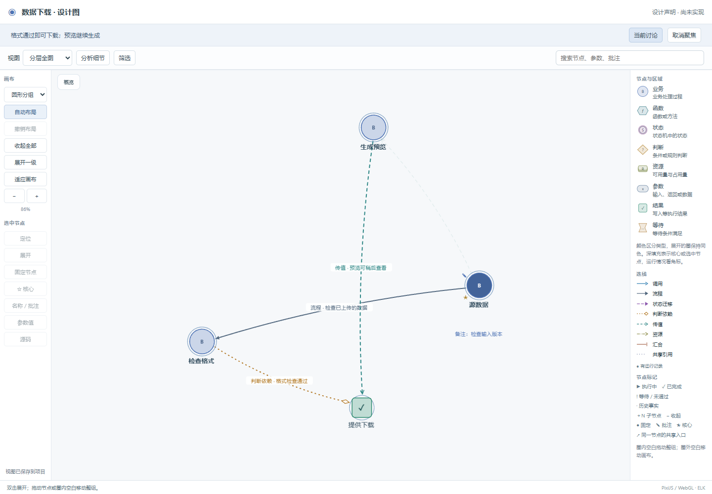
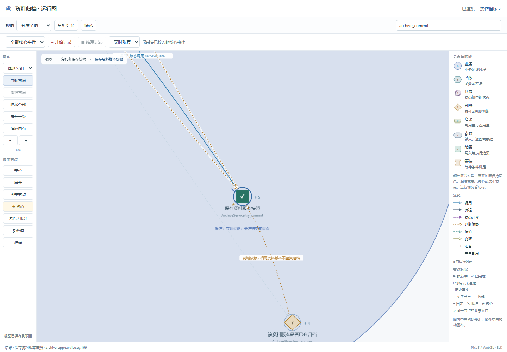

# 对话设计图与运行图衔接

已完成并通过本轮验收。本机安装的 `business-observer` 已同步。

**用户仍在 Codex 等开发工具中确认和修改，Web 只查看图。** 页面没有答题或业务确认入口。AI 根据对话更新设计、实现映射和检查，再高亮当前讨论的节点、关系及所属区域。

## 使用方式

在新对话中使用 `$business-observer`，说明要开发的功能，并要求“在内置图中展示当前讨论的业务与状态关系，我在这里回答和调整”。AI 负责建图、启动页面、同步对话内容及完成原有检查。

设计阶段显示“设计声明 · 尚未实现”，没有伪造的运行状态、调用或参数值。进入实现后，稳定节点 ID 和布局标识连接源码与实际运行，保留拖动布局、名称、批注和核心标记。页面的“当前讨论 / 取消聚焦”仅控制查看范围。

交付阶段可要求“隐藏图入口”“关闭调试 Web”或“导出不含页面的业务核心包”。设置位于 `bo_stategraph/config/web.json`；隐藏入口仍允许直接访问，关闭 Web 则拒绝图、源码、记录及配置等调试 HTTP 接口。程序状态模块和业务执行保留，采集模式单独控制。导出不会删除开发目录。

完整命令和接入约定见[对话与 Web 图](https://github.com/li-bruce/VibeLens/blob/v0.7.0/skills/business-observer/references/conversation-web.md)。

## 实现

- [bo_design.py](https://github.com/li-bruce/VibeLens/blob/v0.7.0/skills/business-observer/scripts/bo_design.py) 从已有需求记录生成只读草图，使用稳定实现标识；根据对话问题或节点集合设置聚焦。它不改用户决定、不接受页面回答、不生成验收结论。需求变更后旧聚焦会标为待更新。
- [bo_web.py](https://github.com/li-bruce/VibeLens/blob/v0.7.0/skills/business-observer/scripts/bo_web.py) 提供立项阶段的本地图服务、Web 可见性控制及核心包导出命令。两套示例接入同一控制模块；交付示例的业务页面改读业务数据接口，与调试接口分开，但仍以同一个 Store 为实际数据来源。
- [conversation.js](https://github.com/li-bruce/VibeLens/blob/v0.7.0/skills/business-observer/assets/stategraph-viewer/conversation.js) 读取讨论范围；[glyphs.js](https://github.com/li-bruce/VibeLens/blob/v0.7.0/skills/business-observer/assets/stategraph-viewer/glyphs.js) 统一画布和图例的类型填充。核心、选中及关联节点有不同强调程度，运行结果仍由独立角标表示。
- 个人配置支持明确列出的旧项目标识迁移，保留原条目和修订。归档示例统一设计和运行时的配置标识；无关项目配置仍拒绝读取。

## 最后一轮结果

| 检查 | 结果与证据 |
| --- | --- |
| 原有完整验收 | 通过，[完整日志](full-acceptance-final.log)。包含此前六项修复、严格定义校验、源码/图映射、业务场景、运行 HTTP、安装和真实核心包执行。 |
| 两套业务示例 | 原 56 个场景 × on/off/fault 三种模式保留。映射、状态约束、业务规则分别通过；原业务预期和白盒文件字节未改，见[最终汇总](final/summary.json)。 |
| 新增单元/HTTP 回归 | 9 项通过，覆盖无伪造事实、只读聚焦、需求门禁、非法层级/标识、Web 关闭、同源限制、相对路径保存和配置迁移；见[日志](unit-path-persistence.log)。 |
| 类型颜色 | 8 类节点 × 4 种强调状态，填充区分、核心强调及字形对比度检查通过；[失败](colors-first.log)与[修复后结果](colors-retest.log)均保留。 |
| 设计图浏览器操作 | 6 项通过：草图、布局/批注保留、对话聚焦、对话改图、窄窗口和关闭恢复；见[结果](design-final/design-ui-result.json)。 |
| 设计到运行与 Web 控制 | 7 项通过，三个服务顺序运行，使用同一归档项目目录；见[设计](lifecycle-complete/lifecycle-design.json)、[运行](lifecycle-complete/lifecycle-archive.json)、[交付程序](lifecycle-complete/lifecycle-delivery.json)。 |
| 原运行图回归 | 14 项浏览器操作及 5 项重启检查通过；见[浏览器日志](runtime-final/browser-first.log)、[重启日志](runtime-final/browser-restart.log)。 |
| 新核心包命令 | `bo_web.py package` 成功，解压后实际执行得到 completed 和 1 条交付效果；[证据](web-package.json)。 |
| 全新目录恢复 | 两套发布记录均恢复后 check 通过；[证据](fresh-release-results.json)。 |

冻结的活动记录为 `web-continuity`，旧记录保留。源码及证据散列分别见 [product-sha256.json](final/product-sha256.json) 和 [evidence-sha256.json](evidence-sha256.json)。

## 截图

对话在开发工具中进行，图展示修改后的关联。蓝色核心节点、绿色结果节点及关联高亮保持各自含义。

同一归档项目从设计进入运行，保留立项阶段对提交节点的核心标记与批注。

## 失败、修复和复测

| 发现 | 处理 | 证据 |
| --- | --- | --- |
| 普通/关联节点填充后的字形对比度不足 | 加深字形颜色，保持类型色，未降低 4.5 的阈值 | colors-first.log → colors-retest.log |
| 设计图未实现源码绑定，旧页面读取 bindings 报错 | 为设计投影明确空绑定，并禁用设计阶段源码查找；运行视图校验保持原有要求 | design-diagnostic/browser.log → design-binding-fixed/、design-final/ |
| 当前 Windows 环境对相对 `Path.resolve()` 得到重复目录 | 先 absolute 再 resolve，统一服务和配置根目录；增加 `--root .` 的实际 HTTP 落盘测试 | lifecycle-isolated/design.log、unit-relative-root.log、unit-path-persistence.log |
| 聚焦时相关连线的端点可能在画面外 | 把当前讨论节点及直接相关节点一起纳入视野 | design-final/03-chat-updated-graph.png |
| 初始测试等待 networkidle，持续轮询页面无法满足 | 测试改为等待真实图和布局完成 | design-first/browser.log → design-final/browser.log |
| 测试读取配置文件早于保存确认 | 等待页面“视图已保存到项目”，随后同时检查 HTTP 内容与实际文件；未删除持久化断言 | persistence-server.log、lifecycle-absolute/design.log → lifecycle-complete/ |
| 测试副本在源码与验收 manifest 更新间复制，启动拒绝不一致版本 | 在验收完成后重新复制，不启用候选模式或降低启动检查 | lifecycle-final/archive.log → lifecycle-complete/archive.log |
| 交付示例测试误用了不存在的 run.py 入口 | 改用项目真实 integrations/bo_server.py 入口 | lifecycle-save-receipt/delivery.log → lifecycle-complete/delivery.log |

## 证据边界

对话修改使用明确标注的合成需求方答案，页面操作由 Playwright 执行。这证明本轮工程行为和原有检查在已列范围内通过，不构成真人易用性试验，也不证明 AI 对任意业务的理解一定正确。原有未覆盖动态行为边界保持不变。

Web 不会自行唤醒其他编辑器的大模型。用户继续对话后，由使用 Skill 的 AI 更新需求、图和检查；页面自动读取已写入的内容。本材料记录本地验收，发布记录见 Git 历史。
