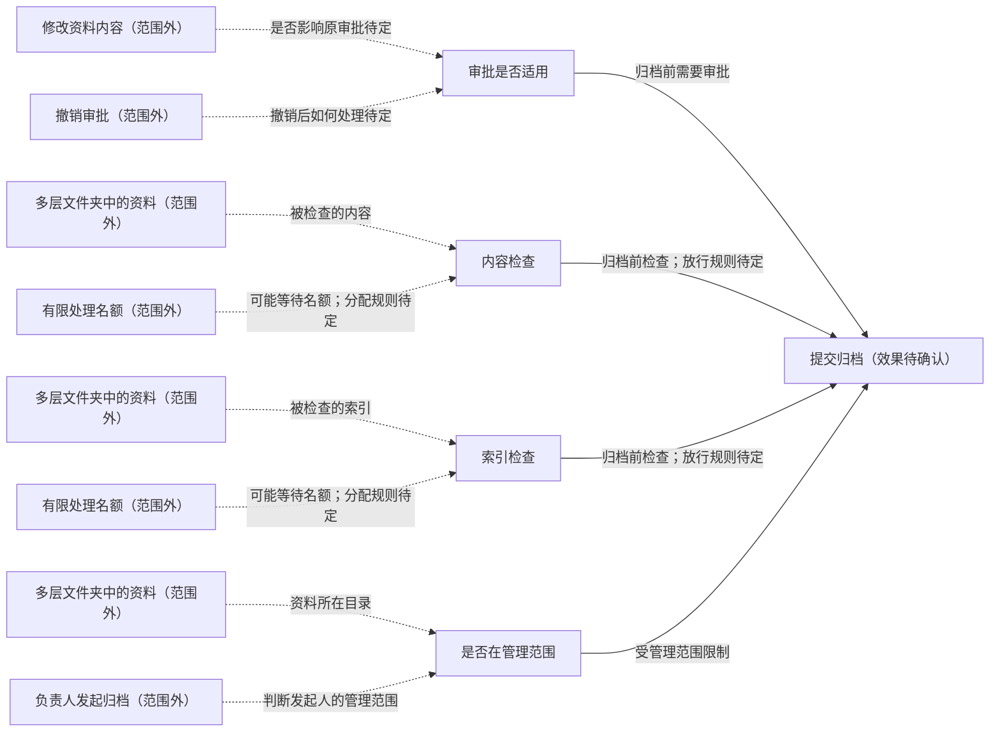

# 当前关注的业务与实现

模型版本：discovery-r01
局部图：`focus:b2139bff98d78538bd8a`

虚线保留范围外的原关系，不表示已经执行或获得许可。

| 节点 | 类型 | 源码 |
|---|---|---|
| 审批是否适用 | decision |   |
| 提交归档（效果待确认） | effect |   |
| 内容检查 | action |   |
| 索引检查 | action |   |
| 是否在管理范围 | decision |   |

范围外或未显示的关系：8；未解析项：9；运行证据：not_selected。
