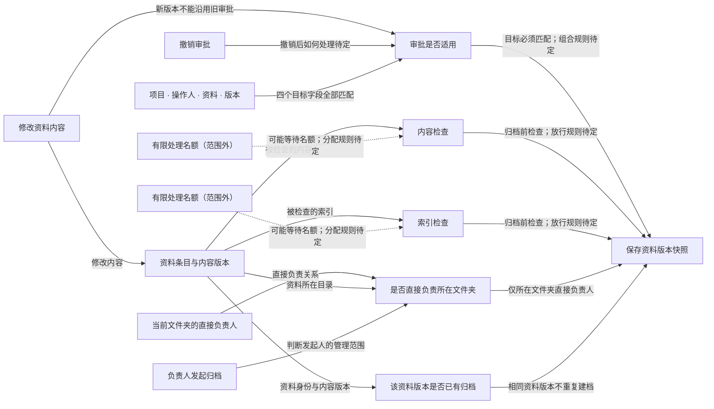

# 当前关注的业务与实现

模型版本：discovery-r02
局部图：`focus:e37a3eaa4da875261ada`

虚线保留范围外的原关系，不表示已经执行或获得许可。

| 节点 | 类型 | 源码 |
|---|---|---|
| 审批是否适用 | decision |   |
| 撤销审批 | action |   |
| 项目 · 操作人 · 资料 · 版本 | data |   |
| 保存资料版本快照 | effect |   |
| 负责人发起归档 | action |   |
| 该资料版本是否已有归档 | decision |   |
| 修改资料内容 | action |   |
| 内容检查 | action |   |
| 资料条目与内容版本 | data |   |
| 当前文件夹的直接负责人 | data |   |
| 索引检查 | action |   |
| 是否直接负责所在文件夹 | decision |   |

范围外或未显示的关系：2；未解析项：6；运行证据：not_selected。
