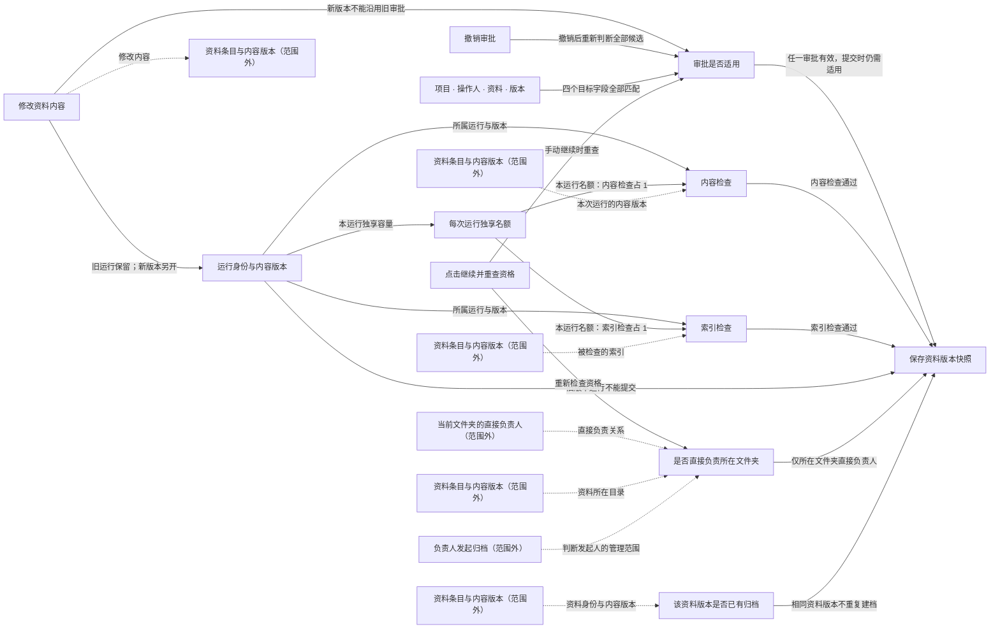

# 当前关注的业务与实现

模型版本：discovery-r03
局部图：`focus:5adcd246977eaca37e29`

虚线保留范围外的原关系，不表示已经执行或获得许可。

| 节点 | 类型 | 源码 |
|---|---|---|
| 审批是否适用 | decision |   |
| 撤销审批 | action |   |
| 项目 · 操作人 · 资料 · 版本 | data |   |
| 保存资料版本快照 | effect |   |
| 该资料版本是否已有归档 | decision |   |
| 修改资料内容 | action |   |
| 内容检查 | action |   |
| 索引检查 | action |   |
| 每次运行独享名额 | data |   |
| 点击继续并重查资格 | action |   |
| 运行身份与内容版本 | data |   |
| 是否直接负责所在文件夹 | decision |   |

范围外或未显示的关系：7；未解析项：5；运行证据：not_selected。
