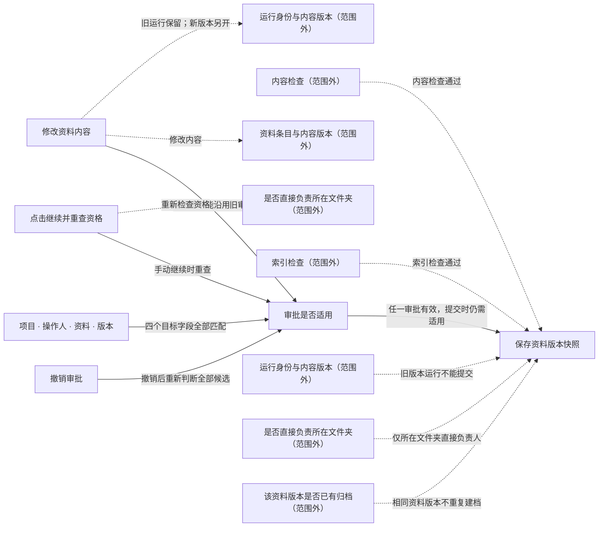

# 当前关注的业务与实现

模型版本：discovery-r03
局部图：`focus:a12fa4939e9312593ce0`

虚线保留范围外的原关系，不表示已经执行或获得许可。

| 节点 | 类型 | 源码 |
|---|---|---|
| 审批是否适用 | decision |   |
| 撤销审批 | action |   |
| 项目 · 操作人 · 资料 · 版本 | data |   |
| 保存资料版本快照 | effect |   |
| 修改资料内容 | action |   |
| 点击继续并重查资格 | action |   |

范围外或未显示的关系：8；未解析项：5；运行证据：not_selected。

| 未展开关系 | 类型 | 作用 |
|---|---|---|
| content_check → archive_commit | guard | 内容检查通过 |
| content_changed → document | data | 修改内容 |
| content_changed → run_identity | data | 旧运行保留；新版本另开 |
| index_check → archive_commit | guard | 索引检查通过 |
| resume_run → scope_check | flow | 重新检查资格 |
| run_identity → archive_commit | guard | 旧版本运行不能提交 |
| scope_check → archive_commit | guard | 仅所在文件夹直接负责人 |
| archive_unique → archive_commit | guard | 相同资料版本不重复建档 |
