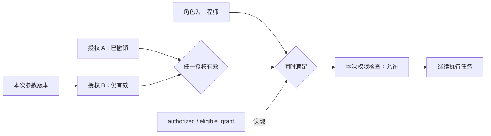

# ReBAC 规则在运行图中如何展示

状态：设计分析，尚未接入通用 ReBAC 引擎。沿用一张节点图，通过展开权限判断节点逐步增加细节。

## 展示什么

以一次具体问题为入口：“用户甲现在能执行任务 T 吗？”规则定义说明如何计算；关系事实和请求参数是输入；本次检查的结果是运行事实。三者分别有来源，放在同一张图里连接。

ReBAC 通常依赖成员、所属、拥有等关系及它们的组合。业务中的“审批有效期”“参数版本”还需要条件判断。OpenFGA 的规则支持并集、交集、排除和沿对象关系继承；这些结构适合显示成有向依赖图，而不必把每种关系组合枚举成状态机状态。[规则语言](https://openfga.dev/docs/configuration-language)、[条件](https://openfga.dev/docs/modeling/conditions)

建议逐层展开：

| 操作 | 同一画布中新出现的内容 |
|---|---|
| 默认查看业务动作 | 权限判断节点，显示允许、拒绝或尚不能确定，并连接后续业务动作 |
| 展开权限判断 | “同时满足”“任一满足”“排除”及相关条件，每项显示本次求值结果 |
| 展开某条条件 | 参与者、对象、具体关系、授权记录和参数；边上写“成员”“所属”等真实关系 |
| 继续展开或查看源码 | 负责读取/判断的函数、规则定义位置、请求与结果，以及实际采集到的依赖记录 |

默认只看这次请求相关的部分。共享对象和共享子表达式复用节点，不复制出相互矛盾的结果。折叠保留内部身份、坐标、名称和备注；展开新增节点时不打乱已有位置。

## “状态”属于哪一部分

| 内容 | 建议显示 |
|---|---|
| 规则定义 | 规则版本、表达式及源码位置；没有本次运行证据时不染成通过 |
| 条件的结果 | 满足、不满足、尚不能确定；未执行的分支显示“本次未求值” |
| 一次检查的执行 | 未开始、求值中、完成、出错；与条件真/假分开 |
| 结果对当前请求是否仍适用 | 当前可用、依赖已变待重新检查、历史记录 |
| 业务执行 | 继续、等待、取消等，按项目已确认的业务规则处理 |

规则不必随每次授权撤销而改变；改变的是输入关系和这次求值结果。“旧结果不再适用”也不等于“旧结果当时错误”。超时、缺上下文、采集缺口不能统一画成拒绝。SpiceDB 的条件权限可返回“缺少上下文”，并指出缺失字段；其他引擎应按实际响应映射，不能假设都有同样的返回类型。[SpiceDB caveats](https://authzed.com/docs/spicedb/concepts/caveats)

节点只显示当前需要的短结果，例如“允许 · 规则 M3”“未满足：参数已变”“缺少：访问时间”。完整版本、输入和证据放在节点旁，避免每个节点变成大段说明。

## 与现有任务授权示例的对应

当前 `Delivery` 实际规则是：执行者角色为工程师，且至少一条授权满足项目、执行者、参数版本、未撤销和未过期。它是一个内嵌 Python 判断示例，尚未接入多跳关系查询或通用 ReBAC 规则引擎。

下图是建议的展开形式，不代表当前示例已经采集了所有子条件：

对用户已确认的行为：A 撤销后重新求值；B 仍有效则继续，否则进入等待。图中应新增一条检查记录并切换到新结果；旧检查保留原有证据。是否自动恢复、取消在途操作、提交前是否再检查，仍由具体业务规则确定，不能由图推导。

重新检查的触发依据包括关系增删、规则版本变化、参数或请求上下文变化，以及时间条件到期。有效期到了，即使关系记录未改变，旧结果也可能不再适用。图记录触发原因和新的检查身份；是否自动发起检查由程序决定，观测页不会自行给出新的许可。

当前 `authorize` 探针只有角色、授权数量和汇总 `allowed`；`commit_guard` 记录提交前检查。它们足以显示汇总判断，不能证明每条授权、每个子条件都执行过。Python `any()` 可能短路，后面的授权应标“未求值”，不能补画成通过或失败。补足证据需要在实际求值路径采集，而不是让页面重新执行权限逻辑。

## 最小数据契约

以下为后续适配建议，不是现有事件协议已经支持的承诺。

- 检查身份：`check_id`、业务运行 `attempt`、主体、动作、对象、参数版本和请求上下文指纹。
- 规则身份：规则/模型版本、表达式节点 ID、对应定义与函数位置。
- 输入依据：关系元组或读取范围、读取时间、实际可取得的关系版本/一致性令牌、条件输入。
- 求值记录：子检查 ID、表达式 ID、是否实际求值、结果、引用的读取/子检查事件、错误或缺失字段。
- 适用性：依赖变化通知、被哪次新检查替代。历史记录保持不可变。

规则节点的稳定 ID 与一次运行的子检查 ID 分开；观察某次运行时按 `check_id` 投影，避免多个请求相互覆盖。别名和备注绑定稳定节点 ID，既不改规则表达式，也不改权限结果。

## 不能省略的边界

1. **有结果不等于有完整解释。** OpenFGA 的普通 Check 用于回答是否具有关系，并不负责解释“为什么”。规则展开、关系读取和运行追踪分别标明来源；只有实际子检查记录能标成已执行。[Check、Read、Expand 的区别](https://openfga.dev/docs/interacting/relationship-queries)
2. **没有看到关系不等于证明关系不存在。** 排除/否定条件需要说明查询范围、完整性和读取依据。分页未完成、查询失败或观察缺口都不能当作“没有禁止关系”。
3. **关系更新要影响依赖它的检查。** 除已命中的授权，还要记录读取范围；新增禁止关系、对象换父级等变化也可能使旧结果失效。无法确定影响范围时重新检查相关请求，不能继续沿用绿色结果。
4. **一致性按实际引擎记录。** OpenFGA 提供查询一致性选项；SpiceDB 提供与快照有关的一致性方式和 ZedToken。适配器保留实际元数据，不给未提供版本的响应伪造统一版本号。不能把多个不同快照的读取拼成一次权威证明。[OpenFGA consistency](https://openfga.dev/docs/interacting/consistency)、[SpiceDB consistency](https://authzed.com/docs/spicedb/concepts/consistency)
5. **递归和规模要可见。** 循环引用显示回边；展开预算耗尽显示截断。它们不是失败条件，也不能冒充完整权限路径。
6. **观察不替代鉴权。** 页面只展示规则引擎或程序提供的结果。即使应用遇错时拒绝执行，也要区分“检查出错”和“规则判定拒绝”。

## 后续实现时的验证场景

至少覆盖直接授权、组成员或父对象继承、AND/OR/排除、短路、缺少条件输入、替代授权、撤销后无替代、有效期到期、规则或参数版本变化、禁止关系新增、关系快照过期、查询错误及两个请求并行。分别核对实际鉴权结果、业务动作和图上标记。图上缺少完整解释时明确显示缺口，不能让静态规则充当运行证据。

先让当前示例采集真实子条件，再选择一个实际 ReBAC 引擎适配。已有项目使用何种引擎、允许公开哪些关系数据、能采集到何种追踪，需要在接入时确认。
