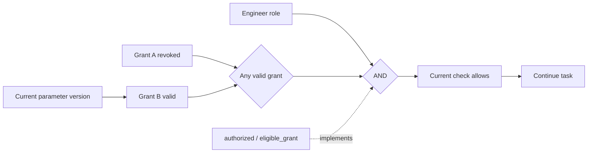

# ReBAC rules in the runtime graph

Status: representation and engine-adapter guidance. Python examples capture real local authorization conditions; generic ReBAC engines are not integrated. Identify actual rules using [authorization patterns](authorization-patterns.md), then expand the same graph. Direct grants, valid inheritance, groups, roles, and conditions all apply; the parent-child example is not the main model.

## What to show

Start with a concrete request: can this actor perform this action on this object now? Rules describe computation; relation facts/context are inputs; this check's result is a runtime fact. Connect them while retaining their different sources. ReBAC combines membership, ownership, containment, etc.; expiry/version restrictions need conditions. [OpenFGA expressions](https://openfga.dev/docs/configuration-language) support union/intersection/exclusion/related-object inheritance and [conditions](https://openfga.dev/docs/modeling/conditions). Display dependencies without enumerating every combination as a state.

| Expansion | Content added to the same canvas |
|---|---|
| Business action | Authorization node with allow/deny/unknown and its action relation |
| Authorization | AND/OR/exclusion and conditions, each with actual evaluation result |
| Condition | Actors, objects, relations, grants, parameters, typed relation labels |
| Source detail | Actual reader/decision function, rule location, request/result/dependency evidence |

Default to the selected request. Shared objects/subexpressions reuse identity, never contradictory copies. Collapse retains identity/position/names/notes; adding detail should preserve existing layout.

## Separate kinds of state

| Content | Display |
|---|---|
| Rule definition | Version/expression/source; not marked passed without runtime evidence |
| Condition result | True/false/unknown; skipped branches are not evaluated |
| Check execution | Not started/evaluating/completed/error, separate from truth |
| Current applicability | Current, dependencies changed, or historical |
| Business execution | Continue/wait/cancel according to confirmed project rules |

Revocation changes inputs/results without necessarily changing rules. An obsolete result was not necessarily wrong when obtained. Timeout, absent context, and missing capture are not all denial. Map actual engine responses, e.g. [SpiceDB caveats](https://authzed.com/docs/spicedb/concepts/caveats) expose missing context, without assuming every engine does. Show short current results; expand complete versions/inputs/evidence beside the node.

## Existing authorization example

Delivery requires an engineer plus at least one grant matching project, actor, parameter version, nonrevocation, and expiry. This is an embedded Python decision, not generic multi-hop ReBAC.

The user's confirmed example reevaluates after A is revoked: continue if B remains valid, otherwise wait. Add a new check record and preserve old evidence. Automatic recovery, cancelling inflight work, and commit-time rechecks still come from project rules, not graph inference.

Recheck triggers may include relation additions/removals, rule/parameter/context changes, and time expiry. Record trigger and new check identity; the application decides whether to recheck. The observer never issues permission.

Current grant probes inside eligible_grant record actual project/actor/version/revocation/expiry conditions and call inputs/identity. authorize records role, evaluated grants, aggregate; commit_guard records precommit checks. Skipped conditions/grants are not recomputed. whitebox.json verifies those same-call facts.

## Future adapter contract

The following is a design, not a claim of universal current protocol support:

- Check identity: check_id, attempt, actor/action/object, parameter version, request-context fingerprint.
- Rule identity: model/rule version, expression ID, definition/function location.
- Input basis: tuples/read scope/time, actual available relation versions/consistency tokens, condition inputs.
- Evaluation: subcheck/expression IDs, evaluated flag/result, read/subcheck event references, errors/missing fields.
- Applicability: dependency-change notification and replacement-check identity; immutable history.

Stable rule IDs differ from per-run subcheck IDs. Project by check_id to avoid concurrent requests overwriting each other. Personal notes/aliases bind stable IDs and never alter expressions/results.

## Required boundaries

1. A result is not necessarily an explanation. [OpenFGA Check/Read/Expand](https://openfga.dev/docs/interacting/relationship-queries) serve different purposes. Only actual child-check traces count as executed paths.
2. An unseen relation is not proven absent. Negation/exclusion needs query scope/completeness/read basis. Incomplete pagination, failure, or capture gaps cannot mean no prohibition.
3. Changes affect dependent checks. Track queried scope as well as matched grants; new denials/reparenting may invalidate old results. Unknown impact requires rechecking relevant requests, not retaining a green result.
4. Preserve real [OpenFGA consistency](https://openfga.dev/docs/interacting/consistency) or [SpiceDB snapshots/ZedToken](https://authzed.com/docs/spicedb/concepts/consistency). Never fabricate a common version or combine incompatible snapshots as one proof.
5. Show recursion/back-edges and budget truncation; neither automatically means denial nor a complete path.
6. Observation does not replace authorization. If the application rejects on error, still distinguish check failure from rule denial.

Future engine integration tests direct grants, group/inherited paths, AND/OR/exclusion, short circuit, missing context, alternative grant, revoke-without-alternative, expiry, rule/parameter changes, new denial, stale snapshots, query errors, and concurrent requests. Compare actual authorization, business action, and graph. Incomplete explanations remain gaps. Confirm engine, disclosure policy, and available tracing per project. Passing embedded-Python tests does not validate OpenFGA/SpiceDB adapters.
